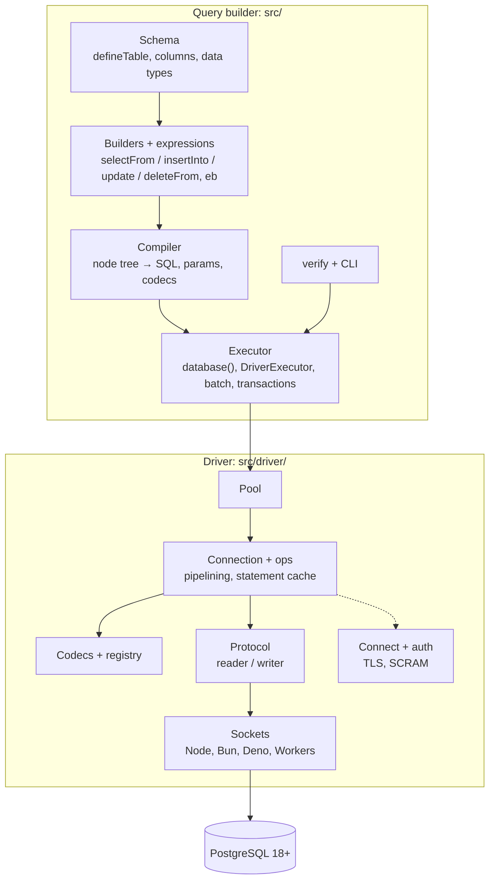

# quarry internals: start here

This is the index of quarry's **internal documentation**: how the code works and why it is built the way it is. The documents live next to the code they describe, so a change to a directory can update its document in the same pull request.

They are written for a programmer who knows basic TypeScript and nothing about databases, PostgreSQL's wire protocol, connection pools, query builders or type-level programming. Every concept is introduced from first principles, and each document ends with a glossary. To **use** quarry, read the public [README.md](README.md) instead.

## What quarry is

quarry is two things in one package:

- a **type-safe query builder** for PostgreSQL (`quarry`): you declare your tables in TypeScript, build queries with method chains, and the compiler checks every column, value and result row;
- a **PostgreSQL driver** with no dependencies (`quarry/driver`): it opens connections, speaks PostgreSQL's wire protocol, pools and pipelines connections, and encodes and decodes values.

## Reading order

If you're new, read in this order. Each step builds on the previous one.

1. [src/ARCHITECTURE.md](src/ARCHITECTURE.md): databases, SQL and query builders from first principles; the builder's layers, files and conventions.
2. [src/WALKTHROUGH.md](src/WALKTHROUGH.md): one real query traced from `db.selectFrom(…)…execute()` through compiling, codecs, the pool, the bytes on the wire, the server's reply and decoding, back to a typed row.
3. [src/driver/ARCHITECTURE.md](src/driver/ARCHITECTURE.md): connections, round trips, pipelining, the event loop; the driver's layers and files.
4. Then whichever area you're working on, from the list below.

To understand **why** something is built the way it is, start at [DECISIONS.md](DECISIONS.md): the index of every design decision and optimisation, each with what it is, why, the alternatives, the cost and the measured impact. Each area document also ends with a short **Decisions** section linking to the entries for its area.

## Every internal document

### Query builder

| Document                                           | Covers                                                                                                                                                                                                                                                                                               |
| -------------------------------------------------- | ---------------------------------------------------------------------------------------------------------------------------------------------------------------------------------------------------------------------------------------------------------------------------------------------------- |
| [src/ARCHITECTURE.md](src/ARCHITECTURE.md)         | first principles, the pipeline, every file in `src/`, conventions (immutability, `_quarry`, phantom `$` members, rejecting `await`), the decisions that shape the builder                                                                                                                            |
| [src/DECISIONS.md](src/DECISIONS.md)               | every builder design decision and trick: what, why, alternatives, cost, measured impact                                                                                                                                                                                                              |
| [src/column/README.md](src/column/README.md)       | tables, columns, the modifier state machine, data types, every factory, arrays, enums, `defineType`, `useCodec`, `typed`, row types, aliases, call sites                                                                                                                                             |
| [src/data-type/README.md](src/data-type/README.md) | the `DataType` classes (pointer to the above)                                                                                                                                                                                                                                                        |
| [src/TYPES.md](src/TYPES.md)                       | TypeScript type-level programming as quarry uses it: phantom types, scope, `Expr` and methods by kind, null propagation, row types (outer joins, `setEach` rows, keyset keys, `RowStream`), builder state in type parameters (required `where`, locking), error tricks, type-checking speed          |
| [src/EXPRESSIONS.md](src/EXPRESSIONS.md)           | the expression builder: references, values vs expressions, comparison methods and how they exist at run time, lowering (`in`, `any`, `between`, `is`), codecs per value, arithmetic, `case`, functions, jsonb, `where`/`on`, raw `sql` fragments, refusing `undefined`                               |
| [src/QUERIES.md](src/QUERIES.md)                   | the select (joins, `selectAll`, `distinct`, `groupBy`/`having`, `orderBy`, `limit`/`offset`), insert, update (`setEach` for bulk updates) and delete builders; `db.sql`; row locking; result shapes (`execute`, `take…`, `expect…`, `expectRows`) and `keepRows`; errors; `toSQL`/`toNode`/`toQuery` |
| [src/PAGINATION.md](src/PAGINATION.md)             | keyset and offset pagination: `iterateChunks`, `paginateByCursor`, `paginateByOffset`, the key rules, exact keys, cursors, `countTotal`                                                                                                                                                              |
| [src/COMPILER.md](src/COMPILER.md)                 | `compile()`: parameter numbering, rendering, quoting and literals, precedence, select (joins, grouping, ordering), locks, insert (`values` vs `unnest`), upserts, update and `setEach`, delete, result codecs, compile errors                                                                        |
| [src/EXECUTION.md](src/EXECUTION.md)               | `database()`, the `Executor` interface, `DriverExecutor`, how the builder picks codecs, the type catalog, what a query borrows from the pool, `db.batch` (three modes), transactions, streaming (`RowStream`, cursors, timeouts), timeouts, `onQuery`, error decoration                              |
| [src/WALKTHROUGH.md](src/WALKTHROUGH.md)           | the end-to-end trace, with captured bytes                                                                                                                                                                                                                                                            |
| [src/verify/README.md](src/verify/README.md)       | `db.verify`: describing the code, the catalog query, type comparison, every rule, the report and its renderers                                                                                                                                                                                       |
| [src/cli/README.md](src/cli/README.md)             | the `quarry verify` command, its config file and exit codes                                                                                                                                                                                                                                          |

### Driver

| Document                                                       | Covers                                                                                                                                                                                                                                                                    |
| -------------------------------------------------------------- | ------------------------------------------------------------------------------------------------------------------------------------------------------------------------------------------------------------------------------------------------------------------------- |
| [src/driver/DECISIONS.md](src/driver/DECISIONS.md)             | every driver design decision and optimisation: what, why, alternatives, cost, measured impact, with how to read the benchmark numbers                                                                                                                                     |
| [src/driver/ARCHITECTURE.md](src/driver/ARCHITECTURE.md)       | foundations; layers; every file; the connection (queue, flush, backpressure, dispatch, closing); operations; the prepared-statement cache and stale statements; pipelining; PgBouncer; memory and allocation; timing and telemetry; runtimes and sockets; errors; testing |
| [src/driver/protocol/README.md](src/driver/protocol/README.md) | the wire protocol from scratch: framing, startup, simple and extended query protocols, Sync and errors, formats; the writer and the reader                                                                                                                                |
| [src/driver/auth/README.md](src/driver/auth/README.md)         | configuration resolution, hosts and failover, TLS and certificates, protocol negotiation, startup, SCRAM-SHA-256, channel binding, `requireAuth`, passwords and IAM tokens, client certificates, crypto, the PostgreSQL 18 check                                          |
| [src/driver/CODECS.md](src/driver/CODECS.md)                   | the `Codec` interface, built-ins, `arrayOf`, `defineCodec`, parameter encoding and OIDs, result plans, binary after describe, generated row decoders, the registry, the type catalog                                                                                      |
| [src/driver/POOL.md](src/driver/POOL.md)                       | the pool's bookkeeping, exclusive vs shared use, opening and releasing, pipelining onto busy connections, adaptive depth, draining for exclusive callers, idle and lifetime, ending                                                                                       |
| [src/driver/TRANSACTIONS.md](src/driver/TRANSACTIONS.md)       | transactions from first principles, `Transaction.run`, BEGIN sharing the first statement's Sync, the `Session`, savepoints, retries, settings and timeouts, silent rollbacks, one-round-trip batches                                                                      |
| [src/driver/STREAMING.md](src/driver/STREAMING.md)             | cursors (strict pull, binary from the first run, named portals inside transactions) and `RowStream`, COPY in and out with backpressure, LISTEN/NOTIFY and the pool's self-healing listener                                                                                |
| [src/driver/CANCELLATION.md](src/driver/CANCELLATION.md)       | every timeout, `AbortSignal`, cancel requests, why later writes are held back, statement timeouts, `QueryCanceled` reasons                                                                                                                                                |

The user-facing driver reference is [src/driver/README.md](src/driver/README.md) (options and methods); the public [README.md](README.md) documents the whole API.

## The rest of the repository

| Path             | What's there                                                                                                                                                                                                                                                                                                                                                                          |
| ---------------- | ------------------------------------------------------------------------------------------------------------------------------------------------------------------------------------------------------------------------------------------------------------------------------------------------------------------------------------------------------------------------------------- |
| [src/](src/)     | the source; `src/index.ts` and `src/driver/index.ts` are the two entry points (`quarry`, `quarry/driver`)                                                                                                                                                                                                                                                                             |
| [test/](test/)   | Vitest tests: `*.test.ts` run, `*.test-d.ts` type-check ([src/TYPES.md](src/TYPES.md#testing-the-types)); `test/driver/` has the driver's unit, fake-server, integration (a throwaway PostgreSQL cluster when one is installed), compatibility and runtime tests ([src/driver/ARCHITECTURE.md](src/driver/ARCHITECTURE.md#part-14-testing)); `test/verify/` covers verify and the CLI |
| [bench/](bench/) | `bench/driver` (driver throughput and latency against `pg` and postgres.js), `bench/types` (type-checking time and editor latency on a generated schema)                                                                                                                                                                                                                              |
| `package.json`   | scripts: `test`, `typecheck`, `lint` (oxlint), `format`/`check:format` (oxfmt, which also formats these Markdown files), `build` (tsdown), benchmarks                                                                                                                                                                                                                                 |

## Conventions across the codebase

- **Immutable builders**: every builder method returns a new builder ([src/ARCHITECTURE.md](src/ARCHITECTURE.md#builders-are-immutable)).
- **`_quarry`** holds the internal data of public objects; **`#private`** fields hold state only the class itself reads; **`$name`** properties are phantom types, never set ([src/TYPES.md](src/TYPES.md#phantom-types)).
- **Names say whether a method throws**: `take…` never throws for the row count, `expect…` does.
- **Comments state constraints and reasons**, not what the next line does. Hot paths carry comments explaining why they avoid closures, spreads or `Map` churn; keep them when editing.
- **The driver never imports the builder** ([src/driver/ARCHITECTURE.md](src/driver/ARCHITECTURE.md#the-driver-knows-nothing-about-quarry)).

## Glossary index

Each document has a glossary for its own terms:

- databases, SQL, builders: [src/ARCHITECTURE.md](src/ARCHITECTURE.md#glossary)
- schema and columns: [src/column/README.md](src/column/README.md#glossary)
- TypeScript type-level terms: [src/TYPES.md](src/TYPES.md#glossary)
- expressions: [src/EXPRESSIONS.md](src/EXPRESSIONS.md#glossary)
- queries and shapes: [src/QUERIES.md](src/QUERIES.md#glossary)
- compiling: [src/COMPILER.md](src/COMPILER.md#glossary)
- running queries: [src/EXECUTION.md](src/EXECUTION.md#glossary)
- verify: [src/verify/README.md](src/verify/README.md#glossary)
- the driver and networking: [src/driver/ARCHITECTURE.md](src/driver/ARCHITECTURE.md#glossary)
- the wire protocol: [src/driver/protocol/README.md](src/driver/protocol/README.md#glossary)
- TLS and authentication: [src/driver/auth/README.md](src/driver/auth/README.md#glossary)
- codecs: [src/driver/CODECS.md](src/driver/CODECS.md#glossary)
- the pool: [src/driver/POOL.md](src/driver/POOL.md#glossary)
- transactions: [src/driver/TRANSACTIONS.md](src/driver/TRANSACTIONS.md#glossary)
- streaming, COPY, LISTEN: [src/driver/STREAMING.md](src/driver/STREAMING.md#glossary)
- cancellation: [src/driver/CANCELLATION.md](src/driver/CANCELLATION.md#glossary)

## Keeping these documents in sync

These documents describe `main` as of October 2026 (through bulk updates with `setEach`, keyset pagination, everyday SQL and the production `stream()`). They quote code and captured protocol traces, so they go stale when the code changes. When a pull request changes behaviour:

1. **Update the document next to the code you changed**, in the same pull request. Use the tables above to find it; cross-cutting changes usually touch one builder document and one driver document.
2. **Re-check the traces** if the change alters what goes on the wire (message order, naming, formats, transaction framing): the captured sequences in [src/WALKTHROUGH.md](src/WALKTHROUGH.md), [src/EXECUTION.md](src/EXECUTION.md#batches), [src/driver/TRANSACTIONS.md](src/driver/TRANSACTIONS.md) and [src/driver/CANCELLATION.md](src/driver/CANCELLATION.md#statement-timeouts) came from running the code against an in-memory server through the `socket` option ([src/driver/ARCHITECTURE.md](src/driver/ARCHITECTURE.md#anything-else)); re-capture them rather than editing bytes by hand.
3. **Re-check compiled SQL examples** by calling `toSQL()` on the example: they were all produced that way.
4. **Update the decision log** when a change makes, reverses or measures a design decision: add or edit its entry in [src/DECISIONS.md](src/DECISIONS.md) or [src/driver/DECISIONS.md](src/driver/DECISIONS.md) (what, why, alternatives, cost, measured, code), link it from the area document's **Decisions** section, and regenerate the lists in [DECISIONS.md](DECISIONS.md) from the entries' headings.
5. **Link to files and functions, not line numbers**, so the links survive refactors.
6. **Run `pnpm format`** (oxfmt formats Markdown too).

Changes in flight when these were written, and the documents they will need to touch:

| In-flight change                                                                                                                                                         | Documents to update                                                                                                                                                                                  |
| ------------------------------------------------------------------------------------------------------------------------------------------------------------------------ | ---------------------------------------------------------------------------------------------------------------------------------------------------------------------------------------------------- |
| [#9](https://github.com/shlokdesai33/quarry/pull/9): `inc` / `dec` in updates (increments are already possible with arithmetic: `eb.ref('posts.views').plus(1)`)         | [src/QUERIES.md](src/QUERIES.md#update), [src/EXPRESSIONS.md](src/EXPRESSIONS.md#arithmetic), [src/DECISIONS.md](src/DECISIONS.md)                                                                   |
| [#10](https://github.com/shlokdesai33/quarry/pull/10): `toSQL` with inline literals, query budgets, `sensitive()` columns (must also render `setEach`'s `unnest` arrays) | [src/COMPILER.md](src/COMPILER.md#tosql-and-when-compiling-happens), [src/QUERIES.md](src/QUERIES.md#inspecting-a-query), [src/EXECUTION.md](src/EXECUTION.md), [src/DECISIONS.md](src/DECISIONS.md) |
| [#6](https://github.com/shlokdesai33/quarry/pull/6): the driver benchmark suite (most numbers in the decision logs came from it)                                         | [bench/](bench/) and the measured figures in [src/driver/DECISIONS.md](src/driver/DECISIONS.md) if they are re-run                                                                                   |
| Not yet built: subqueries, CTEs, set operations, `insertInto(…).fromSelect`, window functions, lateral joins                                                             | [src/QUERIES.md](src/QUERIES.md), [src/COMPILER.md](src/COMPILER.md#select), [src/TYPES.md](src/TYPES.md), [src/EXPRESSIONS.md](src/EXPRESSIONS.md)                                                  |
