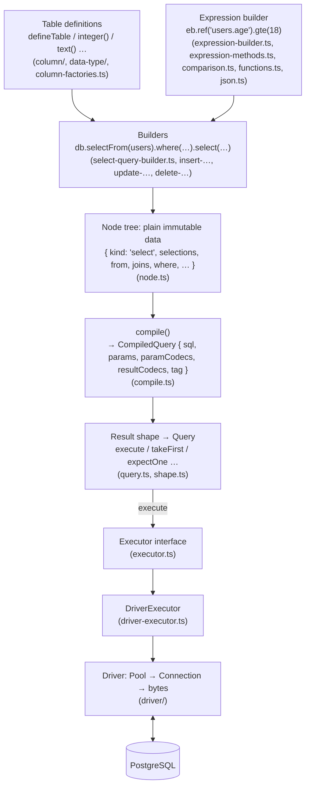

# The query builder, from the inside

This is the internal guide to quarry's **query builder**: the TypeScript in `src/` (outside `src/driver/`) that turns table definitions and method chains into SQL, runs that SQL through the driver, and hands back typed rows.

It is written for someone who knows basic TypeScript (functions, classes, objects, `async`/`await`) and nothing about databases. Every database word is explained the first time it appears, and collected again in the [glossary](#glossary) at the end. If you only want to use quarry, read the public [README](../README.md) instead; this guide is about how the code works and why it is written the way it is.

The rest of the builder documentation:

| Document                             | What it covers                                                                                            |
| ------------------------------------ | --------------------------------------------------------------------------------------------------------- |
| [column/README.md](column/README.md) | Tables, columns, modifiers, data types, enums, `defineType`, `useCodec`: the schema you declare           |
| [TYPES.md](TYPES.md)                 | The TypeScript type-level machinery: phantom types, scope, row types, builder state, null propagation     |
| [EXPRESSIONS.md](EXPRESSIONS.md)     | The expression builder (`eb`): references, values, comparison methods, functions, jsonb, `and`/`or`/`not` |
| [QUERIES.md](QUERIES.md)             | The select, insert, update and delete builders; result shapes (`execute`, `take…`, `expect…`); errors     |
| [COMPILER.md](COMPILER.md)           | How the node tree becomes SQL text, parameters and codecs (`compile.ts`)                                  |
| [EXECUTION.md](EXECUTION.md)         | `database()`, executors, how the builder hands queries to the driver, `db.batch`, transactions, `onQuery` |
| [PAGINATION.md](PAGINATION.md)       | Keyset pagination: `iterateChunks`, `paginateByCursor`, `paginateByOffset`, exact keys, cursors           |
| [DECISIONS.md](DECISIONS.md)         | Every design decision and trick in the builder: what, why, alternatives, cost, measured impact            |
| [WALKTHROUGH.md](WALKTHROUGH.md)     | One real query traced end to end, down to the bytes on the wire and back                                  |
| [verify/README.md](verify/README.md) | `db.verify`: comparing your table definitions with the live database                                      |
| [cli/README.md](cli/README.md)       | The `quarry verify` command                                                                               |

The driver has its own set, starting at [driver/ARCHITECTURE.md](driver/ARCHITECTURE.md). The index of everything is [../ARCHITECTURE.md](../ARCHITECTURE.md).

## Contents

- [Part 1: First principles](#part-1-first-principles)
- [Part 2: The big picture](#part-2-the-big-picture)
- [Part 3: Every file in `src/`](#part-3-every-file-in-src)
- [Part 4: Conventions you will see everywhere](#part-4-conventions-you-will-see-everywhere)
- [Part 5: The life of a query, stage by stage](#part-5-the-life-of-a-query-stage-by-stage)
- [Part 6: Decisions](#part-6-decisions)
- [Glossary](#glossary)

## Part 1: First principles

### What a database is

A **database** stores data so that many programs can read and change it safely at the same time, and so that it survives restarts. **PostgreSQL** (often "Postgres") is the database quarry talks to. It runs as a separate program, the **server**, usually on another machine. Your application is a **client**: it opens a network connection to the server, sends it requests, and reads its answers.

Postgres keeps data in **tables**. A table is like a spreadsheet with a fixed set of named **columns**, each with a **type**, and any number of **rows**:

```
users
┌────┬───────────────────┬──────────────┬────────────────────────┐
│ id │ email             │ name         │ created_at             │
│ int│ text              │ text or NULL │ timestamptz            │
├────┼───────────────────┼──────────────┼────────────────────────┤
│  1 │ ada@example.com   │ Ada Lovelace │ 2026-10-17 03:51:00+00 │
│  2 │ alan@example.com  │ NULL         │ 2026-10-17 04:02:13+00 │
└────┴───────────────────┴──────────────┴────────────────────────┘
```

- A **type** says what a column may hold: `integer` (whole numbers), `text` (strings), `timestamptz` (a moment in time), `boolean`, `jsonb` (a JSON document), and many more. Postgres refuses values of the wrong type.
- **NULL** means "no value" (or "unknown"). It is not zero and not the empty string. A column either allows NULL (it is **nullable**) or is declared `not null`. NULL has a famous oddity: `NULL = NULL` is not true, it is NULL ("unknown"). To test for it you write `x is null`. This shows up all over quarry's types.
- A **default** is a value the server fills in when an insert doesn't give one, such as `now()` for `created_at`.
- An **identity** column gets its value from a counter (a sequence) the server maintains, the usual way to number rows (`id` above).

### What SQL is

You talk to Postgres in **SQL**, a language of **statements** (also called **queries**). The four you meet most:

```sql
select id, name from users where email = 'ada@example.com';   -- read rows
insert into users (email, name) values ('grace@example.com', 'Grace');   -- add a row
update users set name = 'Ada' where id = 1;                    -- change rows
delete from users where id = 2;                                -- remove rows
```

A `select` returns a **result**: rows of the columns you asked for. The others return how many rows they changed (the **row count**), and can return rows too with `returning`.

More vocabulary the builder uses:

- **`where`**: a condition that picks which rows a statement touches.
- **Join**: combine rows of two tables, e.g. each post with its author: `from posts inner join users on users.id = posts.author_id`. `on` is the condition that pairs rows up.
- **Alias**: another name for a table or a result column within one query, written `as`: `users as managers`, `lower(email) as email`.
- **Expression**: anything that computes a value: a column, a literal like `42`, a function call like `lower(email)`, a comparison like `age >= 18` (whose value is a boolean).
- **Predicate** or **condition**: an expression whose value is a boolean, used in `where` and `on`.

### Parameters, and why quarry never pastes values into SQL

Writing `where email = 'ada@example.com'` by gluing a user's input into the text is dangerous: input like `' or '1'='1` changes the meaning of the query. This is **SQL injection**, one of the most common security bugs.

The fix is **parameters**: the SQL text has numbered placeholders `$1`, `$2`, … and the values travel separately, so the server never reads them as SQL:

```
sql:    select "users"."id" from "users" where "users"."email" = $1
params: ['ada@example.com']
```

quarry always works this way. The output of compiling a query is a `CompiledQuery`: the SQL text, the parameter values, and, for the driver, the **codec** to send each parameter with and to read each result column with (a codec is the code that converts one Postgres type to and from JavaScript; see [driver/CODECS.md](driver/CODECS.md)). The only values written into SQL text are the few Postgres refuses as parameters (`is null`, `is true`, jsonb keys; see [COMPILER.md](COMPILER.md#literals)), and those are quoted and escaped.

### What a driver is, and what a query builder is

A **driver** is the library that speaks the network protocol to the server: it opens connections, sends SQL and parameters as bytes, reads the bytes that come back, and turns them into JavaScript values. quarry has its own driver in `src/driver/` (see [driver/ARCHITECTURE.md](driver/ARCHITECTURE.md)).

A **query builder** is a library that lets you write queries as code instead of strings:

```ts
const user = await db
	.selectFrom(users)
	.where('users.email', email)
	.select(['users.id', 'users.name'])
	.expectOne()
	.execute();
// user: { id: number; name: string | null }
```

The builder produces the same SQL you would write by hand. What it adds is **checking**: because the tables are declared in TypeScript, the compiler knows that `users.email` exists and is text, that `name` can be null, and what shape each row has. A typo, a comparison between a number and a string column, an `update` without a `where`, or reading a column of a table you didn't join is a red squiggle in your editor, not a crash in production. Making that checking precise is most of the work in this codebase, and most of [TYPES.md](TYPES.md).

## Part 2: The big picture

Everything the builder does is a pipeline of plain data transformations. Only the last stages touch the network.



Read it as three layers:

1. **Describing** (top): table definitions and builders. Nothing here does any I/O. Builders are immutable values that record what you asked for.
2. **Compiling** (middle): the recorded request becomes a tree of nodes, then SQL text with parameters, plus the codecs the driver should use. Pure functions, easy to test without a database ([test/compile.test.ts](../test/compile.test.ts) does exactly that).
3. **Running** (bottom): an `Executor` runs a `CompiledQuery` and returns raw rows; a result shape reads them (first row, exactly one row, …). The real executor sits on the driver; tests swap in a fake ([test/helpers/executor.ts](../test/helpers/executor.ts)).

The driver knows nothing about the builder. The builder only knows the driver through `driver-executor.ts` and the codec objects it picks. That boundary is deliberate (see [Part 6](#part-6-decisions)).

## Part 3: Every file in `src/`

Files are listed by layer. "Public" means exported from [index.ts](index.ts), the package's entry point.

### Schema: tables, columns, types

| File                                       | What it does                                                                                                                                                                                           |
| ------------------------------------------ | ------------------------------------------------------------------------------------------------------------------------------------------------------------------------------------------------------ |
| [define-table.ts](define-table.ts)         | `defineTable(name, { columns })`: makes a `Table`, recording where it was called for `db.verify`.                                                                                                      |
| [table.ts](table.ts)                       | The `Table<N, S>` class: name, schema, the phantom `$refs` map of every `table.column` reference, `as(alias)`, `tableNode()` for rendering, and `NullableTable` (a table on the outer side of a join). |
| [column-factories.ts](column-factories.ts) | The column factories (`integer()`, `text()`, `timestamptz()`, `array()`, …), each a `Column` of one `DataType`.                                                                                        |
| [column/](column/README.md)                | The column classes: `BaseColumn` and the modifier state machine (`Column`, `IntegerColumn`, `DefaultColumn`, `GeneratedColumn`, `IdentityColumn`), and `AnyColumn`.                                    |
| [data-type/](data-type/README.md)          | `DataType` (a SQL type: kind, codec, modifiers) and its subclasses `ArrayType`, `EnumType`, `CustomType`.                                                                                              |
| [kind-codecs.ts](kind-codecs.ts)           | Which driver codec each column factory uses (`kindCodecs`), and `quarryRegistry`, the codecs for columns no query typed.                                                                               |
| [define-enum.ts](define-enum.ts)           | `defineEnum(name, labels)`: returns a column factory for a Postgres enum.                                                                                                                              |
| [define-type.ts](define-type.ts)           | `defineType({ sql, codec })`: returns a column factory for a type quarry has no factory for.                                                                                                           |
| [range.ts](range.ts)                       | The `Range<T>` value type and `isRange`.                                                                                                                                                               |
| [types.ts](types.ts)                       | `Schema`, `Prettify`, and the row helpers `InferSelectType`, `InferInsertType`, `InferUpdateType`.                                                                                                     |
| [call-site.ts](call-site.ts)               | Captures and resolves where a factory was called (file, line, column), for `db.verify`'s code frames.                                                                                                  |

### Expressions

| File                                           | What it does                                                                                                                                                                |
| ---------------------------------------------- | --------------------------------------------------------------------------------------------------------------------------------------------------------------------------- |
| [expression.ts](expression.ts)                 | The expression classes: `Expression<T>`, `TypedExpression<T, D>`, `Param<T>`, `Quantified` (`any`/`all`), `AliasedExpression`.                                              |
| [operators.ts](operators.ts)                   | Types only: `Kind`, the operand types (`One`, `Binary`, `List`, `EqualsValue`), the method interfaces per SQL type, `MethodsByKind`, `Expr`, `Predicate`, null propagation. |
| [expression-methods.ts](expression-methods.ts) | The runtime side of the methods: method name → SQL operator, `compare()`, `arithmetic()` (with Postgres's result types), the prototype classes the methods are attached to. |
| [comparison.ts](comparison.ts)                 | Lowers one comparison to nodes (`in` lists, `between`, `any`/`all`, `is`), choosing each value's codec; refuses `undefined`.                                                |
| [expression-builder.ts](expression-builder.ts) | `expressionBuilder(...tables)`: the `eb` object with `ref`, `val`, `fn`, `json`, `and`, `or`, `not`, `case`.                                                                |
| [functions.ts](functions.ts)                   | `eb.fn`: text, comparison, aggregate, math, date and array functions, `cast`, `any`, `all`, typed with Postgres's result types.                                             |
| [case.ts](case.ts)                             | `eb.case()`: the `case when … then … else … end` builder and its types.                                                                                                     |
| [sql.ts](sql.ts)                               | The `sql` template tag (`sql.id`, `sql.lit`, `sql.join`) for raw fragments, and `SqlQuery` for `db.sql` statements.                                                         |
| [json.ts](json.ts)                             | `eb.json`: `get`, `text`, `hasKey`, `hasAnyKey`, `hasAllKeys`, `pathExists`, `pathMatches`, `typeOf`, `length`.                                                             |
| [refs.ts](refs.ts)                             | Types only: the scope of references (`Refs`, `RefsOf`, `Ref`), and what an operand is (`Operand`, `TypeOf`, `DataTypeOf`, `NullOf`).                                        |
| [where-builder.ts](where-builder.ts)           | The three forms of `where` (`Condition`), and `WhereBuilder`, which collects conditions joined by `and`.                                                                    |

### Queries

| File                                               | What it does                                                                                                                                                                                                                                                                                                                          |
| -------------------------------------------------- | ------------------------------------------------------------------------------------------------------------------------------------------------------------------------------------------------------------------------------------------------------------------------------------------------------------------------------------- |
| [select-query-builder.ts](select-query-builder.ts) | `selectFrom`, `fragment`, `SelectQueryBuilder` (`where`, the joins, `select`, `selectAll`, `distinct`, `distinctOn`, `groupBy`, `having`, `orderBy`, `limit`, `offset`, `when`, `pipe`, locking, `tag`, shapes, `execute`, `stream`, `iterateChunks`, `paginateByCursor`, `paginateByOffset`, `describe`, `toSQL`), `JoinBuilder.on`. |
| [pagination.ts](pagination.ts)                     | Keyset and offset pagination: resolving the key, the seek condition, exact-text keys, cursors, `InvalidCursorError`.                                                                                                                                                                                                                  |
| [insert-query-builder.ts](insert-query-builder.ts) | `insertInto`, `InsertQueryBuilder` (`values`, `onConflict`, `returning`, `when`), `OnConflictBuilder` (`doNothing`, `merge`, `doUpdate`).                                                                                                                                                                                             |
| [update-query-builder.ts](update-query-builder.ts) | `update`, `UpdateQueryBuilder` (`set`, `setEach`, `where`, `allRows`, `returning`, `returningAll`, `when`).                                                                                                                                                                                                                           |
| [delete-query-builder.ts](delete-query-builder.ts) | `deleteFrom`, `DeleteQueryBuilder` (`where`, `allRows`, `returning`, `when`).                                                                                                                                                                                                                                                         |
| [write-query.ts](write-query.ts)                   | What the write builders share: `WriteQueryBuilder` (shapes, `expectRows`, `execute`), and the helpers that turn values into `SetNode`s and `RowsNode`s.                                                                                                                                                                               |
| [row.ts](row.ts)                                   | The select list: `Selection`, the row type it produces (`RowOf`, `AddRow`), and `selectionNodes()`.                                                                                                                                                                                                                                   |
| [node.ts](node.ts)                                 | Types only: every node of the tree (`OperationNode`, `SelectNode`, `InsertNode`, …).                                                                                                                                                                                                                                                  |
| [compile.ts](compile.ts)                           | `compile(node)`: node tree → `CompiledQuery`.                                                                                                                                                                                                                                                                                         |
| [query.ts](query.ts)                               | `Query<T>`: a compiled query plus how to read its result; `rejectAwait`; `Executable`.                                                                                                                                                                                                                                                |
| [shape.ts](shape.ts)                               | The result shapes (`allRows`, `takeFirst`, `takeValue`, `expectNonEmpty`, `expectFirst`, `expectOne`, `expectAtMostOne`, `expectValue`).                                                                                                                                                                                              |

### Running

| File                                     | What it does                                                                                                                                               |
| ---------------------------------------- | ---------------------------------------------------------------------------------------------------------------------------------------------------------- |
| [database.ts](database.ts)               | `database(source, options)`: the `Database` object (`selectFrom`, `insertInto`, `update`, `deleteFrom`, `sql`, `batch`, `transaction`, `verify`, `close`). |
| [executor.ts](executor.ts)               | The `Executor` interface the builder runs on, its option types, and `NoRowError`, `TooManyRowsError`, `RowCountError`.                                     |
| [driver-executor.ts](driver-executor.ts) | `DriverExecutor`: the `Executor` built on the driver's pool, client, connection or transaction; `onQuery` events; error decoration.                        |
| [batch.ts](batch.ts)                     | `db.batch()` and `BatchError`.                                                                                                                             |
| [errors.ts](errors.ts)                   | `violatedColumns(error, table)`: maps a constraint error's columns back to your TypeScript keys.                                                           |
| [verify/](verify/README.md)              | `db.verify`.                                                                                                                                               |
| [cli/](cli/README.md)                    | The `quarry` command.                                                                                                                                      |
| [index.ts](index.ts)                     | The public API: what `import … from 'quarry'` gives.                                                                                                       |

## Part 4: Conventions you will see everywhere

### Builders are immutable

Every builder method returns a **new** builder; none changes the one it was called on. Each builder keeps what it has recorded in one private field, `#state`, and a method copies it with one thing changed:

```ts
// select-query-builder.ts, SelectQueryBuilder
tag(name: string): SelectQueryBuilder<T, O, L> {
	return new SelectQueryBuilder<T, O, L>({ ...this.#state, tag: name });
}
```

So a partly built query can be reused safely:

```ts
const active = db.selectFrom(users).where('users.active', true);
const admins = active.where('users.role', 'admin'); // `active` is unchanged
const members = active.where('users.role', 'member');
```

The state objects (`SelectState`, `InsertState`, `UpdateState`, `DeleteState`) hold nodes and small values, never anything that runs. Copying them is cheap: `{ ...state }` copies references, not the nodes themselves, and nodes are never mutated.

### Internals live under `_quarry`

Objects users can hold (tables, columns, expressions, queries) need some internal data the library reads: a column's `DataType`, an expression's node, a query's compiled SQL. That data is kept in a single property called `_quarry`:

```ts
column._quarry.dataType; // DataType
column._quarry.columnName; // 'created_at', or undefined
expression._quarry.node; // OperationNode
table._quarry.source; // the table's name in the database
```

Why one public-but-ugly property instead of JavaScript `#private` fields? Because the library must read it from **other** classes (the compiler reads a column's data from a builder; `Expression.is` checks any value), and `#private` fields are only readable inside their own class. One clearly named property keeps autocomplete clean (it sorts last and looks internal), and the linter allows exactly this underscore name ([.oxlintrc.json](../.oxlintrc.json), `no-underscore-dangle` with `allow: ['_quarry']`). Builders themselves use real `#state` fields, since only they read their state.

`Expression.is(value)` (in [expression.ts](expression.ts)) decides whether a value is an expression by checking `'_quarry' in value`, so that two copies of quarry in one program (a common bundling accident) still recognise each other's expressions, which `instanceof` would not.

### `$` members are phantom types

You will see properties declared with `declare readonly` and a `$` name, such as `$select` on columns, `$refs` on tables, `$output` on builders, `$result` on queries. They are **never set at run time**; they exist only so TypeScript can carry a type around on the value. [TYPES.md](TYPES.md#phantom-types) explains the trick in detail.

### Nothing runs by accident

A builder is a description, not an action. It runs only when you call `execute()` (or `stream()`, or pass it to `db.batch`). Builders and queries even define a `then` property:

```ts
// query.ts
readonly then = rejectAwait;
```

Any object with a `then` method is treated by `await` as a promise, so `await db.update(users).set(…).where(…)` (missing `.execute()`) calls `rejectAwait`, which rejects with "A query runs with execute(), not when awaited". Without this, the `await` would quietly resolve to the builder and the update would never happen. The type side makes the mistake visible too: the resolved type is `NotExecuted`, a branded type with a message in it ([query.ts](query.ts)).

### Built with or without a database

Each builder's state has an `executor` field. `db.selectFrom(…)` passes the database's executor; the standalone `selectFrom(…)` exported from the package passes `undefined`. A query without an executor can be inspected (`toSQL()`), composed, and run by a database's `db.batch([...])`, which uses its own executor; but its `execute()` throws "The query has no database to run on". This lets you build queries in modules that never import your database.

### Errors at build time vs. at run time

There are three moments a mistake can be caught, and the code tries to catch each as early as possible:

1. **Type-check time**: misspelled columns, wrong value types, missing `where` on an update. Most mistakes end here; see [TYPES.md](TYPES.md).
2. **Build time** (when you call the method): things the types can't see, such as `undefined` passed as a value (`comparison.ts` throws a `TypeError` with a fix-it hint), `limit(-1)` (`RangeError`), `of()` without a locking clause, a `setEach` row without its key, or two rows with the same key.
3. **Compile time** (when the SQL is rendered, usually inside `execute()` or `toSQL()`): structural problems such as an insert with no rows or a locking clause on an aggregate query ([compile.ts](compile.ts)).

Run-time errors from the server are the driver's `PostgresError` classes, decorated by the executor with the query and your call site ([EXECUTION.md](EXECUTION.md#errors)).

## Part 5: The life of a query, stage by stage

This is the short version; [WALKTHROUGH.md](WALKTHROUGH.md) follows one query all the way to the bytes.

```ts
const user = await db
	.selectFrom(users)
	.where('users.email', 'ada@example.com')
	.select(['users.id', 'users.name', 'users.createdAt'])
	.expectOne()
	.execute();
```

1. **`db.selectFrom(users)`** ([database.ts](database.ts) → `selectFromWith` in [select-query-builder.ts](select-query-builder.ts)) creates a `SelectQueryBuilder<[typeof users], {}>` whose state has the table, an empty `WhereBuilder` and the database's executor.
2. **`.where('users.email', …)`** ([where-builder.ts](where-builder.ts)) resolves `users.email` to its column (database name `email`, codec `text`) and builds the node `"users"."email" = <value 'ada@example.com' with codec text>`.
3. **`.select([...])`** ([row.ts](row.ts) `selectionNodes`) turns each reference into a `SelectionNode`: the column's node, the key it gets in the row (`createdAt`), and the codec to read it with (`timestamptz`). The type parameter `O` becomes `{ id: number; name: string | null; createdAt: Date }`.
4. **`.expectOne()`** compiles the tree right away ([compile.ts](compile.ts)) and wraps the result in a `Query<O>` together with a **shape**: how to read the rows (keep at most two; throw `NoRowError` for none and `TooManyRowsError` for several).
5. **`.execute()`** ([query.ts](query.ts)) hands the compiled query to the executor, asking for only 2 rows to be kept and decoded.
6. **`DriverExecutor.execute`** ([driver-executor.ts](driver-executor.ts)) borrows a connection from the pool, passes the SQL, parameters and codecs to `connection.query`, times the query for `onQuery`, and decorates errors.
7. **The driver** ([driver/ARCHITECTURE.md](driver/ARCHITECTURE.md)) encodes the parameter, sends Parse/Describe/Bind/Execute/Sync, reads RowDescription and DataRow messages, decodes each column with the codec it was given, and resolves with `{ rows, rowCount, command }`.
8. **The shape** reads the rows: one row, so it returns it, typed as `O`.

## Part 6: Decisions

<a id="part-6-why-it-is-built-this-way"></a>
The decisions that shape the whole builder. Each paragraph links to where it lives, and to its full entry (what it is, why, the alternatives, the cost, measured impact) in [DECISIONS.md](DECISIONS.md), which lists every other decision too.

**Types follow PostgreSQL, not JavaScript.** A comparison is checked by the operands' **SQL types**, not their TypeScript types: a `uuid` column and a `text` column both hold strings, but Postgres won't compare them without a cast, so neither does quarry. Each column's `DataType` carries its SQL `kind`, and `MethodsByKind` in [operators.ts](operators.ts) gives each kind exactly the methods Postgres has for it. [EXPRESSIONS.md](EXPRESSIONS.md#why-methods-and-not-operator-strings). Decision: [Types follow PostgreSQL, not JavaScript](DECISIONS.md#types-follow-postgresql-not-javascript).

**Comparisons are methods, typed per SQL kind.** `eb.ref('users.age').gte(18)` rather than `eb('users.age', '>=', 18)`. Methods autocomplete only what the type supports, each carries its own documentation (`/** */` JSDoc shows on hover), and the operand type of each method can be precise. [EXPRESSIONS.md](EXPRESSIONS.md). Decision: [Comparisons are methods, typed per SQL kind](DECISIONS.md#comparisons-are-methods-typed-per-sql-kind).

**Builders are immutable, and their types record their state.** Immutability makes reuse and composition (`when`, `fragment`, `pipe`) safe. Type parameters record what a builder still needs (`M` on write builders: `'set' | 'where'`) and what its latest locking clause still accepts (`L`), so invalid sequences are type errors. [TYPES.md](TYPES.md#builder-state-in-type-parameters). Decisions: [Immutable builders](DECISIONS.md#immutable-builders), [What a builder still needs, in its type: `M` and `this` gating](DECISIONS.md#what-a-builder-still-needs-in-its-type-m-and-this-gating), [The locking clause as a state machine: `L`](DECISIONS.md#the-locking-clause-as-a-state-machine-l).

**A node tree between builders and SQL.** Builders produce plain data (`node.ts`); one function renders it (`compile.ts`). Rendering rules (quoting, parenthesising, numbering parameters) then live in one place, and the tree can be inspected (`toNode()`, `toWhereNode()`) and tested without a database. References are resolved to database names before they reach the tree, so rendering needs no schema. [COMPILER.md](COMPILER.md). Decisions: [A node tree, and one compiler](DECISIONS.md#a-node-tree-and-one-compiler), [References resolved before compiling](DECISIONS.md#references-resolved-before-compiling).

**Result shapes never change the SQL.** `takeFirst()` does not add `limit 1`, and `expectOne()` does not add `limit 2`. A shape only says how the rows are read, and asks the driver to keep and decode only the rows it needs (`keepRows`). So the SQL you see in `toSQL()` is what runs whatever the shape, the statement cache sees one statement per query, and `forUpdate()` locks exactly the rows the query returns, not "the first one the shape happened to keep". [QUERIES.md](QUERIES.md#result-shapes). Decisions: [No implicit LIMIT in result shapes](DECISIONS.md#no-implicit-limit-in-result-shapes), [`keepRows` instead of `limit`](DECISIONS.md#keeprows-instead-of-limit).

**Methods that can throw say so in their name.** `take…` shapes never throw for the number of rows; `expect…` shapes do, and each takes an optional function to make the error to throw instead. You can tell from the call alone whether a line can fail on an empty result. [QUERIES.md](QUERIES.md#result-shapes). Decision: [Throwing is in the name: the `take…` and `expect…` split](DECISIONS.md#throwing-is-in-the-name-the-take-and-expect-split).

**Awaiting a builder rejects.** See [Nothing runs by accident](#nothing-runs-by-accident). Decision: [Awaiting a builder rejects](DECISIONS.md#awaiting-a-builder-rejects).

**`undefined` is an error, `null` is SQL NULL.** Comparing with `undefined` throws at build time (an optional filter that silently matched nothing is a classic bug); the driver also refuses `undefined` parameters. [EXPRESSIONS.md](EXPRESSIONS.md#undefined-is-refused). Decision: [`undefined` is refused; optional filters use `when()`](DECISIONS.md#undefined-is-refused-optional-filters-use-when).

**The driver owns the codecs; the builder only chooses them.** Each column's `DataType` names one driver codec, the object that encodes its parameters and decodes its results. The builder records, per parameter and per result column, which codec applies (`paramCodecs`, `resultCodecs` on the compiled query), and the driver does all the encoding and decoding. The encoding logic exists once, the column's TypeScript type is by construction what its codec returns, and the driver can pick binary formats per column. [EXECUTION.md](EXECUTION.md#how-the-builder-picks-codecs), [driver/CODECS.md](driver/CODECS.md). Decision: [The driver owns the codecs; the builder only chooses them](DECISIONS.md#the-driver-owns-the-codecs-the-builder-only-chooses-them).

**One `Executor` interface between the builder and the driver.** [executor.ts](executor.ts) is small (`execute`, `stream`, `describe`, `batch`, `transaction`, `close`). The real one is `DriverExecutor`; tests use an in-memory one; nothing in the builders knows the difference. [EXECUTION.md](EXECUTION.md). Decision: [One small `Executor` interface between the builder and the driver](DECISIONS.md#one-small-executor-interface-between-the-builder-and-the-driver).

**The driver knows nothing about quarry.** The driver module (`quarry/driver`) has no imports from the builder and could be published alone. Everything quarry-specific (decoding to quarry's column types, `onQuery`, adding your call site to errors) lives in `driver-executor.ts`. [driver/ARCHITECTURE.md](driver/ARCHITECTURE.md#the-driver-knows-nothing-about-quarry). Decision: [The driver knows nothing about the query builder](driver/DECISIONS.md#the-driver-knows-nothing-about-the-query-builder).

**`db.verify` instead of trusting that code and database agree.** Table definitions describe the database but don't create it. `verify` compares them with the live catalog and points at the line that's wrong. [verify/README.md](verify/README.md). Decision: [`verify` instead of trusting that code and database agree](DECISIONS.md#verify-instead-of-trusting-that-code-and-database-agree).

**Type-checking speed is a design constraint.** Several types are written in roundabout ways (`RefsOfTuple`, `Unconstrained`, `extends infer` deferrals, `in out` variance annotations) because the straightforward version made the compiler or the editor slow on large schemas. `bench/types` measures it. [TYPES.md](TYPES.md#type-checking-speed). Decision: [Speed is a design constraint, measured](DECISIONS.md#speed-is-a-design-constraint-measured).

## Glossary

**Alias**: another name for a table (`users as managers`) or a selected expression (`lower(email) as email`) within one query. In quarry, `table.as('managers')`, and `expression.as('email')`; a selected column is aliased to its TypeScript key.

**Builder**: an immutable object that records a query being built (`SelectQueryBuilder`, `InsertQueryBuilder`, …). Every method returns a new one.

**Codec**: the driver object that converts values of one Postgres type to and from JavaScript (`codecs.int4`, `codecs.timestamptz`, …). See [driver/CODECS.md](driver/CODECS.md).

**Column**: a named slot of a table with a type. In quarry, a `Column` object made by a factory such as `text()`, carrying a `DataType` and its select, insert and update TypeScript types.

**CompiledQuery**: the output of `compile()`: `sql`, `params`, and (as getters) `paramCodecs`, `resultCodecs`, plus `tag`.

**Data type** (`DataType`): quarry's object for a SQL type: its `kind` (`'integer'`, `'text'`, …), its codec, and its modifiers (`varchar(320)`).

**Executor**: the interface that runs compiled queries ([executor.ts](executor.ts)).

**Expression**: anything that computes a value in SQL. In quarry, an `Expression<T>` object holding a node; `T` is the TypeScript type of its value.

**Identity**: a column numbered by the server (`generated always as identity`).

**Join**: combining rows of two tables, paired by a condition (`on`).

**Kind**: the name of a SQL type as quarry records it in `DataType.kind`, and the key of `MethodsByKind`.

**Node**: one element of the tree a query compiles from ([node.ts](node.ts)).

**NULL**: SQL's "no value". Comparisons with it give NULL ("unknown"), which `where` treats as false.

**Parameter**: a value sent separately from the SQL text, referred to as `$1`, `$2`, … in it.

**Phantom type**: a property declared only for the type checker, never set at run time.

**Predicate**: an expression whose value is a boolean: a condition.

**Reference** (`Ref`): a column named as `'table.column'` (or `'alias.column'`), resolved against the tables in scope.

**Result shape**: how a query's rows are read into its result: every row, the first row, exactly one, …

**Row count**: how many rows a statement returned or changed, from the server's command tag (`UPDATE 3`).

**Scope**: the tables a query can reference at a given point: the `from` table and those joined so far.

**SQL injection**: changing a query's meaning by smuggling SQL into a value pasted into its text. Parameters prevent it.

**Tag**: a label attached to a query with `.tag('users.byEmail')`, passed to `onQuery` and telemetry, never written into the SQL.
