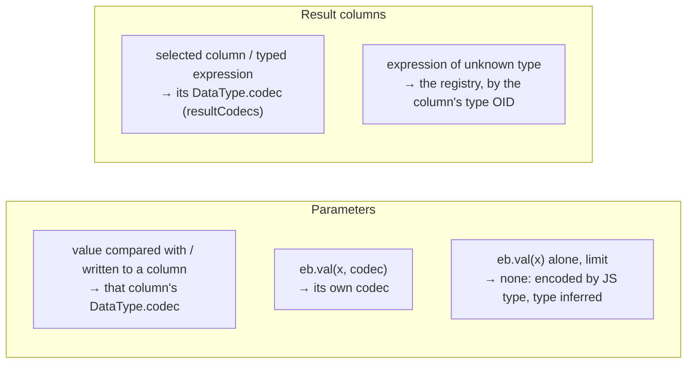

# Running queries: `database()`, executors and the driver

This guide covers what happens after a query is built: how `database()` connects the builder to the driver, how a compiled query is handed over, which codecs the driver is told to use, and how batches, transactions, streams, timeouts, `onQuery` events and errors work from the builder's side.

Files: [database.ts](database.ts), [executor.ts](executor.ts), [driver-executor.ts](driver-executor.ts), [batch.ts](batch.ts), [query.ts](query.ts), [kind-codecs.ts](kind-codecs.ts). The driver's side of each topic is linked as it comes up.

## Contents

- [`database()`](#database)
- [The `Executor` interface](#the-executor-interface)
- [`DriverExecutor`](#driverexecutor)
- [How the builder picks codecs](#how-the-builder-picks-codecs)
- [`execute`, step by step](#execute-step-by-step)
- [Connections: what a query borrows](#connections-what-a-query-borrows)
- [Batches](#batches)
- [Transactions](#transactions)
- [Streaming](#streaming)
- [Timeouts and cancellation](#timeouts-and-cancellation)
- [`onQuery` events](#onquery-events)
- [Errors](#errors)
- [Closing](#closing)
- [Why it is built this way](#why-it-is-built-this-way)
- [Glossary](#glossary)

## `database()`

```ts
const db = database(process.env.DATABASE_URL); // owns a pool
const db = database({ connectionString: url, max: 20 }, { onQuery: log }); // owns a pool
const db = database(pool); // a Pool, PoolClient or Connection you manage
```

[database.ts](database.ts):

```ts
export function database(
	source: DatabaseSource,
	options: DatabaseOptions = {},
): Database {
	const executor = isDriverSource(source)
		? new DriverExecutor(source, options)
		: new DriverExecutor(createPool(source), options, true);
	return databaseWith(executor);
}
```

- A **string** or **pool options** make a new `Pool` that the database **owns** (`owned = true`): `db.close()` ends it. Creating a pool opens no connection yet; the first query does ([driver/POOL.md](driver/POOL.md)).
- A driver `Pool`, `PoolClient` or `Connection` is used as is, and `db.close()` leaves it alone.
- `databaseWith(executor)` (internal) builds the `Database` object over **any** executor; tests use it with a fake ([test/helpers/executor.ts](../test/helpers/executor.ts)).

The `Database` object is a plain object of functions (`queries(executor)`), each starting a builder or an operation with that executor: `selectFrom`, `insertInto`, `update`, `updateMany`, `deleteFrom`, `batch`, `transaction`, `verify`, plus `close` and `[Symbol.asyncDispose]` (so `await using db = database(url)` closes it at the end of the scope). Inside a transaction, `transactionWith(tx)` makes the same object over the transaction's executor, plus `afterCommit`, `afterRollback` and `setLocal`, and without `close`.

`DatabaseOptions` ([driver-executor.ts](driver-executor.ts)):

| Option      | Default          | Meaning                                                                                  |
| ----------- | ---------------- | ---------------------------------------------------------------------------------------- |
| `codecs`    | quarry's         | codecs for result columns no query types ([below](#how-the-builder-picks-codecs))        |
| `catalog`   | `true`           | look up named types (enums, `vector`, custom types) before the first query               |
| `onQuery`   |                  | called once per query with its SQL, timings, row count, error ([below](#onquery-events)) |
| `callsites` | `true`           | append the stack of the code that ran a query to its error                               |
| `prepare`   | the connection's | use cached prepared statements                                                           |

## The `Executor` interface

[executor.ts](executor.ts) is the whole contract between the builder and whatever runs its queries:

```ts
interface Executor {
	execute(
		query: CompiledQuery,
		options?: ExecuteOptions,
	): Promise<ExecuteResult>;
	stream(
		query: CompiledQuery,
		options?: StreamOptions,
	): AsyncIterable<readonly unknown[]>;
	describe(query: CompiledQuery): Promise<QueryDescription>;
	batch(
		queries: readonly BatchQuery[],
		options?: ExecuteBatchOptions,
	): Promise<readonly PromiseSettledResult<ExecuteResult>[]>;
	transaction<T>(
		fn: (executor: TransactionExecutor) => Promise<T>,
		options?: TransactionOptions,
	): Promise<T>;
	close(): Promise<void>;
}
interface ExecuteResult {
	rows: readonly unknown[];
	rowCount: number | null;
	command: string;
}
```

`ExecuteOptions` combines what the caller passed (`signal`, `timeout`) with what the result shape needs (`rowMode`, `keepRows`). An executor returns rows already decoded; the builder never sees bytes or text.

Not part of the public API: it exists so the builder can be tested without a database and could run on another backend (an HTTP proxy, PGlite) without changing a builder.

## `DriverExecutor`

[driver-executor.ts](driver-executor.ts) implements `Executor` (and `TransactionExecutor`) over a **driver source**: a `Pool`, a `PoolClient`, a `Connection`, or a driver `Transaction`. It:

1. chooses the **codec registry** for untyped columns, once, at construction;
2. loads the **type catalog** before the first query (unless `catalog: false`);
3. turns quarry's options into the driver's `QueryOptions`;
4. borrows a connection for each operation from a pool, or uses the source directly;
5. times queries and reports `onQuery` events;
6. **decorates errors** with the query and the caller's stack.

Everything quarry-specific about running queries lives here. The driver itself knows nothing about quarry ([driver/ARCHITECTURE.md](driver/ARCHITECTURE.md#the-driver-knows-nothing-about-quarry)).

## How the builder picks codecs

A **codec** encodes a parameter for the server and decodes a result value for you ([driver/CODECS.md](driver/CODECS.md)). The builder decides which codec applies where; the driver applies it. Three sources, from most to least specific:



1. **Per parameter: `paramCodecs`.** Every value node records the codec of what it is compared with or written to ([EXPRESSIONS.md](EXPRESSIONS.md#codecs-per-value-codecfor)). `compile` collects them by position. The driver encodes each value with its codec, once, and **declares** the parameter's type (its OID) in the Parse message, except for text-like codecs, which leave the type for the server to infer (`inferParamType`, so a text value against a `citext` or enum column isn't forced to `text`).
2. **Per result column: `resultCodecs`.** Every selection records its codec. The driver reads column _i_ with `resultCodecs[i]` while the column really has that codec's type (checked against the OID in RowDescription), and in that codec's preferred format (binary or text) once the statement's columns are known ([driver/CODECS.md](driver/CODECS.md#binary-after-describe)).
3. **The registry, for everything else.** A column with no expected codec (an expression of unknown type) or of a different type than expected (the schema changed) is read by the codec the **registry** has for its type OID. The registry is chosen once in the constructor:

```ts
this.#registry =
	registry ??
	(options.codecs === undefined || options.codecs.length === 0
		? quarryRegistry
		: createCodecRegistry(options.codecs, quarryRegistry));
```

`quarryRegistry` ([kind-codecs.ts](kind-codecs.ts)) is the driver's lossless defaults with quarry's choices on top: int8 as a string, timestamptz as a `Date`, ranges as `Range`, pgvector as `number[]`. `options.codecs` override it per type.

Because a column's TypeScript type is derived from its codec ([column/README.md](column/README.md#kindcodecs-the-codec-of-each-factory)), and that same codec decodes it, the types hold at run time without quarry decoding anything itself.

### The type catalog

Some codecs don't know their type's OID in advance: enums (`EnumType`), `codecs.vector`, `defineType` codecs without an `oid`. The driver looks them up in `pg_type` once per pool (the **catalog**, [driver/CODECS.md](driver/CODECS.md#types-looked-up-by-name-the-catalog)). `DriverExecutor.#prepare` calls `runner.loadTypes()` before its first operation, so even the first query declares enum parameters exactly and reads `vector` columns in binary:

```ts
async #prepare(runner: Runner): Promise<void> {
	if (this.#ready || runner.loadTypes === undefined) return;
	await runner.loadTypes();
	this.#ready = true;
}
```

With `catalog: false` it doesn't wait for it; the driver then loads the catalog in the background behind the first query that needs it (quarry's registry includes `vector`, so in practice that is the first query), and until it arrives such parameters are inferred and such columns read as text.

## `execute`, step by step

```ts
async execute(query, options = {}) {
	const callsite = this.#callsite();                 // new Error(), unless callsites: false
	const observe = this.#options.onQuery !== undefined;
	const start = observe ? performance.now() : 0;
	try {
		const result = await this.#run(options.signal, (runner) => {
			if (observe) acquired = performance.now();
			return runner.query(query.sql, query.params, this.#queryOptions(options, onTiming, query));
		});
		if (observe) this.#report('execute', query, start, acquired, timing, result.command, result.rowCount ?? result.rows.length);
		return { rows: result.rows, rowCount: result.rowCount, command: result.command };
	} catch (error) {
		decorate(error, query, callsite);
		if (observe) this.#report('execute', …, error);
		throw error;
	}
}
```

`#queryOptions` builds the driver's `QueryOptions` in one object (this runs per query, so it avoids spreads):

| quarry                                     | driver `QueryOptions`            |
| ------------------------------------------ | -------------------------------- |
| registry                                   | `codecs`                         |
| shape's `rowMode` (default `'object'`)     | `rowMode`                        |
| shape's `keepRows`                         | `keepRows`                       |
| `query.paramCodecs` / `query.resultCodecs` | `paramCodecs` / `resultCodecs`   |
| `DatabaseOptions.prepare`                  | `prepare`                        |
| `RunOptions.signal`                        | `signal`                         |
| `RunOptions.timeout`                       | `statementTimeout` (server-side) |
| `onQuery` timing callback                  | `onTiming`                       |
| `query.tag`                                | `tag`                            |

## Connections: what a query borrows

```ts
async #run(signal, fn) {
	const source = this.#source;
	if (!(source instanceof Pool)) {
		const runner = source instanceof PoolClient ? source.connection : source;
		await this.#prepare(runner);
		return fn(runner);
	}
	const client = await source.acquire(signal === undefined ? {} : { signal });
	try {
		await this.#prepare(client.connection);
		return await fn(client.connection);
	} finally {
		client.release();
	}
}
```

Over a pool, **each operation reserves a connection** with `pool.acquire()` for its duration and releases it after. So concurrent `execute()` calls from your code each get their own connection (up to the pool's `max`), and beyond that wait in the pool's queue for one to be released. They do not go through the pool's shared-connection pipelining (`pool.query`), which applies to the driver's own `query`/`simpleQuery`/`describe` ([driver/POOL.md](driver/POOL.md#pipelining-onto-busy-connections)). Within one borrowed connection, the driver still pipelines what quarry sends together: a `db.batch`, a transaction's BEGIN with its first statement, a statement timeout's BEGIN/`set_config`/query/COMMIT. To send many independent queries in one round trip, use `db.batch`.

Over a `PoolClient` or `Connection`, every operation uses that one connection, and concurrent queries on it are pipelined by the connection ([driver/ARCHITECTURE.md](driver/ARCHITECTURE.md#pipelining)).

## Batches

`db.batch(queries, options?)` ([batch.ts](batch.ts) `batchWith`, `DriverExecutor.batch`) runs a fixed list of queries **in one round trip on one connection**, and resolves to their results by position, each read as its own `execute()` would (shapes included):

```ts
const [user, posts, { rowCount }] = await db.batch([
	db
		.selectFrom(users)
		.where('users.id', id)
		.select(['users.email'])
		.expectOne(),
	db.selectFrom(posts).where('posts.authorId', id).select(['posts.title']),
	db.update(users).set({ seenAt: new Date() }).where('users.id', id),
]);
```

Each item is a `Query` or a builder (`toQuery()` gives its default shape). `batchWith` compiles them, sends `{ query, rowMode, keepRows }` for each, and reads each result with its shape. It runs them on **this** database's executor wherever they were started, so queries built with the standalone `selectFrom` work too.

There are three modes. The message sequences below were captured from the driver; "Sync" ends a protocol segment and is where the server reports success or failure ([driver/protocol/README.md](driver/protocol/README.md#the-extended-query-protocol)).

### Outside a transaction (default)

Each query is sent with its own Sync, all in one write. They run independently: one failing doesn't stop the others, and what the others wrote stays committed.

```
C> Bind q1 Execute Sync  Bind q1 Execute Sync          (one write)
S< BindComplete DataRow CommandComplete ReadyForQuery
S< BindComplete DataRow CommandComplete ReadyForQuery
```

If any fails (or its shape throws, e.g. `expectOne` finds no row), the batch rejects with a `BatchError` holding every outcome ([QUERIES.md](QUERIES.md#batcherror-batchts)).

### `transaction: true` (or transaction options)

All or nothing. `Transaction.batch` ([driver/TRANSACTIONS.md](driver/TRANSACTIONS.md#batches-in-one-round-trip)) sends BEGIN (and any settings) and the queries under **one** Sync, then COMMIT with its own Sync:

```
C> Parse/Bind/Execute "begin"  Bind q1 Execute  Bind q1 Execute  Sync  Bind "commit" Execute Sync   (one write)
S< … BEGIN … SELECT 1 … SELECT 1 … ReadyForQuery(T)
S< … COMMIT … ReadyForQuery(I)
```

Under one Sync, the first failing statement makes the server skip the rest; COMMIT then reports ROLLBACK, and the batch rejects with the error that failed it.

If any query has a **checked** shape (`expect…`), its result must be checked **before** committing, so a failed check can roll the transaction back. `batchWith` passes a `verify` callback that reads every result; COMMIT then waits for the results: a second round trip.

```
C> begin + queries + Sync                              (first write)
S< … ReadyForQuery(T)
   (verify reads the results; throwing here rolls back)
C> commit + Sync                                       (second write)
```

Take shapes (`takeFirst`, `takeValue`) and builders check nothing, so they keep the batch at one round trip. A `timeout` becomes a `statement_timeout` setting of that transaction.

### Inside a transaction

On a transaction's `tx.batch(...)`, the queries share **one** Sync (and BEGIN's, if it hasn't been sent yet): the first error skips the rest and rejects the batch, and the transaction is failed, as after any failed query. `transaction: true` there makes the batch a savepoint. A `timeout` is refused inside a transaction (set `statement_timeout` with `tx.setLocal` instead).

## Transactions

A **transaction** groups statements so they take effect together or not at all: between `begin` and `commit`, nobody else sees your changes; `rollback` (or an error) undoes them all. Postgres also uses transactions for **isolation** (what concurrent transactions see of each other) and locks ([QUERIES.md](QUERIES.md#row-locking)).

```ts
await db.transaction(
	async (tx) => {
		const order = await tx.insertInto(orders).values(row).returning(['orders.id']).expectOne().execute();
		await tx.update(stock).set(…).where(…).execute();
		tx.afterCommit(() => queue.publish('order.created', order.id));
	},
	{ isolation: 'serializable', retries: 3 },
);
```

`DriverExecutor.transaction` calls the source's `transaction(fn, options)` (the pool reserves a connection for the whole callback) and gives `fn` a new `DriverExecutor` over the driver `Transaction`, sharing the registry. `database.ts` wraps that executor as a `DatabaseTransaction`, so `tx` has every query method.

- **Nesting**: `tx.transaction(fn)` inside a transaction runs `fn` in a **savepoint**, a named point inside the transaction that can be rolled back to without aborting the whole transaction. Isolation, read-only, deferrable, retries and timeout can only be set on the outermost transaction; `DriverExecutor.transaction` rejects them on a nested one. `durable: true` refuses to nest at all (for code that must really commit when it returns).
- **`retries`**: on a serialization failure or deadlock, the whole callback runs again (after a backoff), so it must be safe to re-run. Side effects belong in `afterCommit`.
- **`afterCommit(fn)`** runs `fn` once the outermost transaction commits; dropped on rollback or retry. **`afterRollback(fn)`** runs if this transaction or savepoint rolls back.
- **`setLocal(name, value)`** sets a run-time parameter for the rest of the transaction with `set_config(name, $value, true)`: bound, never interpolated.
- **`settings`** (an option) does the same for several settings at the start, sent with BEGIN.

The driver's framing (BEGIN sharing the first statement's Sync, deferred savepoint releases, detecting a COMMIT that rolled back) is in [driver/TRANSACTIONS.md](driver/TRANSACTIONS.md).

## Streaming

```ts
for await (const user of db.selectFrom(users).select(['users.id']).stream({ batchSize: 500 })) { … }
```

`SelectQueryBuilder.stream` calls `executor.stream(compiled, options)` and yields each batch's rows one by one. `DriverExecutor.stream`:

1. Reserves a connection for the **whole** iteration (a cursor holds the connection; nothing else can run on it until it's closed).
2. With a `timeout`, outside a transaction, opens one on that connection (`begin`) and sets `statement_timeout` with `set_config(…, true)`, so the setting can't outlive the stream; inside a transaction it only sets it.
3. Iterates `runner.cursor(sql, params, { batchSize, …codecs })`, which fetches `batchSize` rows per round trip ([driver/STREAMING.md](driver/STREAMING.md#cursors)).
4. On finish, commits the transaction it opened; on an error or an early `break`, rolls it back and releases the connection (`finally`).
5. Reports one `onQuery` event of kind `'stream'` with the total row count.

## Timeouts and cancellation

- **`signal`** (`RunOptions`): aborting it cancels the query: if it was already sent, the driver sends a **cancel request** to the server over a separate connection; if it was still waiting, it is dropped without contacting the server. Over a pool, the signal also aborts waiting for a connection.
- **`timeout`** (`RunOptions`): a **server-side** `statement_timeout` for this query only. The driver applies it with `set_config('statement_timeout', $1, true)`, transaction-local, so it never leaks into later queries or other clients behind a pooler. Outside a transaction it wraps the query in `begin … commit`, all pipelined in one write:

```
C> begin Sync  select set_config('statement_timeout', $1, true) Sync  <the query> Sync  commit Sync   (one write)
```

A canceled query fails with `QueryCanceled` (`reason`: `'abort'`, `'timeout'`, `'statement_timeout'` or `'user'`). The mechanics are in [driver/CANCELLATION.md](driver/CANCELLATION.md).

## `onQuery` events

```ts
database(url, { onQuery: (event) => logger.debug(event) });
```

Each `execute`, each query of a batch, each `stream` and `describe` reports one `QueryEvent` when it settles:

```ts
interface QueryEvent {
	kind: 'execute' | 'stream' | 'describe';
	sql: string;
	params: readonly unknown[];
	tag: string | undefined;
	command: string | undefined; // 'SELECT', 'INSERT', … on success
	rowCount: number | undefined;
	durationMs: number;
	phases: {
		acquireMs: number; // waiting for a pool connection
		queuedMs: number; // waiting on the connection behind other pipelined queries
		execMs: number; // sent → finished (server work, transfer, decoding)
	};
	error: Error | undefined;
}
```

The timestamps come from `performance.now()`; `queuedMs` and `execMs` come from the driver's `onTiming` callback ([driver/ARCHITECTURE.md](driver/ARCHITECTURE.md#timing)). Nothing is timed when there is no `onQuery`. A listener that throws doesn't break the query: `#emit` rethrows its error in a microtask, where it surfaces as an uncaught exception instead of rejecting your query.

## Errors

`decorate(error, query, callsite)`:

1. A `PostgresError` (an error the **server** reported) gets a non-enumerable `query` property: `{ sql, params, tag }`. Non-enumerable, so a logger that prints the error's own properties won't print parameter values.
2. **Any** error gets the caller's stack appended, once (a symbol marks it):

```
UniqueViolation: duplicate key value violates unique constraint "users_email_key"
    at … (driver internals)
    --- query issued at ---
    at createUser (/app/src/users.ts:42:7)
    at …
```

Without this, a server error's stack shows only the driver's code (the error is created when the server's reply is read, long after your call returned to the event loop). `#callsite()` captures `new Error()` at the start of every `execute` (a few hundred nanoseconds); `callsites: false` turns it off.

Error classes: the driver's `PostgresError` subclasses (`UniqueViolation`, `SerializationFailure`, …), `ConnectionError`, `DecodeError`, `AbortError`, `QueryCanceled`, `TransactionRolledBack`, all re-exported from `quarry` ([driver/ARCHITECTURE.md](driver/ARCHITECTURE.md#errors)); and quarry's own `NoRowError`, `TooManyRowsError`, `RowCountError`, `BatchError` ([QUERIES.md](QUERIES.md#errors)).

## Closing

`db.close()` calls `executor.close()`, which ends the pool **only if the database created it** (`#owned`). `pool.end()` waits for work already issued, then closes every connection ([driver/POOL.md](driver/POOL.md#ending-the-pool)).

## Why it is built this way

- **An executor interface**: the builder can be tested in memory, and the driver integration is one file.
- **The builder chooses codecs, the driver applies them**: encoding and decoding exist once, in the driver, and the driver can pick binary formats per column. quarry adds no per-row work of its own.
- **The catalog loaded up front**: the first query already declares enum parameter types and reads named types in binary; without it, the first queries would behave slightly differently from later ones.
- **Server-side timeouts, transaction-local**: a client-side timer can't stop the server from working; `set_config(…, true)` can't leak a setting into another request through a pooler.
- **Batches with explicit modes**: "run these together" and "run these atomically" are different requests with different failure behaviour, and the API names them.
- **Errors carry the query (hidden) and your stack**: debuggable without leaking parameters into logs.

## Glossary

**Catalog** (`pg_type`): Postgres's table of types; the driver reads it to find the OIDs of named types.

**Executor**: the object that runs compiled queries ([executor.ts](executor.ts)).

**OID**: a Postgres type's numeric id.

**Registry**: the driver's map from type OID to codec, for columns no query typed.

**Round trip**: one message to the server and its answer: the unit of network latency.

**Savepoint**: a point inside a transaction that can be rolled back to without aborting the transaction.

**Serialization failure**: the error a `serializable` transaction gets when it conflicts with a concurrent one; retrying succeeds.

**`statement_timeout`**: Postgres's setting that cancels statements running longer than it.

**Sync**: the protocol message that ends a segment of pipelined statements ([driver/protocol/README.md](driver/protocol/README.md)).
