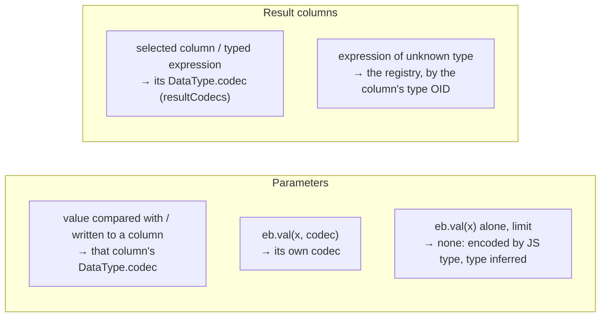

# Running queries: `database()`, executors and the driver

This guide covers what happens after a query is built: how `database()` connects the builder to the driver, how a compiled query is handed over, which codecs the driver is told to use, and how batches, transactions, streams, timeouts, `onQuery` events and errors work from the builder's side.

Files: [database.ts](database.ts), [executor.ts](executor.ts), [driver-executor.ts](driver-executor.ts), [batch.ts](batch.ts), [query.ts](query.ts), [kind-codecs.ts](kind-codecs.ts). The driver's side of each topic is linked as it comes up.

## Contents

- [`database()`](#database)
- [The `Executor` interface](#the-executor-interface)
- [`DriverExecutor`](#driverexecutor)
- [How the builder picks codecs](#how-the-builder-picks-codecs)
- [`execute`, step by step](#execute-step-by-step)
- [Connections: shared or exclusive](#connections-shared-or-exclusive)
- [Batches](#batches)
- [Transactions](#transactions)
- [Streaming](#streaming)
- [Timeouts and cancellation](#timeouts-and-cancellation)
- [`onQuery` events](#onquery-events)
- [Errors](#errors)
- [Closing](#closing)
- [Decisions](#decisions)
- [Glossary](#glossary)

## `database()`

```ts
const db = database(process.env.DATABASE_URL); // owns a pool
const db = database({ connectionString: url, max: 20 }, { onQuery: log }); // owns a pool
const db = database(pool); // a Pool, PoolClient or Connection you manage
```

[database.ts](database.ts):

```ts
export function database(
  source: DatabaseSource,
  options: DatabaseOptions = {},
): Database {
  const executor = isDriverSource(source)
    ? new DriverExecutor(source, options)
    : new DriverExecutor(createPool(source), options, true);
  return databaseWith(executor);
}
```

- A **string** or **pool options** make a new `Pool` that the database **owns** (`owned = true`): `db.close()` ends it. Creating a pool opens no connection yet; the first query does ([driver/POOL.md](driver/POOL.md)).
- A driver `Pool`, `PoolClient` or `Connection` is used as is, and `db.close()` leaves it alone.
- `databaseWith(executor)` (internal) builds the `Database` object over **any** executor; tests use it with a fake ([test/helpers/executor.ts](../test/helpers/executor.ts)).

The `Database` object is a plain object of functions (`queries(executor)`), each starting a builder or an operation with that executor: `selectFrom`, `insertInto`, `update`, `deleteFrom`, `sql` (a hand-written statement, [QUERIES.md](QUERIES.md#whole-statements-dbsql)), `batch`, `transaction`, `verify`, plus `close` and `[Symbol.asyncDispose]` (so `await using db = database(url)` closes it at the end of the scope). Inside a transaction, `transactionWith(tx)` makes the same object over the transaction's executor, plus `afterCommit`, `afterRollback` and `setLocal`, and without `close`.

`DatabaseOptions` ([driver-executor.ts](driver-executor.ts)):

| Option      | Default          | Meaning                                                                                  |
| ----------- | ---------------- | ---------------------------------------------------------------------------------------- |
| `codecs`    | quarry's         | codecs for result columns no query types ([below](#how-the-builder-picks-codecs))        |
| `catalog`   | `true`           | look up named types (enums, `vector`, custom types) before the first query               |
| `onQuery`   |                  | called once per query with its SQL, timings, row count, error ([below](#onquery-events)) |
| `callsites` | `true`           | append the stack of the code awaiting a failed query to its error ([below](#errors))     |
| `prepare`   | the connection's | use cached prepared statements                                                           |

## The `Executor` interface

[executor.ts](executor.ts) is the whole contract between the builder and whatever runs its queries:

```ts
interface Executor {
  execute(
    query: CompiledQuery,
    options?: ExecuteOptions,
  ): Promise<ExecuteResult>;
  stream(
    query: CompiledQuery,
    options?: StreamOptions,
  ): AsyncIterable<readonly unknown[]>;
  describe(query: CompiledQuery): Promise<QueryDescription>;
  batch(
    queries: readonly BatchQuery[],
    options?: ExecuteBatchOptions,
  ): Promise<readonly PromiseSettledResult<ExecuteResult>[]>;
  transaction<T>(
    fn: (executor: TransactionExecutor) => Promise<T>,
    options?: TransactionOptions,
  ): Promise<T>;
  close(): Promise<void>;
}
interface ExecuteResult {
  rows: readonly unknown[];
  rowCount: number | null;
  command: string;
}
```

`ExecuteOptions` combines what the caller passed (`signal`, `timeout`) with what the result shape needs (`rowMode`, `keepRows`). An executor returns rows already decoded; the builder never sees bytes or text.

Not part of the public API: it exists so the builder can be tested without a database and could run on another backend (an HTTP proxy, PGlite) without changing a builder.

## `DriverExecutor`

[driver-executor.ts](driver-executor.ts) implements `Executor` (and `TransactionExecutor`) over a **driver source**: a `Pool`, a `PoolClient`, a `Connection`, or a driver `Transaction`. It:

1. chooses the **codec registry** for untyped columns, once, at construction;
2. loads the **type catalog** before the first query (unless `catalog: false`);
3. turns quarry's options into the driver's `QueryOptions`;
4. over a pool, runs plain queries on its shared, pipelined connections and gives what holds state a connection of its own; otherwise uses the source directly;
5. times queries and reports `onQuery` events;
6. **decorates errors** with the query and the caller's stack.

Everything quarry-specific about running queries lives here. The driver itself knows nothing about quarry ([driver/ARCHITECTURE.md](driver/ARCHITECTURE.md#the-driver-knows-nothing-about-quarry)).

## How the builder picks codecs

A **codec** encodes a parameter for the server and decodes a result value for you ([driver/CODECS.md](driver/CODECS.md)). The builder decides which codec applies where; the driver applies it. Three sources, from most to least specific:



1. **Per parameter: `paramCodecs`.** Every value node records the codec of what it is compared with or written to ([EXPRESSIONS.md](EXPRESSIONS.md#codecs-per-value-codecfor)). `compile` collects them by position. The driver encodes each value with its codec, once, and **declares** the parameter's type (its OID) in the Parse message, except for text-like codecs, which leave the type for the server to infer (`inferParamType`, so a text value against a `citext` or enum column isn't forced to `text`).
2. **Per result column: `resultCodecs`.** Every selection records its codec. The driver reads column _i_ with `resultCodecs[i]` while the column really has that codec's type (checked against the OID in RowDescription), and in that codec's preferred format (binary or text) once the statement's columns are known ([driver/CODECS.md](driver/CODECS.md#binary-after-describe)).
3. **The registry, for everything else.** A column with no expected codec (an expression of unknown type) or of a different type than expected (the schema changed) is read by the codec the **registry** has for its type OID. The registry is chosen once in the constructor:

```ts
this.#registry =
  registry ??
  (options.codecs === undefined || options.codecs.length === 0
    ? quarryRegistry
    : createCodecRegistry(options.codecs, quarryRegistry));
```

`quarryRegistry` ([kind-codecs.ts](kind-codecs.ts)) is the driver's lossless defaults with quarry's choices on top: int8 as a string, timestamptz as a `Date`, ranges as `Range`, pgvector as `number[]`. `options.codecs` override it per type.

Because a column's TypeScript type is derived from its codec ([column/README.md](column/README.md#kindcodecs-the-codec-of-each-factory)), and that same codec decodes it, the types hold at run time without quarry decoding anything itself.

### The type catalog

Some codecs don't know their type's OID in advance: enums (`EnumType`), `codecs.vector`, `defineType` codecs without an `oid`. The driver looks them up in `pg_type` once per pool (the **catalog**, [driver/CODECS.md](driver/CODECS.md#types-looked-up-by-name-the-catalog)). `DriverExecutor.#prepare` calls `runner.loadTypes()` before its first operation, so even the first query declares enum parameters exactly and reads `vector` columns in binary:

```ts
async #prepare(runner: Runner): Promise<void> {
  if (this.#ready || runner.loadTypes === undefined) return;
  await runner.loadTypes();
  this.#ready = true;
}
```

With `catalog: false` it doesn't wait for it; the driver then loads the catalog in the background behind the first query that needs it (quarry's registry includes `vector`, so in practice that is the first query), and until it arrives such parameters are inferred and such columns read as text.

## `execute`, step by step

```ts
async execute(query, options = {}) {
  const observe = this.#options.onQuery !== undefined;
  const start = observe ? performance.now() : 0;
  try {
    const pool = this.#shared(query);                  // the pool, if the query can share its connections
    let result;
    if (pool !== undefined) {
      if (!this.#ready) await this.#prepare(pool);
      result = await pool.query(query.sql, query.params, this.#queryOptions(options, onTiming, query));
    } else {
      result = await this.#run(options.signal, (runner) => {        // a connection of its own
        if (observe) acquired = performance.now();
        return runner.query(query.sql, query.params, this.#queryOptions(options, onTiming, query));
      });
    }
    if (observe) this.#report('execute', query, start, acquired, timing, result.command, result.rowCount ?? result.rows.length);
    return { rows: result.rows, rowCount: result.rowCount, command: result.command };
  } catch (error) {
    decorate(error, query, issuedAt(this.#options)); // the call site, captured now: see Errors
    if (observe) this.#report('execute', …, error);
    throw error;
  }
}
```

`#queryOptions` builds the driver's `QueryOptions` in one object (this runs per query, so it avoids spreads):

| quarry                                     | driver `QueryOptions`            |
| ------------------------------------------ | -------------------------------- |
| registry                                   | `codecs`                         |
| shape's `rowMode` (default `'object'`)     | `rowMode`                        |
| shape's `keepRows`                         | `keepRows`                       |
| `query.paramCodecs` / `query.resultCodecs` | `paramCodecs` / `resultCodecs`   |
| `DatabaseOptions.prepare`                  | `prepare`                        |
| `RunOptions.signal`                        | `signal`                         |
| `RunOptions.timeout`                       | `statementTimeout` (server-side) |
| `onQuery` timing callback                  | `onTiming`                       |
| `query.tag`                                | `tag`                            |

## Connections: shared or exclusive

Over a pool, an operation runs either on the pool's **shared** connections, pipelined with other callers' queries, or on a connection **of its own**, depending on whether it leaves anything on the connection that another caller's query could see:

| Operation                                                                                                                                                    | Over a pool                                              | Why                                                                                                                           |
| ------------------------------------------------------------------------------------------------------------------------------------------------------------ | -------------------------------------------------------- | ----------------------------------------------------------------------------------------------------------------------------- |
| `execute()`: a builder query or a `db.sql` statement, with or without a `timeout`                                                                            | shared: `pool.query`                                     | one statement with its own Sync (a `timeout` shares it: [below](#timeouts-and-cancellation)); nothing stays on the connection |
| `describe()`                                                                                                                                                 | shared: `pool.describe`                                  | the same                                                                                                                      |
| `db.batch` (default, `timeout` or not)                                                                                                                       | shared: `pool.withShared`, one connection, one write     | independent statements, each with its own Sync                                                                                |
| `db.sql` whose first keyword changes session or transaction state: `begin`, `commit`, `set`, `reset`, `discard`, `listen`, `declare`, `create temp table`, … | its own: `pool.acquire()`                                | queries pipelined behind it would run in that state (inside the transaction a `begin` opens)                                  |
| `db.batch(…, { transaction })`                                                                                                                               | its own: `pool.acquire()`                                | BEGIN … COMMIT                                                                                                                |
| `db.transaction`                                                                                                                                             | its own: `pool.transaction`                              | the whole callback                                                                                                            |
| `stream()`                                                                                                                                                   | its own: `pool.acquire()`, held until the iteration ends | the cursor's portal, which holds the connection between batches                                                               |

COPY and LISTEN aren't builder operations: the driver's `pool.copyFrom`, `copyRows` and `copyTo` take a connection of their own, and `pool.listen` a dedicated one outside `max` ([driver/POOL.md](driver/POOL.md#two-ways-to-use-a-connection)).

```ts
#shared(queries): Pool | undefined {
  const source = this.#source;
  if (!(source instanceof Pool)) return undefined;
  // undefined as well when a statement matches SESSION_STATEMENT
  return source;
}
```

**Shared.** Until the pool is full, a query takes an idle connection or waits for one being opened; once it is full, it pipelines onto the least loaded busy connection, waits in the pool's FIFO of pipeline slots beyond each connection's (adaptive) depth, and a connection is drained for a caller who needs one of its own, so transactions and streams aren't starved ([driver/POOL.md](driver/POOL.md#pipelining-onto-busy-connections)). Each query keeps its own behaviour, because all of it is per query in the connection: codecs and binary results once its statement is described (the statement cache is per connection), `keepRows`, the tag, the signal (a cancel is only sent once the query is at the head of the connection's queue, so it can't hit another caller's query: [driver/CANCELLATION.md](driver/CANCELLATION.md)), the unnamed statements behind PgBouncer, and the retry of a stale cached statement. A failing query fails alone: each has its own Sync. A batch runs as one pipeline slot: `withShared` hands it one connection, its statements go out together, and the slot ends when the last one settles.

**What sharing doesn't see.** The keyword check only reads a statement's first word. Session state a `select` sets (`set_config(…, false)`, `pg_advisory_lock`) or a `do` block, run with `db.sql` on a pool, lands on whichever connection runs it and stays there, as it always did. For session state, reserve a connection (`database(await pool.acquire())`) or use a transaction (`tx.setLocal`, `pg_advisory_xact_lock`).

**Its own.** `#run` reserves a connection with `pool.acquire()` (or `pool.transaction` holds one for the callback), runs the operation, and releases it; the driver still pipelines what quarry sends together on it: a transaction's BEGIN with its first statement, an atomic batch.

```ts
async #run(signal, fn) {
  const source = this.#source;
  if (!(source instanceof Pool)) {
    const runner = source instanceof PoolClient ? source.connection : source;
    await this.#prepare(runner);
    return await fn(runner); // awaited, so a failure's call site traces back through it
  }
  const client = await source.acquire(signal === undefined ? {} : { signal });
  try {
    await this.#prepare(client.connection);
    return await fn(client.connection);
  } finally {
    client.release();
  }
}
```

Until #37, every operation took this path, so concurrent builder queries never pipelined: beyond `max`, each waited for a whole connection ([DECISIONS.md](DECISIONS.md#plain-queries-share-the-pools-pipelined-connections) has the measurements).

Over a `PoolClient` or `Connection`, every operation uses that one connection, and concurrent queries on it are pipelined by the connection ([driver/ARCHITECTURE.md](driver/ARCHITECTURE.md#pipelining)).

## Batches

`db.batch(queries, options?)` ([batch.ts](batch.ts) `batchWith`, `DriverExecutor.batch`) runs a fixed list of queries **in one round trip on one connection**, and resolves to their results by position, each read as its own `execute()` would (shapes included):

```ts
const [user, posts, { rowCount }] = await db.batch([
  db
    .selectFrom(users)
    .where('users.id', id)
    .select(['users.email'])
    .expectOne(),
  db.selectFrom(posts).where('posts.authorId', id).select(['posts.title']),
  db.update(users).set({ seenAt: new Date() }).where('users.id', id),
]);
```

Each item is a `Query` or a builder (`toQuery()` gives its default shape). `batchWith` compiles them, sends `{ query, rowMode, keepRows }` for each, and reads each result with its shape. It runs them on **this** database's executor wherever they were started, so queries built with the standalone `selectFrom` work too.

There are three modes. The message sequences below were captured from the driver; "Sync" ends a protocol segment and is where the server reports success or failure ([driver/protocol/README.md](driver/protocol/README.md#the-extended-query-protocol)).

### Outside a transaction (default)

Each query is sent with its own Sync, all in one write. They run independently: one failing doesn't stop the others, and what the others wrote stays committed. Over a pool, the batch runs on a shared connection (`pool.withShared`), after whatever other callers' queries are in flight on it ([above](#connections-shared-or-exclusive)).

```
C> Bind q1 Execute Sync  Bind q1 Execute Sync          (one write)
S< BindComplete DataRow CommandComplete ReadyForQuery
S< BindComplete DataRow CommandComplete ReadyForQuery
```

If any fails (or its shape throws, e.g. `expectOne` finds no row), the batch rejects with a `BatchError` holding every outcome ([QUERIES.md](QUERIES.md#batcherror-batchts)).

### `transaction: true` (or transaction options)

All or nothing. `Transaction.batch` ([driver/TRANSACTIONS.md](driver/TRANSACTIONS.md#batches-in-one-round-trip)) sends BEGIN (and any settings) and the queries under **one** Sync, then COMMIT with its own Sync:

```
C> Parse/Bind/Execute "begin"  Bind q1 Execute  Bind q1 Execute  Sync  Bind "commit" Execute Sync   (one write)
S< … BEGIN … SELECT 1 … SELECT 1 … ReadyForQuery(T)
S< … COMMIT … ReadyForQuery(I)
```

Under one Sync, the first failing statement makes the server skip the rest; COMMIT then reports ROLLBACK, and the batch rejects with the error that failed it.

If any query has a **checked** shape (`expect…`), its result must be checked **before** committing, so a failed check can roll the transaction back. `batchWith` passes a `verify` callback that reads every result; COMMIT then waits for the results: a second round trip.

```
C> begin + queries + Sync                              (first write)
S< … ReadyForQuery(T)
   (verify reads the results; throwing here rolls back)
C> commit + Sync                                       (second write)
```

Take shapes (`takeFirst`, `takeValue`) and builders check nothing, so they keep the batch at one round trip. A `timeout` becomes a `statement_timeout` setting of that transaction.

### Inside a transaction

On a transaction's `tx.batch(...)`, the queries share **one** Sync (and BEGIN's, if it hasn't been sent yet): the first error skips the rest and rejects the batch, and the transaction is failed, as after any failed query. `transaction: true` there makes the batch a savepoint. A `timeout` is refused inside a transaction (set `statement_timeout` with `tx.setLocal` instead).

## Transactions

A **transaction** groups statements so they take effect together or not at all: between `begin` and `commit`, nobody else sees your changes; `rollback` (or an error) undoes them all. Postgres also uses transactions for **isolation** (what concurrent transactions see of each other) and locks ([QUERIES.md](QUERIES.md#row-locking)).

```ts
await db.transaction(
  async (tx) => {
    const order = await tx.insertInto(orders).values(row).returning(['orders.id']).expectOne().execute();
    await tx.update(stock).set(…).where(…).execute();
    tx.afterCommit(() => queue.publish('order.created', order.id));
  },
  { isolation: 'serializable', retries: 3 },
);
```

`DriverExecutor.transaction` calls the source's `transaction(fn, options)` (the pool reserves a connection for the whole callback) and gives `fn` a new `DriverExecutor` over the driver `Transaction`, sharing the registry. `database.ts` wraps that executor as a `DatabaseTransaction`, so `tx` has every query method.

- **Nesting**: `tx.transaction(fn)` inside a transaction runs `fn` in a **savepoint**, a named point inside the transaction that can be rolled back to without aborting the whole transaction. Isolation, read-only, deferrable, retries and timeout can only be set on the outermost transaction; `DriverExecutor.transaction` rejects them on a nested one. `durable: true` refuses to nest at all (for code that must really commit when it returns).
- **`retries`**: on a serialization failure or deadlock, the whole callback runs again (after a backoff), so it must be safe to re-run. Side effects belong in `afterCommit`.
- **`afterCommit(fn)`** runs `fn` once the outermost transaction commits; dropped on rollback or retry. **`afterRollback(fn)`** runs if this transaction or savepoint rolls back.
- **`setLocal(name, value)`** sets a run-time parameter for the rest of the transaction with `set_config(name, $value, true)`: bound, never interpolated.
- **`settings`** (an option) does the same for several settings at the start, sent with BEGIN.

The driver's framing (BEGIN sharing the first statement's Sync, deferred savepoint releases, detecting a COMMIT that rolled back) is in [driver/TRANSACTIONS.md](driver/TRANSACTIONS.md).

## Streaming

```ts
for await (const user of db.selectFrom(users).select(['users.id']).stream({ batchSize: 500, signal })) { … }

await db.transaction(async (tx) => {
  for await (const job of tx.selectFrom(jobs).select(['jobs.id']).forUpdate().stream())
    await tx.update(jobs).set({ status: 'done' }).where('jobs.id', job.id).execute(); // runs between batches
});
```

`SelectQueryBuilder.stream` (reworked in #34) checks `batchSize`, compiles the query, and returns a `RowStream` over `executor.stream(compiled, options)`, without starting anything: the executor's generator only runs when the first row is pulled. `DriverExecutor.stream`:

1. Refuses a `timeout` inside a transaction (other queries of the transaction run between the stream's batches, so a transaction-local `statement_timeout` would apply to them too; use `tx.setLocal`).
2. Over a pool, **acquires a connection** when the first batch is asked for, and releases it in `finally`, however the iteration ends: read to the end, `break`, `return`, a throw, an abort. Inside a transaction, it uses the transaction's connection.
3. Iterates `runner.cursor(sql, params, { batchSize, …codecs, signal, statementTimeout })` ([driver/STREAMING.md](driver/STREAMING.md#cursors)): each batch is fetched only once the rows before it are taken, columns come in their codecs' formats (binary where they can) **from the first run**, and outside a transaction a `timeout` becomes the cursor's `statementTimeout`: the driver sets it before the portal and restores it before the portal's Sync, so it bounds the whole stream (the loop's time included) and can't leak.
4. Decorates an error with the query and the call site, as `execute` does; an error in the middle (a division by zero at row 10,001) rejects the pull that reaches it, after the rows before it.
5. Reports one `onQuery` event of kind `'stream'` with the total row count.

A `RowStream` is an async iterable, so `Readable.from(query.stream())` (Node) and `ReadableStream.from(query.stream())` (web) read it with backpressure, and close it when destroyed or canceled; `await using rows = query.stream()` closes it at the end of the block.

The keyset helpers (`iterateChunks`, `paginateByCursor`, `paginateByOffset`) are the other way to read big results in pieces: each batch is its own query, holding no connection or cursor between batches ([PAGINATION.md](PAGINATION.md)). `paginateByOffset({ countTotal: true })` runs its page and its `count(*)` through `executor.batch`, in one round trip.

## Timeouts and cancellation

- **`signal`** (`RunOptions`): aborting it cancels the query: if it was already sent, the driver sends a **cancel request** to the server over a separate connection; if it was still waiting, it is dropped without contacting the server. Over a pool, the signal also aborts waiting for a connection.
- **`timeout`** (`RunOptions`): a **server-side** `statement_timeout` for this query only. The driver applies it with `set_config('statement_timeout', $1, true)`, transaction-local, so it never leaks into later queries or other clients behind a pooler. The setting, the query and a statement restoring the previous value share the query's Sync, so the timeout bounds this query alone, in a transaction or not, whatever else is pipelined on the connection:

```
C> <set statement_timeout = $1>  <the query>  <restore it>  Sync   (one write)
```

Since that leaves nothing on the connection, a query or a default `db.batch` with a `timeout` runs on the pool's shared, pipelined connections like any other ([above](#connections-shared-or-exclusive)): each of the batch's queries gets its own. On a `stream()`, the setting goes before the cursor's portal and the restore before its Sync.

A canceled query fails with `QueryCanceled` (`reason`: `'abort'`, `'timeout'`, `'statement_timeout'` or `'user'`). The mechanics are in [driver/CANCELLATION.md](driver/CANCELLATION.md).

## `onQuery` events

```ts
database(url, { onQuery: (event) => logger.debug(event) });
```

Each `execute`, each query of a batch, each `stream` and `describe` reports one `QueryEvent` when it settles:

```ts
interface QueryEvent {
  kind: 'execute' | 'stream' | 'describe';
  sql: string;
  params: readonly unknown[];
  tag: string | undefined;
  command: string | undefined; // 'SELECT', 'INSERT', … on success
  rowCount: number | undefined;
  durationMs: number;
  phases: {
    acquireMs: number; // waiting for a pool connection or pipeline slot
    queuedMs: number; // waiting on the connection behind other pipelined queries
    execMs: number; // sent → finished (server work, transfer, decoding)
  };
  error: Error | undefined;
}
```

The timestamps come from `performance.now()`; `queuedMs` and `execMs` come from the driver's `onTiming` callback ([driver/ARCHITECTURE.md](driver/ARCHITECTURE.md#timing)). On a shared connection the pool picks the connection inside `pool.query`, so `acquireMs` is the time before the query reached one (a connection being opened, or a pipeline slot), worked out from the driver's timing: the time it settled, less `queuedMs` and `execMs`; and `queuedMs` includes other callers' queries pipelined ahead of it. Nothing is timed when there is no `onQuery`. A listener that throws doesn't break the query: `#emit` rethrows its error in a microtask, where it surfaces as an uncaught exception instead of rejecting your query.

## Errors

`decorate(error, query, callsite)`:

1. A `PostgresError` (an error the **server** reported) gets a non-enumerable `query` property: `{ sql, params, tag }`. Non-enumerable, so a logger that prints the error's own properties won't print parameter values.
2. **Any** error gets the caller's stack appended, once (a symbol marks it):

```
UniqueViolation: duplicate key value violates unique constraint "users_email_key"
    at … (driver internals)
    --- query issued at ---
    at DriverExecutor.execute (…/quarry/dist/index.js:…)
    at async Query.execute (…/quarry/dist/index.js:…)
    at async createUser (/app/src/users.ts:42:7)
    at async signUp (/app/src/routes.ts:18:3)
```

Without this, a server error's stack shows only the driver's code (the error is created when the server's reply is read, long after your call returned to the event loop).

**When the call site is captured.** Only when a query fails. `issuedAt()` creates the `Error` in `execute`'s `catch`, after the `await`, where the engine's **async stack trace** lists the async functions awaiting the query: `Query.execute`, then your function, then whatever awaits it, up to `Error.stackTraceLimit` frames (10 by default). Node, Deno, Bun and Workers all record them. A query that succeeds captures nothing. Before, `execute` and `batch` ran `new Error()` for every query: about 2 µs on V8 however few frames it keeps, a quarter of a pipelined point lookup's client CPU ([DECISIONS.md](DECISIONS.md#errors-carry-the-query-hidden-and-the-code-awaiting-it)).

What it lists, compared with a stack taken when the query was issued:

- `await q.execute()` in an async function: that function and its awaiting callers, those that resumed after an `await` of their own included (a stack taken at issue time ends at the first of them).
- `Promise.all([q.execute(), …])`: `at async Promise.all (index 0)`, then the function awaiting it.
- A plain function returning `q.execute()` to an async caller: the caller, not the plain function, which isn't awaiting anything.
- A query started now and awaited later, or never: the code awaiting it **when it fails**, which may be no code of yours (the stack then ends at `Query.execute`).

`batch` captures once, at its first failure, in its own continuation: `settle` runs after `await pool.withShared(…)` or inside `#run`'s callback, and `#run` awaits that callback, so the chain reaches `batchWith` and your code. Each link has to be an `await`; a returned promise breaks the chain. `stream` and `describe` still capture when they start: once per stream or description, not per query. `callsites: false` turns it all off.

Error classes: the driver's `PostgresError` subclasses (`UniqueViolation`, `SerializationFailure`, …), `ConnectionError`, `DecodeError`, `AbortError`, `QueryCanceled`, `TransactionRolledBack`, all re-exported from `quarry` ([driver/ARCHITECTURE.md](driver/ARCHITECTURE.md#errors)); and quarry's own `NoRowError`, `TooManyRowsError`, `RowCountError`, `BatchError` ([QUERIES.md](QUERIES.md#errors)).

## Closing

`db.close()` calls `executor.close()`, which ends the pool **only if the database created it** (`#owned`). `pool.end()` waits for work already issued, then closes every connection ([driver/POOL.md](driver/POOL.md#ending-the-pool)).

## Decisions

Why execution works this way. Each links to its full entry (what it is, why, the alternatives, the cost, measured impact) in [DECISIONS.md](DECISIONS.md):

- [One small `Executor` interface between the builder and the driver](DECISIONS.md#one-small-executor-interface-between-the-builder-and-the-driver): the builder can be tested in memory, and the driver integration is one file.
- [The driver owns the codecs; the builder only chooses them](DECISIONS.md#the-driver-owns-the-codecs-the-builder-only-chooses-them): quarry adds no per-row work of its own.
- [The type catalog loaded before the first query](DECISIONS.md#the-type-catalog-loaded-before-the-first-query): the first query behaves like every later one.
- [Plain queries share the pool's pipelined connections](DECISIONS.md#plain-queries-share-the-pools-pipelined-connections): concurrent builder queries pipeline beyond `max`; what holds state keeps a connection of its own.
- [Server-side statement timeouts, transaction-local and pipelined](driver/DECISIONS.md#server-side-statement-timeouts-transaction-local-and-pipelined): a client-side timer can't stop the server; a transaction-local setting can't leak.
- [`db.batch`: two modes with names](DECISIONS.md#dbbatch-two-modes-with-names): "together" and "atomically" fail differently.
- [`db.batch` framing: one write, with COMMIT pipelined unless results are checked](driver/DECISIONS.md#dbbatch-framing-one-write-with-commit-pipelined-unless-results-are-checked): how a batch goes on the wire.
- [`stream()`: only for every-row reads, and it runs immediately](DECISIONS.md#stream-only-for-every-row-reads-and-it-runs-immediately): and why its `timeout` is refused in a transaction.
- [Errors carry the query (hidden) and the code awaiting it](DECISIONS.md#errors-carry-the-query-hidden-and-the-code-awaiting-it): debuggable without leaking parameters into logs, and without a stack captured per query.
- [Nested `durable` transactions throw](DECISIONS.md#nested-durable-transactions-throw): a durable request never silently becomes a savepoint.

## Glossary

**Catalog** (`pg_type`): Postgres's table of types; the driver reads it to find the OIDs of named types.

**Executor**: the object that runs compiled queries ([executor.ts](executor.ts)).

**OID**: a Postgres type's numeric id.

**Registry**: the driver's map from type OID to codec, for columns no query typed.

**Round trip**: one message to the server and its answer: the unit of network latency.

**Savepoint**: a point inside a transaction that can be rolled back to without aborting the transaction.

**Serialization failure**: the error a `serializable` transaction gets when it conflicts with a concurrent one; retrying succeeds.

**`statement_timeout`**: Postgres's setting that cancels statements running longer than it.

**Sync**: the protocol message that ends a segment of pipelined statements ([driver/protocol/README.md](driver/protocol/README.md)).
