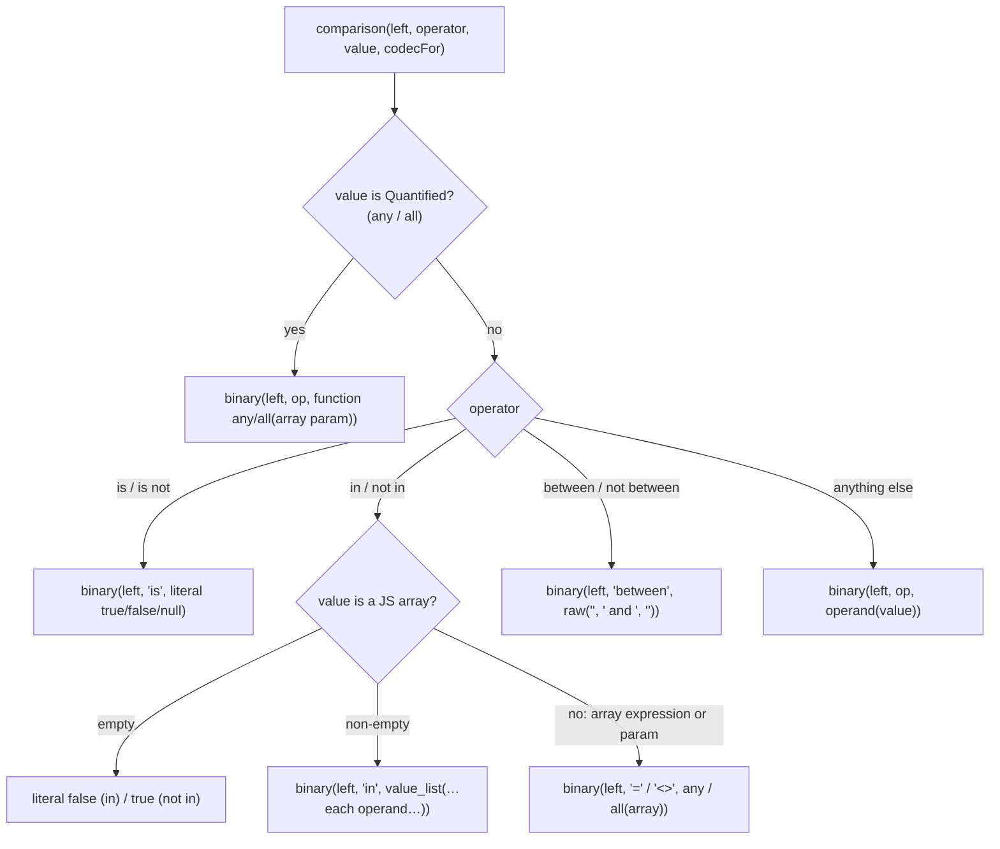

# Expressions and the expression builder

Every condition, computed column and function call in quarry is built with the **expression builder**, the `eb` argument of callbacks:

```ts
.where((eb) => eb.ref('users.age').gte(18))
.select((eb) => [eb.fn.lower('users.email').as('email')])
.on((eb) => eb.and([eb.ref('memberships.userId').eq(eb.ref('users.id')), eb.ref('memberships.active').isTrue()]))
```

This guide explains what those calls build at run time, how values get their codecs, and how each SQL operator is lowered into the node tree the compiler renders. The type-level side (why `.like` exists on a text column and not on a uuid column, how nullability propagates) is in [TYPES.md](TYPES.md#part-4-expressions-and-their-methods).

Files: [expression.ts](expression.ts), [expression-builder.ts](expression-builder.ts), [expression-methods.ts](expression-methods.ts), [comparison.ts](comparison.ts), [operators.ts](operators.ts), [functions.ts](functions.ts), [json.ts](json.ts), [where-builder.ts](where-builder.ts), [node.ts](node.ts).

## Contents

- [What an expression is](#what-an-expression-is)
- [The expression builder object](#the-expression-builder-object)
- [References: `eb.ref`](#references-ebref)
- [Values vs expressions](#values-vs-expressions)
- [Comparison methods](#comparison-methods)
- [How methods exist at run time](#how-methods-exist-at-run-time)
- [Lowering a comparison: `comparison()`](#lowering-a-comparison-comparison)
- [Which types compare with which](#which-types-compare-with-which)
- [Parameters: `eb.val`](#parameters-ebval)
- [`any` and `all`](#any-and-all)
- [`and`, `or`, `not`](#and-or-not)
- [Arithmetic](#arithmetic)
- [`case`](#case)
- [Functions: `eb.fn`](#functions-ebfn)
- [jsonb: `eb.json`](#jsonb-ebjson)
- [`where` and `on`: the three forms](#where-and-on-the-three-forms)
- [Raw SQL fragments](#raw-sql-fragments)
- [`undefined` is refused](#undefined-is-refused)
- [Why methods and not operator strings](#why-methods-and-not-operator-strings)
- [Decisions](#decisions)
- [Glossary](#glossary)

## What an expression is

In SQL, an **expression** computes a value: `"users"."age"`, `$1`, `lower("users"."email")`, `"users"."age" >= $1`. In quarry, an expression is an object holding a **node**: a small piece of plain data that the compiler will render ([node.ts](node.ts), [COMPILER.md](COMPILER.md)):

```ts
eb.ref('users.age').gte(18)._quarry.node;
// {
//   kind: 'binary',
//   left: { kind: 'reference', table: 'users', column: 'age' },
//   operator: '>=',
//   right: { kind: 'value', value: 18, codec: codecs.int4 },
// }
```

The classes ([expression.ts](expression.ts)):

| Class                        | Holds                                            | Made by                                                            |
| ---------------------------- | ------------------------------------------------ | ------------------------------------------------------------------ |
| `Expression<T>`              | `_quarry.node`                                   | the base; `T` is the type of its value                             |
| `TypedExpression<T, D>`      | `node` and `dataType: D`                         | `eb.ref`, functions, comparisons: anything whose SQL type is known |
| `Param<T>`                   | `node` (a value node), `value`, optional `codec` | `eb.val(x)`                                                        |
| `Quantified<S, D, N, Typed>` | `quantifier`, `array`, `element`                 | `eb.fn.any(…)`, `eb.fn.all(…)`; **not** an expression              |
| `AliasedExpression<T, A>`    | `expression`, `alias`                            | `expression.as('name')`; **not** an expression                     |

`Quantified` and `AliasedExpression` are deliberately not expressions: Postgres only allows `any(…)` on the right of an operator, and an alias only on a select-list entry, so nothing else in quarry accepts them.

## The expression builder object

`expressionBuilder(...tables)` ([expression-builder.ts](expression-builder.ts)) makes an `eb` for a scope:

```ts
return {
	ref: (column) => { … },
	val: (value, codec) => param(value, codec),
	fn: functions({ node, dataType }),
	json: jsonFunctions({ node }),
	and: junction('and'),
	or: junction('or'),
	not: (expression) => predicate({ kind: 'not', operand: expression._quarry.node }),
};
```

- Every member is an arrow function that doesn't use `this`, so `({ ref, fn }) => …` destructuring works.
- The runtime implementation only builds nodes; the `ExpressionBuilder<R>` **interface** supplies the precise types. That split is how all of quarry's expression code works: simple runtime, rich types on top.
- Builders make a new `eb` whenever their table list changes (`select`, `innerJoin`, `on` each call `expressionBuilder(...tables)`), and callbacks for `where`, `on`, `select`, `set`, `returning` all receive the same kind of object.

## References: `eb.ref`

```ts
const resolve = (reference: string) => {
	const dot = reference.indexOf('.');
	const tableName = reference.slice(0, dot);
	const key = reference.slice(dot + 1);
	const column = tables.find((table) => table.name === tableName)?.schema
		.columns[key];
	if (column === undefined)
		throw new Error(`Unknown column reference "${reference}"`);
	return {
		node: {
			kind: 'reference',
			table: tableName,
			column: column._quarry.columnName ?? key,
		},
		column,
	};
};
```

- The reference is split at the **first** dot: table (or alias) name, then the TypeScript key.
- The node records the table **as referenced** (`managers` for an alias) and the column's **database** name (`created_at` for key `createdAt`). So the tree is already in database terms, and the compiler needs no schema.
- `eb.ref` returns a `TypedExpression` with the column's `DataType`, so values compared with it are encoded by the column's codec.
- `nameReference(node, column)` ([comparison.ts](comparison.ts)) remembers the reference as you wrote it (`users.createdAt`) in a `WeakMap`, only so error messages can name it ([below](#undefined-is-refused)).

Functions accept a reference string directly (`eb.fn.lower('users.email')`) and resolve it the same way through the `node`/`dataType` helpers passed to `functions()`.

## Values vs expressions

A comparison's right-hand side can be:

1. **A plain value** (`18`, `'admin'`, a `Date`): becomes a parameter. It must have the left side's TypeScript type, and is encoded with the left side's codec.
2. **An expression** (`eb.ref('users.maxAge')`, `eb.fn.now()`): rendered in place. It is checked by its **SQL type** only: any expression of a compatible SQL type is accepted, whatever its TypeScript type. That is how a branded `UserId` column compares with a plain integer column.
3. **A parameter** (`eb.val(x)`): a value you've wrapped explicitly, for positions that would otherwise read a string as a column reference, or to give it a codec.

How the code tells them apart: `Expression.is(value)` (`'_quarry' in value`). Anything else is a value.

## Comparison methods

Every typed expression has the methods of its SQL kind (`MethodsByKind` in [operators.ts](operators.ts)):

| Method family                                                                                                                           | SQL                                                 | On                                         |
| --------------------------------------------------------------------------------------------------------------------------------------- | --------------------------------------------------- | ------------------------------------------ |
| `isNull`, `isNotNull`                                                                                                                   | `is null`, `is not null`                            | every type                                 |
| `eq`, `ne`, `isDistinctFrom`, `isNotDistinctFrom`, `in`, `notIn`                                                                        | `=`, `<>`, `is [not] distinct from`, `in`, `not in` | every type with equality                   |
| `gt`, `gte`, `lt`, `lte`, `between`, `notBetween`                                                                                       | `>`, `>=`, `<`, `<=`, `between … and …`             | ordered types                              |
| `like`, `notLike`, `ilike`, `notIlike`, `regex`, `notRegex`, `iregex`, `notIregex`, `startsWith`                                        | `like`, `ilike`, `~`, `!~`, `~*`, `!~*`, `^@`       | `text`, `varchar`                          |
| `isTrue`, `isNotTrue`, `isFalse`, `isNotFalse`                                                                                          | `is [not] true/false`                               | `boolean` (and every predicate)            |
| `contains`, `containedBy`, `overlaps`, `strictlyLeftOf`, `strictlyRightOf`, `doesNotExtendRightOf`, `doesNotExtendLeftOf`, `adjacentTo` | `@>`, `<@`, `&&`, `<<`, `>>`, `&<`, `&>`, `-\|-`    | ranges                                     |
| `contains`, `containedBy`, `overlaps`                                                                                                   | `@>`, `<@`, `&&`                                    | arrays, `jsonb` (`contains`/`containedBy`) |
| `isSubnetOf`, `isSubnetOrEqual`, `isSupernetOf`, `isSupernetOrEqual`, `overlaps`                                                        | `<<`, `<<=`, `>>`, `>>=`, `&&`                      | `inet`                                     |
| `matches`                                                                                                                               | `@@`                                                | `tsvector` (against a tsquery string)      |
| all of the above                                                                                                                        |                                                     | `defineType` types: Postgres decides       |

`vector` (pgvector) has only the null checks: its distance operators aren't modelled yet.

Method names describe the meaning, so one SQL operator can have several names (`<<` is `strictlyLeftOf` on a range and `isSubnetOf` on an inet). The name-to-operator table is `OPERATORS` in [expression-methods.ts](expression-methods.ts), and the `is` tests are `TESTS`.

## How methods exist at run time

The methods aren't written out per type at run time. [expression-methods.ts](expression-methods.ts) generates one function per method name and attaches all of them to two prototypes:

```ts
for (const [name, operator] of Object.entries(OPERATORS)) {
	methods[name] = function (this: Expression<unknown>, value: unknown) {
		return compare(this, operator, value);
	};
}
// … the `is` tests …
class MethodExpression<T, D> extends TypedExpression<T, D> {}
class MethodParam<T> extends Param<T> {}
for (const prototype of [MethodExpression.prototype, MethodParam.prototype])
	for (const [name, method] of Object.entries(methods))
		Object.defineProperty(prototype, name, {
			value: method,
			writable: true,
			configurable: true,
		});
```

So **every** typed expression has **every** method at run time; the types decide which ones you can call. `typedExpression(node, dataType)` and `param(value, codec)` construct these classes and return `never`, the bottom type, which is assignable to anything: the **caller's** signature (`ExpressionBuilder.ref`, `Functions.lower`, …) supplies the real type. That is the one place where runtime and types are bridged with a deliberate cast.

`predicate(node)` makes a boolean `TypedExpression`: every comparison result is one, so predicates have `eq`, `isTrue` and the rest too.

## Lowering a comparison: `comparison()`

`compare(left, operator, value)` picks the codec and calls `comparison()` ([comparison.ts](comparison.ts)), which turns one comparison into generic nodes. The compiler then needs no operator-specific rendering.



What the compiler then renders, taken from `toSQL()` of real queries (the `$n` numbers are those of the larger queries the fragments came from):

| Code                                       | SQL                              | Params and their codecs           |
| ------------------------------------------ | -------------------------------- | --------------------------------- |
| `where('users.role', 'admin')`             | `"users"."role" = $1`            | `'admin'` (`user_role`)           |
| `eb.ref('posts.id').in(['1', '2'])`        | `"posts"."id" in ($3, $4)`       | `'1'`, `'2'` (`int8`)             |
| `eb.ref('users.id').in([])`                | `false`                          | none                              |
| `eb.ref('users.id').in(eb.val([1, 2, 3]))` | `"users"."id" = any($4)`         | `[1, 2, 3]` (`int4[]`)            |
| `eb.ref('users.id').between([1, 10])`      | `"users"."id" between $2 and $3` | `1`, `10` (`int4`)                |
| `eb.ref('users.name').isNull()`            | `"users"."name" is null`         | none                              |
| `eb.val('x').eq(eb.fn.any('users.tags'))`  | `$1 = any("users"."tags")`       | `'x'` (`text`, the element codec) |

Details worth knowing:

- **Empty `in`**: Postgres rejects `x in ()`, so an empty list becomes the literal `false` (`not in` → `true`), which is what the comparison means.
- **`in` with an array value** (an array expression or a parameter holding an array): Postgres's `in` only takes a list, so it becomes the equivalent `= any(array)`; `not in` becomes `<> all(array)`.
- **`is` / `is not`**: Postgres refuses a parameter there (`x is $1` is a syntax error), so the keyword is a **literal** node. Only the typed methods produce these, but the runtime still checks the value is `true`, `false` or `null` because it is written into the SQL.
- **`between`**: the right side is a `raw` node with two embedded operands, rendering `$2 and $3`.

### Codecs per value: `codecFor`

`compare()` gives `comparison()` a function `codecFor(value)` that chooses each value's codec, normally the left side's `DataType.codec`. Two operators differ (`codecFor` in [expression-methods.ts](expression-methods.ts)):

- `@>` on a range (`contains`) can take a single point: a `daterange` containing a date is encoded with `codecs.date`, a `tstzrange` containing a `Date` with `codecs.timestamptz`.
- `@@` (tsvector `matches`) takes a tsquery, a different type: no codec, so Postgres infers it.

For lists and arrays, `arrayCodec(values, codecFor)` takes the codec of the first non-null element and wraps it with `arrayOf`, so `in(eb.val([1, 2, 3]))` sends one `int4[]` parameter (in binary, see [driver/CODECS.md](driver/CODECS.md#arrays-arrayof)).

A parameter on the **left** (`eb.val('admin').eq(eb.fn.any('users.tags'))`) has no SQL type, so it takes the **element** codec of the array on the right; without an `any`/`all` of a typed array there, `compare` throws.

## Which types compare with which

Postgres compares values of compatible types without a cast; quarry's types follow the same rules (`ComparableType` in [operators.ts](operators.ts), explained in [TYPES.md](TYPES.md#operand-types-what-each-method-accepts)):

| Left                                                                   | Accepts expressions of                     |
| ---------------------------------------------------------------------- | ------------------------------------------ |
| `text`, `varchar`                                                      | any character type                         |
| `smallint`, `integer`, `bigint`, `decimal`, `real`, `double precision` | any numeric type                           |
| `date`, `timestamp`, `timestamptz`                                     | any of those three                         |
| an enum                                                                | the **same** enum only                     |
| a `defineType` type                                                    | the **same** custom type only              |
| an array                                                               | arrays of a type its element compares with |
| anything else                                                          | the same type                              |

So `eb.ref('users.publicId').eq(eb.ref('users.email'))` (uuid vs text) is a type error even though both are strings in JavaScript, because Postgres would reject it with "operator does not exist: uuid = text".

## Parameters: `eb.val`

`eb.val(value, codec?)` makes a `Param`. Use it:

- where a string would otherwise mean a column reference: `eb.fn.concat('users.firstName', eb.val(' '), 'users.lastName')`;
- for an array as a whole: `eb.ref('users.id').in(eb.val(ids))` (one array parameter, instead of one parameter per element);
- on the left of an `any`/`all` comparison;
- to give a value an explicit codec: `eb.val(range, codecs.tstzrange)`.

How a `Param` is encoded depends on where it ends up:

| Position                                   | Codec                                                                                                    |
| ------------------------------------------ | -------------------------------------------------------------------------------------------------------- |
| right side of a comparison                 | its own codec if given, else the left side's (for `in`/`any`, `arrayOf` it)                              |
| `coalesce` fallback                        | its own, else the first argument's                                                                       |
| left side of `any`/`all`                   | its own, else the array's element codec                                                                  |
| anywhere else (`concat`, a select list, …) | its own if given; otherwise a codec chosen from its JavaScript type, which **declares** its type (below) |

**A bare parameter declares its type** (`codecOfValue` in [expression.ts](expression.ts), since #32). Where nothing else gives a value a type, Postgres has to infer it from the parameter's position, and in `concat($1)` or `select $1` there is nothing to infer from: it fails with "could not determine data type of parameter $1", or picks `text`. So a `Param` without a codec gets one from its JavaScript type: a string is `text` (declared, through `declareParamType`), a whole number within int4 range `integer`, any other number `double precision`, a boolean `boolean`, a bigint `int8`, a `Date` `timestamptz`. That also makes `eb.val(1).as('one')` arrive as the number `1`, matching its TypeScript type, instead of the string `'1'`. In a comparison the other side's codec still wins.

A `Param` has the methods of `ParamMethods`: only comparisons against `any`/`all` of an **array column or expression**, since it has no SQL type of its own to compare by. Since #32 the types also check that the value fits the array's element type and that the operator exists for it (`like` only for text, and so on).

## `any` and `all`

```ts
eb.ref('users.email').like(eb.fn.any(['%@a.com', '%@b.com'])); // like any($1)
eb.ref('users.age').gt(eb.fn.all('users.limits')); // > all("users"."limits")
eb.val('admin').eq(eb.fn.any('users.tags')); // $1 = any("users"."tags")
```

`eb.fn.any(array)` / `all(array)` ([functions.ts](functions.ts) `quantify`) make a `Quantified`:

- From **values** or a **parameter**: `array` is the values as they are and `element` is `undefined`: the comparison encodes them later as one array parameter, with `arrayOf` the left side's codec.
- From an **array column or expression**: `array` is its expression and `element` is its element `DataType` (read from its `ArrayType`), which is what lets a parameter on the left be encoded.

The comparison renders `left op any(array)`; `any` is written as a `function` node, though it isn't really a function in Postgres.

## `and`, `or`, `not`

```ts
eb.and([a, b, c]); // (a and b and c); `true` when empty
eb.or([a, b]); // (a or b);        `false` when empty
eb.not(a); // not (a)
```

`junction(kind)` in [expression-builder.ts](expression-builder.ts) **flattens** nested junctions of the same kind: `eb.and([eb.and([a, b]), c])` becomes one `and` node with three operands. Rendering ([COMPILER.md](COMPILER.md#and-or-and-precedence)): an empty `and` is `true`, an empty `or` is `false`, a single operand renders on its own, several are joined and parenthesised.

## Arithmetic

```ts
eb.ref('posts.views').plus(1); // "posts"."views" + $1   (an integer)
eb.ref('orders.total').times(eb.ref('orders.qty'));
eb.ref('posts.createdAt').plus('1 day'); // timestamptz + interval → timestamptz
eb.ref('posts.createdAt').minus(eb.ref('posts.publishedAt')); // → interval
eb.ref('items.embedding').cosineDistance(query); // pgvector `<=>` → double precision
```

Arithmetic methods ([expression-methods.ts](expression-methods.ts) `ARITHMETIC`, `arithmetic`, `arithmeticOf`) are attached to the same prototypes as comparisons, and typed per kind in [operators.ts](operators.ts):

| On                         | Methods                                                                                                            | Result                                                                                                                         |
| -------------------------- | ------------------------------------------------------------------------------------------------------------------ | ------------------------------------------------------------------------------------------------------------------------------ |
| numbers                    | `plus`, `minus`, `times`, `dividedBy` (all numeric kinds), `mod` (exact kinds: smallint, integer, bigint, decimal) | the **wider** kind: between exact kinds the later of `smallint < integer < bigint < decimal`; with a float, `double precision` |
| `timestamp`, `timestamptz` | `plus`/`minus` an interval; `minus` another timestamp                                                              | the same kind / `interval`                                                                                                     |
| `date`                     | `plus`/`minus` a number of days; `minus` another date                                                              | `date` / `integer`                                                                                                             |
| `interval`                 | `plus`, `minus`                                                                                                    | `interval`                                                                                                                     |
| `vector`                   | `l2Distance` (`<->`), `cosineDistance` (`<=>`), `innerProduct` (`<#>`)                                             | `double precision`                                                                                                             |

The result's SQL type follows Postgres's own rules, so its methods and codec are right (`count + 1` stays a bigint read as a string; `date - date` is an integer). A plain value on the right is sent with its type **declared** (`declareParamType` of the codec `arithmeticOf` picks): `timestamptz - $1` is otherwise ambiguous to Postgres (it could be an interval or a timestamp), and declaring `interval` resolves the operator. Arithmetic makes increments possible: `set((eb) => ({ views: eb.ref('posts.views').plus(1) }))` renders `"views" = "posts"."views" + $1`, computed by the server from the current value. Operands that are operations are bracketed by the compiler ([COMPILER.md](COMPILER.md#rendering-expressions-render)).

## `case`

```ts
eb.case()
	.when(eb.ref('orders.total').gte(1000), 'large')
	.when(eb.ref('orders.total').gte(100), 'medium')
	.else('small')
	.end()
	.as('size');
// case when "orders"."total" >= $1 then $2 when … else $5 end as "size"
```

[case.ts](case.ts). `eb.case()` returns a builder whose types walk through `CaseStart` → `CaseWhen<V, D>` → `CaseElse<V, D>`:

- The result type `V` is the **union** of the branch results, plus `null` without an `else` (no branch matching yields NULL).
- The **first** result fixes the SQL type `D` (an expression's type, or a plain value's by its JavaScript type); later results must be values of that type, `null`, or expressions of a type Postgres resolves with it (`CaseResult`). At run time `caseType` finds the type the same way, and refuses a `case` whose results are only nulls or have conflicting types (an `integer` with a fractional number becomes `double precision`).
- Values are sent with that type declared, so Postgres resolves the `case` the same way.
- It needs at least one `when` (the start type has no `else` or `end`), as Postgres does.

## Functions: `eb.fn`

[functions.ts](functions.ts). Each function builds a `function` node (or a `raw` node) and declares its result's SQL type, following Postgres's result types:

| Group       | Functions                                                                                                                          | Notes                                                                                                                                                                                                                                              |
| ----------- | ---------------------------------------------------------------------------------------------------------------------------------- | -------------------------------------------------------------------------------------------------------------------------------------------------------------------------------------------------------------------------------------------------- |
| text        | `lower`, `upper`, `length`, `concat`, `trim`, `ltrim`, `rtrim`, `substring`, `replace`, `strpos`, `left`, `right`, `splitPart`     | `concat` is never null (Postgres skips nulls); the others are null if an argument is                                                                                                                                                               |
| comparison  | `coalesce`, `nullif`, `greatest`, `least`                                                                                          | `coalesce` is non-null unless its **last** argument can be null; a `Param` fallback takes the first argument's codec                                                                                                                               |
| aggregates  | `count`, `countDistinct`, `min`, `max`, `sum`, `avg`, `arrayAgg`, `stringAgg`, `boolAnd`, `boolOr`, `jsonbAgg`, `jsonbBuildObject` | `count` is a `bigint` (a string); `sum` of an integer is a bigint, of a bigint a numeric; `avg` a numeric; `min`/`max` keep their argument's type and are null over no rows; `countDistinct` renders `count(distinct x)` (`FunctionNode.distinct`) |
| math        | `abs`, `round`, `ceil`, `floor`                                                                                                    | `round(x, places)` on a decimal                                                                                                                                                                                                                    |
| dates       | `now`, `currentDate`, `dateTrunc`, `extract`, `toChar`                                                                             | `extract` and `dateTrunc` take the field as a fixed string                                                                                                                                                                                         |
| arrays      | `cardinality`                                                                                                                      |                                                                                                                                                                                                                                                    |
| conversion  | `cast(x, type)`                                                                                                                    | targets: text, varchar, smallint, integer, bigint, numeric, real, double precision, boolean, uuid, date, timestamp, timestamptz, time, interval, jsonb (`CAST_KINDS`); also takes a parameter                                                      |
| quantifiers | `any`, `all`                                                                                                                       | a `Quantified`, only on the right of a comparison                                                                                                                                                                                                  |

- `cast` renders through a `raw` node because `cast(x as type)` has a keyword inside the parentheses. Its target is one of a fixed list; anything else throws, since the target is written into the SQL.
- The aggregates are what the compiler looks for when it refuses a locking clause on an aggregate query ([COMPILER.md](COMPILER.md#locking-clauses)).

## jsonb: `eb.json`

[json.ts](json.ts). `jsonb` is a JSON document stored in a column. Reading inside it and testing keys use operators whose right side is text or a path, not jsonb, so they are functions here rather than methods on the column:

| Function                                            | SQL                        | Result                                                                 |
| --------------------------------------------------- | -------------------------- | ---------------------------------------------------------------------- |
| `get(json, ...path)`                                | `json -> 'a' -> 'b'`       | jsonb at the path (null where missing); typed from `T` in `jsonb<T>()` |
| `text(json, ...path)`                               | `json -> 'a' ->> 'b'`      | the value as text                                                      |
| `hasKey(json, key)`                                 | `json ? $1`                | predicate                                                              |
| `hasAnyKey(json, keys)`, `hasAllKeys(json, keys)`   | `?\|`, `?&`                | predicate (keys as one `text[]` parameter)                             |
| `pathExists(json, path)`, `pathMatches(json, path)` | `@?`, `@@`                 | predicate (path as a `jsonpath` parameter)                             |
| `typeOf(json)`                                      | `jsonb_typeof(json)`       | `'object' \| 'array' \| …`                                             |
| `length(json)`                                      | `jsonb_array_length(json)` | number                                                                 |

Path keys are written into the SQL as **literals** (`-> 'theme'`), not parameters: an expression index on `settings->>'theme'` only matches a query written the same way. Keys are checked against the column's TypeScript type (`PathIn`, `At` in [json.ts](json.ts)), so `eb.json.get('users.settings', 'theem')` fails to compile when the column is `jsonb<{ theme: … }>()`; an untyped `jsonb()` accepts any key. Array indexes must be integers (negative counts from the end).

A jsonb column's own methods (`eq`, `contains`, `containedBy`) take JSON values encoded with the jsonb codec: `eb.ref('users.settings').contains({ theme: 'dark' })` → `"users"."settings" @> $1` with `{"theme":"dark"}`.

## `where` and `on`: the three forms

`where` on every builder, and `on` after a join, take a `Condition` ([where-builder.ts](where-builder.ts)):

```ts
.where('users.role', 'admin')                    // 1. (column, value): equality
.where((eb) => eb.ref('users.age').gte(18))     // 2. (eb => predicate)
.where(isActive)                                 // 3. a predicate built elsewhere
```

`WhereBuilder` collects them; several calls are joined with `and`:

```ts
#nodeOf(args) {
	if (args.length === 2) return compare(this.#eb.ref(args[0]), '=', args[1])._quarry.node;
	const [first] = args;
	return Expression.is(first) ? first._quarry.node : first(this.#eb)._quarry.node;
}
toNode() {
	const [only, ...rest] = this.#conditions;
	return rest.length === 0 ? only : { kind: 'and', operands: this.#conditions };
}
```

The `(column, value)` form only takes values `eq` would take for that column (`EqualsValue`), and never `null` (use `isNull()`). There is no `orWhere`: an `or` is one condition built with `eb.or([...])`, so precedence is always explicit.

`on`'s shorthand differs: `on('contacts.userId', 'users.id')` compares **two columns**: the joined table's column first, then a column of a table already in scope of a SQL type its `=` takes (`JoinColumn` in [select-query-builder.ts](select-query-builder.ts)). Any other join condition goes in a callback.

## Raw SQL fragments

```ts
.select((eb) => [sql<number>`extract(epoch from ${eb.ref('users.createdAt')})`.as('epoch')])
.where((eb) => sql<boolean>`${eb.ref('posts.title')} % ${search}`)
sql.id('app', 'users')     // "app"."users"
sql.lit('5s')              // '5s', written into the SQL
sql.join(ids)              // $1, $2, $3
```

For anything the builder doesn't model, the `sql` tag ([sql.ts](sql.ts)) makes a fragment usable wherever an expression of type `T` is. It builds a `raw` node from the template's strings and values (`templateNode`):

- An interpolated **value** becomes a parameter, with no codec: Postgres infers its type from where it stands. `undefined` is refused.
- An **expression** (`eb.ref`, `eb.fn…`, another fragment) and a **table** are written into the SQL as their nodes.
- `sql.id(…)` writes a quoted identifier, `sql.lit(…)` a literal (quoted string, finite number, boolean or null) for places Postgres takes no parameter, `sql.join(items, separator?)` a list.
- It must be called as a **template literal**: passing an ordinary string (`sql(userInput)`) is refused at run time (`isTemplate` checks the `raw` property that only template calls have). This is what keeps hand-written SQL injection-safe: the literal parts are always code you wrote, and everything interpolated is either a parameter or a node quarry quoted.
- A fragment has no SQL type, so it has no comparison methods, and its selected value is decoded by the type the server reports (the registry). `T` is a promise you make; nothing checks it. It is written without brackets, so bracket it where precedence matters.

`db.sql` runs a whole statement this way ([QUERIES.md](QUERIES.md#whole-statements-dbsql)).

## `undefined` is refused

```ts
.where('users.name', undefined)
// TypeError: users.name is compared with undefined. For an optional filter, use .when():
//   .when(value !== undefined, (qb) => qb.where('users.name', value)). For SQL NULL, use isNull().
```

`comparison()` checks every value and list item (`check` in [comparison.ts](comparison.ts)) and throws `undefinedComparison(left)` at build time. Sending `undefined` as NULL would make `= NULL`, which matches no row: an optional filter that silently returns nothing. The message names the column as you wrote it (from the `WeakMap` `nameReference` filled) and shows the fix. The driver has the same rule for raw parameters (`UndefinedParameterError`, [driver/CODECS.md](driver/CODECS.md#parameters-without-a-codec)).

## Why methods and not operator strings

Earlier versions had `eb('users.age', '>=', 18)`. Methods won because:

- **Autocomplete lists only what applies.** A uuid column shows `eq`, `ne`, `in`, … and nothing else; a range shows `overlaps`. With a string operator, every operator is offered for every type.
- **Each method documents itself.** The JSDoc on each method in [operators.ts](operators.ts) shows on hover, with the SQL operator and its meaning.
- **Each method has its own operand type.** `between` takes a pair, `in` a list, `like` a pattern, `contains` on a range a range or a point. One generic signature would need a large conditional type keyed on the operator string, which is slow to check and gives poor errors.
- **The result type can depend on the argument** (null propagation), per method.

The runtime cost is nil: one generic `compare` and a table of operator names.

## Decisions

Why expressions work this way. Each links to its full entry (what it is, why, the alternatives, the cost, measured impact) in [DECISIONS.md](DECISIONS.md):

- [Types follow PostgreSQL, not JavaScript](DECISIONS.md#types-follow-postgresql-not-javascript): comparisons are checked by SQL type.
- [Comparisons are methods, typed per SQL kind](DECISIONS.md#comparisons-are-methods-typed-per-sql-kind): see also [above](#why-methods-and-not-operator-strings).
- [Parameters everywhere, literals only where Postgres refuses a parameter](DECISIONS.md#parameters-everywhere-literals-only-where-postgres-refuses-a-parameter): where `is`, empty `in`, jsonb keys and units are written into the SQL.
- [`undefined` is refused; optional filters use `when()`](DECISIONS.md#undefined-is-refused-optional-filters-use-when): an optional filter can't silently match nothing.
- [`eb.val` declares a type from its JavaScript type](DECISIONS.md#ebval-declares-a-type-from-its-javascript-type): a bare value always has a type the server can use.
- [`= any($1)` gets a declared type only for integer and boolean columns](DECISIONS.md#-any1-gets-a-declared-type-only-for-integer-and-boolean-columns): binary arrays where a declared type can't change the comparison.
- [Arithmetic follows Postgres's result types](DECISIONS.md#arithmetic-follows-postgress-result-types): the result has the methods and codec of what Postgres returns.
- [`case`: the first result fixes the SQL type](DECISIONS.md#case-the-first-result-fixes-the-sql-type): every branch is sent with one declared type.
- [Raw SQL only through the `sql` template tag](DECISIONS.md#raw-sql-only-through-the-sql-template-tag): an escape hatch that stays injection-safe.

## Glossary

**Aggregate**: a function over many rows that returns one value (`count`, `min`, `max`).

**Codec**: how a value of one Postgres type is encoded and decoded ([driver/CODECS.md](driver/CODECS.md)).

**jsonb**: Postgres's binary JSON type; `->` reads a member as jsonb, `->>` as text.

**jsonpath**: a small query language for JSON (`$.tags[*] ? (@ == "a")`).

**Lowering**: rewriting a high-level construct (`in` an array) into simpler nodes (`= any(…)`).

**Node**: a piece of the tree a query compiles from ([node.ts](node.ts)).

**Param**: a value sent as a parameter (`$n`), from `eb.val` or any plain value in a comparison.

**Predicate**: a boolean expression.

**Quantified**: `any(array)` / `all(array)` on the right of a comparison.

**tsquery / tsvector**: Postgres's full-text search types: a document prepared for search, and a search query (`'fat & rat'`).
