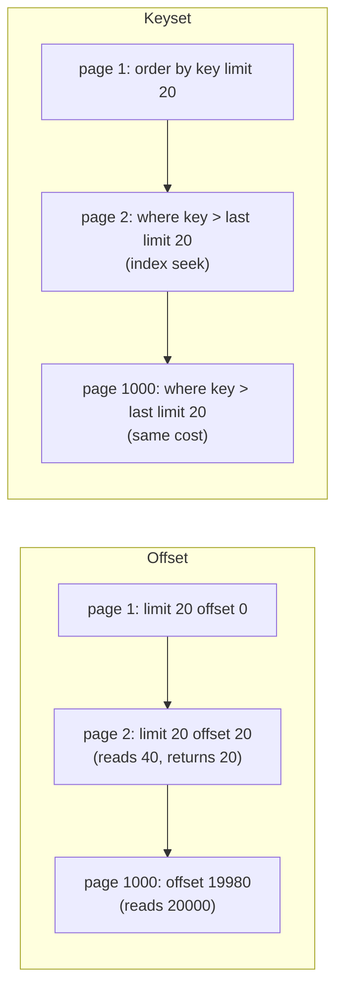

# Pagination: `iterateChunks`, `paginateByCursor`, `paginateByOffset`

Three methods on the select builder read a result piece by piece, each piece its own query ([select-query-builder.ts](select-query-builder.ts), [pagination.ts](pagination.ts); added in #31). This guide explains pagination from scratch, what SQL each method adds, and the details that make it correct: exact key values, row comparisons, `limit + 1`, cursors.

For reading a big result in one go without holding it in memory, `stream()` is the other tool ([QUERIES.md](QUERIES.md#running-execute-stream-describe-pagination), [EXECUTION.md](EXECUTION.md#streaming)); the [difference](#pagination-vs-stream) is at the end.

## Contents

- [Offset vs keyset pagination](#offset-vs-keyset-pagination)
- [The three methods](#the-three-methods)
- [The SQL they add](#the-sql-they-add)
- [The key rules](#the-key-rules)
- [Exact keys: why the key columns are read as text](#exact-keys-why-the-key-columns-are-read-as-text)
- [Row comparison and the index](#row-comparison-and-the-index)
- [`hasMore` with `limit + 1`](#hasmore-with-limit--1)
- [Cursors](#cursors)
- [Offset pages and `countTotal`](#offset-pages-and-counttotal)
- [They own order, limit and offset](#they-own-order-limit-and-offset)
- [How each page runs](#how-each-page-runs)
- [Concurrency and transactions](#concurrency-and-transactions)
- [Pagination vs `stream()`](#pagination-vs-stream)
- [Decisions](#decisions)
- [Glossary](#glossary)

## Offset vs keyset pagination

Suppose you show posts 20 at a time, newest first. There are two ways to ask for page 3:

**Offset**: "skip 40 rows, take 20":

```sql
select … from posts order by created_at desc, id desc limit 20 offset 40
```

Simple, and it supports "jump to page 57". But the server still **reads and throws away** the 40 skipped rows (an index can find where the order starts, not where row 41 is), so page 1,000 reads 20,000 rows. And if a row is inserted at the top between two requests, every row shifts down by one: the next page repeats a row; a delete makes it skip one.

**Keyset** (also "seek" or "cursor" pagination): "the 20 rows after the last one I saw":

```sql
select … from posts where (created_at, id) < ($1, $2) order by created_at desc, id desc limit 20
```

`$1, $2` are the last row's key values. An index on `(created_at, id)` jumps straight to that position, so every page costs the same however deep it is, and inserts or deletes elsewhere don't shift the pages. What it can't do is jump to page 57; you can only go to "the next page".



## The three methods

```ts
// a background job over every user, 1000 at a time
for await (const batch of db.selectFrom(users).select(['users.id', 'users.email'])
  .iterateChunks(1000, { by: 'users.id' })) { … }

// an API endpoint: one page after the client's cursor
const { rows, nextCursor, hasMore } = await db.selectFrom(posts)
  .select(['posts.createdAt', 'posts.id', 'posts.title'])
  .where('posts.published', true)
  .paginateByCursor({ perPage: 20, by: ['posts.createdAt', 'posts.id'], direction: 'desc', after: req.query.cursor });

// numbered pages, with the total
const page = await db.selectFrom(users).select(['users.id', 'users.email'])
  .paginateByOffset({ page: 3, perPage: 50, by: 'users.id', countTotal: true }); // page.total
```

| Method                                                             | Returns                                                                | For                          |
| ------------------------------------------------------------------ | ---------------------------------------------------------------------- | ---------------------------- |
| `iterateChunks(size, { by, direction? })`                          | `AsyncGenerator<O[]>`: each batch                                      | jobs that walk a whole table |
| `paginateByCursor({ perPage, by, direction?, after? })`            | `{ rows, nextCursor, hasMore }`                                        | APIs, infinite scroll        |
| `paginateByOffset({ page, perPage, by, direction?, countTotal? })` | `{ rows, page, perPage, hasMore }` (+ `total` with `countTotal: true`) | numbered pages               |

Like `stream()`, they run without `execute()`, so they need a query started from a database (`db.selectFrom(…)`; on a standalone `selectFrom` they throw `The query has no database to run on`). `iterateChunks` is an async generator: nothing runs, and nothing is checked, until its first batch is pulled. The two `paginate…` methods are `async`: they run when called, and their errors are rejections. None throws because of the rows it gets back, with two exceptions: `InvalidCursorError`, for an `after` that isn't a cursor made for the same key and direction, and `… can't seek past a null`, for a key column that came back null anyway (a column of a left-joined table, keyed from JavaScript, where the types don't stop it).

## The SQL they add

Each adds exactly the clauses its name implies, to the query as built (its `where`, joins, `groupBy`/`having`/`distinct`, locks and `tag` are kept). The real compiled query (line breaks added) of the seek page `paginateByCursor` sends for the example above, after a first page, with `posts.id` a `bigint` column:

```sql
select "posts"."created_at" as "createdAt", "posts"."id" as "id", "posts"."title" as "title"
from "posts"
where ("posts"."published" = $1 and ("posts"."created_at", "posts"."id") < ($2, $3))
order by "posts"."created_at" desc, "posts"."id" desc
limit $4
-- params: [true, '2026-10-17 03:51:00.123456+00', '42', 21]
-- paramCodecs: bool, timestamptz (text), int8 (text)    resultCodecs: raw, raw, text
```

| Method                            | First request                                               | Later requests                                 |
| --------------------------------- | ----------------------------------------------------------- | ---------------------------------------------- |
| `iterateChunks(n)`                | `order by key limit n`                                      | `where … and key > last order by key limit n`  |
| `paginateByCursor(perPage)`       | `order by key limit perPage + 1`                            | with `after`: `where … and key > cursor's key` |
| `paginateByOffset(page, perPage)` | `order by by limit perPage + 1 offset (page − 1) × perPage` | the same                                       |

With `direction: 'desc'` the comparison is `<` and the order descending. `seekPage(node, keyset, after, limit)` builds the node; `seek(keyset, after)` builds the condition, and-ed onto the existing `where` (flattened into its `and` if it is one). The first page above is the same query without the seek: `where "posts"."published" = $1 order by … limit $2`, with `[true, 21]`. The `limit` is a parameter, like any value.

`iterateChunks` stops after a batch with fewer than `size` rows, or an empty one. When the table's row count is an exact multiple of `size`, that costs one final query returning nothing; `paginateByCursor`'s `limit + 1` avoids that ([below](#hasmore-with-limit--1)).

## The key rules

<a id="the-key-rules"></a>
`by` is one column or several, most significant first, that **together are unique**. For `iterateChunks` and `paginateByCursor`, each key column must also be:

- **non-null**: a seek can't continue past a NULL (NULL compares as unknown, so `key > NULL` matches nothing);
- **selected under its own name**: each page's last row gives the next page's start, so the key has to be in the rows, as a top-level key (a column inside a `nest()` object doesn't count, [QUERIES.md](QUERIES.md#nest-a-tables-columns-as-one-object)).

The types enforce both (`KeyColumn<T, O, N>`, where `N` is the row's `nest` keys, excluded since #44; [TYPES.md](TYPES.md#keyset-keys-keycolumn)); `resolveKeyset` checks them again at run time, for JavaScript callers and for a selected key that came from another table (selecting `id` from `users.id` while keying by `posts.id`). quarry doesn't add a hidden key selection: that would change the SQL and the rows behind your back.

A key that isn't unique skips the rows that tie with the last row of a page; the usual fix is to add the primary key as the last key column (`['posts.createdAt', 'posts.id']`).

## Exact keys: why the key columns are read as text

The next page starts from the last row's key, and it must be the **exact** value the database holds. That isn't always what the decoded value is. A `timestamptz` decodes to a JavaScript `Date`, which has **millisecond** precision; Postgres keeps **microseconds**. `created_at default now()` almost always has microseconds. Sending the `Date` back would seek from `…:00.123` instead of `…:00.123456`:

- descending, `created_at < '…:00.123'` skips the rows between `.123000` and `.123456`;
- ascending, `created_at > '…:00.123'` re-reads rows, and when the first key column ties across a batch boundary, `iterateChunks` **looped forever**. #31's integration tests caught it. (Prisma has this problem with `DateTime` cursors; Laravel avoids it because PHP's PDO returns strings.)

So `seekPage` reads the key columns as the server's **text** (`codecs.raw` as their result codec; the SQL doesn't change, only how they're decoded), and `readKeys` then:

1. keeps the last row's key text, which is exactly what the database printed;
2. decodes each key column with its own codec before the rows are returned (`record[alias] = codec.decodeText(text)`), so your rows still have `Date`s, numbers, and so on.

The seek parameters are sent as that text with the key column's codec type declared (`asText(codec)`: text format, the column's OID), so `'2026-10-17 03:51:00.123456+00'` is parsed by the server as a `timestamptz` with all its microseconds. A key value that comes back decoded anyway (an executor that ignores the result codec) is encoded back with its codec; a binary-only encoding is refused except for `bytea`, which is sent as `\x…` hex.

## Row comparison and the index

For a composite key, the seek is a **row comparison**: `(a, b) > ($1, $2)` means "a is greater, or a is equal and b is greater", exactly the lexicographic order of `order by a, b`. Postgres can serve it with a B-tree index on `(a, b)` as one range scan (#31's integration test checks the plan uses the primary-key index). The expanded form, `a > $1 or (a = $1 and b > $2)`, is equivalent but often not planned as one index range.

The row comparison only works when **every key column has the same direction**, which is why `direction` applies to all of them: with mixed directions (`a desc, b asc`) the tuple order no longer matches the sort, and the seek would have to be the expanded form, which an index serves less well.

## `hasMore` with `limit + 1`

`paginateByCursor` and `paginateByOffset` ask for **one more row** than the page (`limit perPage + 1`). If it comes back, there is a next page (`hasMore: true`); the extra row is dropped from `rows`. That answers "is there more?" in the same query, without a count and without an empty last request. (`iterateChunks` uses a plain `limit size`, which costs one empty query at the end of an exact multiple.)

## Cursors

`nextCursor` is base64url of JSON: `{ by: ['posts.createdAt', 'posts.id'], direction: 'desc', after: ['2026-…', '42'] }` (`encodeCursor`). It is opaque to clients (they pass it back as `after`), but **not signed or encrypted**. `decodeCursor` checks its structure and that it was made for the same key and direction, rejecting anything else with `InvalidCursorError`. A client who edits the key values gets at most a different starting point within the same query (whose `where` still applies) or a server error for a value that doesn't parse; so cursors don't carry authorization.

A real cursor for the page after the row keyed `('2026-10-17 03:51:00.123456+00', '42')`, decoded:

```json
{
  "by": ["posts.createdAt", "posts.id"],
  "direction": "desc",
  "after": ["2026-10-17 03:51:00.123456+00", "42"]
}
```

`decodeCursor` accepts only the base64url alphabet, JSON with exactly those three fields, as many `by` and `after` strings as the key has columns, and a `direction` of `asc` or `desc`. The messages are `Invalid cursor: not a cursor paginateByCursor() made` and, for a cursor of another key or direction, `Invalid cursor: made for by posts.id asc, not posts.createdAt, posts.id desc`.

## Offset pages and `countTotal`

`paginateByOffset` adds `order by by limit perPage + 1 offset (page − 1) × perPage`. `by` should be unique so every row is on exactly one page; it may be any column in scope (it isn't read back).

With `countTotal: true` it also runs a count, **in the same round trip**, through `executor.batch` (a default batch: two statements, each with its own Sync, in one write, on one of the pool's shared connections; [EXECUTION.md](EXECUTION.md#batches)). Captured:

- normally the same `from`, joins and `where` with one selection, without locks: for `selectFrom(posts).select(['posts.id']).forUpdate().skipLocked()`, the page is `select "posts"."id" as "id" from "posts" order by "posts"."id" asc limit $1 offset $2 for update skip locked` and the count `select count(*) as "count" from "posts"`;
- over a query with `groupBy`, `having` or `distinct`, the query itself (without locks) as a subquery, since the number of rows is the number of groups: `select count(*) as "count" from (select "posts"."author_id" as "authorId" from "posts" group by "posts"."author_id") as "quarry_rows"`.

The count is read in array row mode and turned into a number (`total`). If either statement fails, the method rejects with that statement's error (not a `BatchError`: it reads `executor.batch`'s settled outcomes itself).

No pagination method counts by default: counting reads every matching row, which on a large table costs more than the page itself.

## They own order, limit and offset

Each method sets `order by`, `limit` and `offset` itself. If the query already has `orderBy()`, `limit()` or `offset()`, it throws **before running anything** (for `iterateChunks`, at the first pull; the `paginate…` methods reject), naming the clauses to remove: `` iterateChunks() sets the query's order by, limit and offset itself: remove orderBy(), and order with `by` and `direction` ``. Combining them would silently produce a different order than the seek assumes. This is a run-time check: tracking these clauses in the builder's type parameters would touch every method's signature.

## How each page runs

Each page or batch is one `executor.execute` of a freshly compiled query (with `countTotal`, one `executor.batch` of two), exactly as `execute()` would run it ([EXECUTION.md](EXECUTION.md#execute-step-by-step)):

- **Options.** Every method's options include `signal` and `timeout` (`RunOptions`), passed to each query it runs. For `iterateChunks`, that means each batch: a `timeout` bounds every batch's query on its own, not the whole iteration, and an aborted `signal` fails the batch in flight, or the next one to start.
- **Sizes.** `size` and `perPage` must be whole numbers from 1, and `page` too: a `RangeError` otherwise (`iterateChunks() takes a whole number of rows, at least 1, as size, not 0`, `paginateByOffset() takes a page from 1, not 0`).
- **Connections.** On a pool, each query runs on the pool's shared, pipelined connections, like any plain query ([EXECUTION.md](EXECUTION.md#connections-shared-or-exclusive)); between batches nothing is held, so leaving an `iterateChunks` loop early (`break`, a throw) has nothing to close. Built from `tx`, every query runs on the transaction's connection.
- **Events.** Each query reports its own `onQuery` event of kind `'execute'` and, with a tracer, its own span, carrying the query's `tag` ([EXECUTION.md](EXECUTION.md#onquery-events)).
- **Rows.** Rows are decoded as `execute()` decodes them; the key columns, read as text, are decoded by their codecs before the rows are returned ([above](#exact-keys-why-the-key-columns-are-read-as-text)).

## Concurrency and transactions

- **Outside a transaction**, each batch or page is its own statement and sees the rows committed when it runs: rows inserted ahead of the cursor's position show up, rows behind it don't, and no row is read twice (the seek is by value, not by position).
- **Built from `tx`**, every batch runs in that transaction. Under `repeatable read`, the whole iteration sees one snapshot; with `forUpdate()`, the locks are held until commit (`for update … skip locked` is rendered after `limit`).

## Pagination vs `stream()`

|                      | `iterateChunks`                                      | `stream()`                                                                         |
| -------------------- | ---------------------------------------------------- | ---------------------------------------------------------------------------------- |
| Queries              | one per batch, each with a seek                      | one, through a cursor                                                              |
| Between batches      | holds nothing: no connection, no cursor, no snapshot | holds a connection (outside a transaction) and a snapshot, which holds back vacuum |
| Order                | by the key, always                                   | whatever the query says, or none                                                   |
| Cost per batch       | an index seek                                        | nothing extra                                                                      |
| Consistency          | each batch sees committed rows, in key order         | one snapshot for the whole result                                                  |
| Resume after a crash | from the last key                                    | from the start                                                                     |

Use `stream()` for "read this result now, fast"; `iterateChunks` for long jobs that do work per batch, over tables that are written meanwhile.

## Decisions

Each links to its full entry (what, why, alternatives, cost, measured impact) in [DECISIONS.md](DECISIONS.md):

- [Keyset seek with a row comparison](DECISIONS.md#keyset-seek-with-a-row-comparison)
- [Exact-text keys](DECISIONS.md#exact-text-keyset-keys)
- [`limit + 1` for `hasMore`, no count by default](DECISIONS.md#limit--1-for-hasmore-no-count-by-default)
- [Pagination owns order, limit and offset](DECISIONS.md#pagination-owns-order-limit-and-offset)
- [Unsigned base64url JSON cursors](DECISIONS.md#unsigned-base64url-json-cursors)
- [Key rules in the types: non-null and selected under its own name](DECISIONS.md#key-rules-in-the-types-non-null-and-selected-under-its-own-name)
- [`iterateChunks` alongside `stream()`](DECISIONS.md#iteratechunks-alongside-stream)

## Glossary

**Cursor** (pagination): an opaque string marking where the next page starts. (Unrelated to a database cursor, which `stream()` uses.)

**Keyset / seek pagination**: fetching the rows after the last key seen, with `where key > last`.

**Offset pagination**: skipping a number of rows with `offset`.

**Row comparison**: comparing tuples, `(a, b) > (x, y)`, in lexicographic order.

**Snapshot**: the consistent view of the data a statement or transaction reads.
