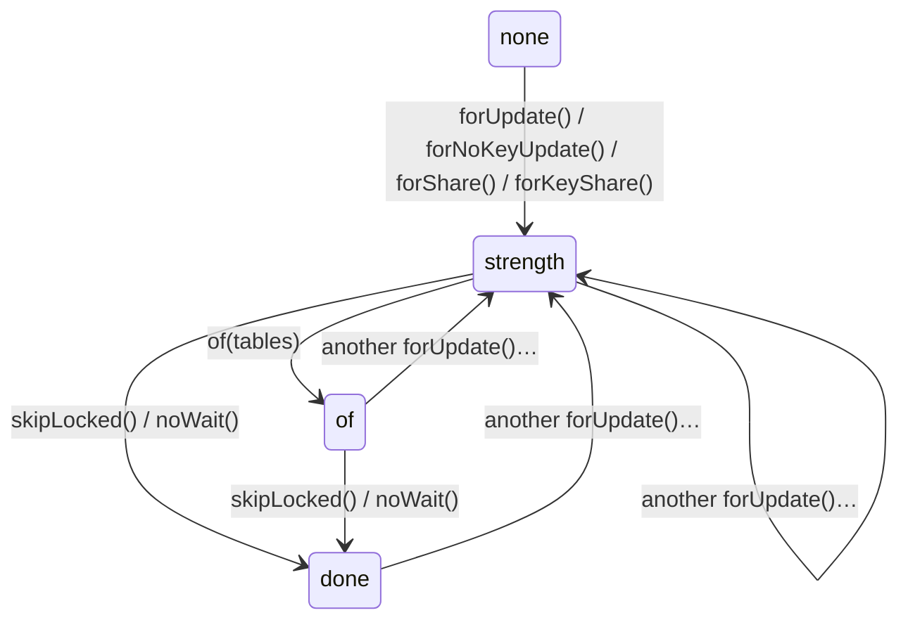

# How the types work

quarry's main promise is that a wrong query doesn't compile. This guide explains, from the ground up, the TypeScript that makes that true: how a table definition becomes a set of column references, how the builder knows the type of every expression and every result row, and how builders remember in their types what they still need.

It assumes you know ordinary TypeScript (interfaces, classes, `string | number` unions, generics like `Array<T>`). Everything beyond that is introduced as it is needed, in [Part 1](#part-1-the-typescript-you-need). If you already know conditional and mapped types, skip to [Part 2](#part-2-phantom-types).

Related: [column/README.md](column/README.md) (what columns are), [EXPRESSIONS.md](EXPRESSIONS.md) (what the expression builder does at run time), [QUERIES.md](QUERIES.md) (the builders' methods).

## Contents

- [Part 1: The TypeScript you need](#part-1-the-typescript-you-need)
- [Part 2: Phantom types](#part-2-phantom-types)
- [Part 3: Scope: which columns you can reference](#scope-which-columns-you-can-reference)
- [Part 4: Expressions and their methods](#part-4-expressions-and-their-methods)
- [Part 5: Null propagation](#part-5-null-propagation)
- [Part 6: Result row types](#part-6-result-row-types)
- [Part 7: Builder state in type parameters](#builder-state-in-type-parameters)
- [Part 8: Tricks for better errors](#part-8-tricks-for-better-errors)
- [Part 9: Type-checking speed](#type-checking-speed)
- [Testing the types](#testing-the-types)
- [Decisions](#decisions)
- [Glossary](#glossary)

## Part 1: The TypeScript you need

### Types are a second program

A TypeScript program is really two programs. The **value** program runs. The **type** program runs only in the compiler and the editor, and its "values" are types. Everything in this guide is the type program: it computes, from your table definitions, what each query's rows look like, and rejects calls that don't fit. None of it exists at run time.

### Generics, constraints and defaults

A **type parameter** is a variable in the type program:

```ts
function first<T>(items: T[]): T | undefined {
	return items[0];
}
first([1, 2]); // T is inferred as number
```

- `T extends Something` is a **constraint**: `T` must be assignable to `Something`. `function integer<T extends number = number>()` means "`T` is some kind of number, `number` if you don't say".
- `= number` is a **default**, used when `T` can't be inferred and isn't given.
- **Inference**: the compiler picks type arguments from the arguments you pass. Much of quarry's design is about making inference produce precise types.

### Literal types and `const` type parameters

`'users'` is a type, not just a value: the type whose only value is the string `'users'`. A **literal type** lets the type program reason about specific names:

```ts
function defineTable<N extends string>(name: N) { … }
defineTable('users'); // N is 'users', not string
```

`<const T>` asks the compiler to infer the most literal type it can, even for arrays and objects: `defineEnum('status', ['a', 'b'])` infers `['a', 'b']` and the label type `'a' | 'b'`, where it would otherwise infer `string[]`.

### `keyof`, indexed access and mapped types

```ts
type User = { id: number; name: string };
type Keys = keyof User; // 'id' | 'name'
type IdType = User['id']; // number            (indexed access)
type Optional = { [K in keyof User]?: User[K] }; // a mapped type: every key optional
```

A **mapped type** `{ [K in Keys]: … }` builds an object type by looping over a union of keys. With an `as` clause it can rename keys, or drop them by mapping to `never`:

```ts
type WithoutId = { [K in keyof User as K extends 'id' ? never : K]: User[K] };
// { name: string }
```

### Template literal types

Types can build strings:

```ts
type Ref<T extends string, C extends string> = `${T}.${C}`;
type R = Ref<'users', 'id' | 'name'>; // 'users.id' | 'users.name'
```

A template over a union produces every combination. This is how a table's references (`'users.email'`) are made from its name and column keys.

### Conditional types and `infer`

A **conditional type** is an `if` in the type program:

```ts
type IsString<T> = T extends string ? 'yes' : 'no';
```

`infer` captures part of a type while matching:

```ts
type ElementOf<T> = T extends readonly (infer E)[] ? E : never;
type E = ElementOf<string[]>; // string

type ColumnOf<R> = R extends `${string}.${infer C}` ? C : never;
type C = ColumnOf<'users.email'>; // 'email'
```

### Distribution, and the `never` test

A conditional type on a **naked** type parameter **distributes** over unions: `IsString<string | number>` is `IsString<string> | IsString<number>`, i.e. `'yes' | 'no'`. That is usually what you want.

<a id="conditional-types-and-the-never-test"></a>
It has one trap: `never` is the empty union, so a distributive conditional over `never` gives `never` without evaluating either branch. To ask "is `X` never?", wrap both sides in a tuple to switch distribution off:

```ts
type IsNever<X> = [X] extends [never] ? true : false;
```

You will see `[X] extends [never]` throughout quarry: in row types (a column whose insert type is `never` is dropped), in `WriteOutput` (`[O] extends [undefined]`), in `ValueArgs`.

### `never`, `unknown`, `any`

- `never`: the type with no values. A function parameter of type `never` can't be called with anything; a key mapped to `never` is dropped.
- `unknown`: any value, but you must check it before using it. quarry uses it for "some type, I don't care which", because unlike `any` it doesn't switch checking off.
- `any`: switches checking off. quarry avoids it.

### Overloads and `this` parameters

A function type can have several **call signatures**; the compiler picks the first that fits:

```ts
interface Condition<R, B> {
	<C extends Ref<R>>(column: C, value: …): B; // where('users.id', 1)
	(group: (eb) => AnyPredicate): B;           // where((eb) => …)
	(predicate: AnyPredicate): B;               // where(predicate)
}
```

A method can declare the type `this` must have to call it, as a fake first parameter:

```ts
execute(this: WriteQueryBuilder<O, never>, options?: RunOptions) { … }
```

Calling `execute()` on a builder whose type doesn't match is a type error. This is how a builder "unlocks" methods once it is complete ([Part 7](#builder-state-in-type-parameters)).

## Part 2: Phantom types

<a id="phantom-types"></a>
A **phantom type** is a type carried by a value but backed by nothing at run time. quarry uses them to attach precise types to objects without storing anything extra.

```ts
export abstract class BaseColumn<D extends DataType, S, I, U> {
	declare readonly $select: S;
	declare readonly $insert: I;
	declare readonly $update: U;
	readonly _quarry: { readonly dataType: D; … };
}
```

`declare readonly $select: S` tells the compiler "this property exists and has type `S`" without emitting any JavaScript for it. At run time `column.$select` is `undefined`. But in the type program, `typeof column['$select']` is the column's select type, which is all the row-type machinery needs.

Why not just use the type parameters? Because TypeScript compares objects **structurally**: two class instances are the same type if their properties match. A type parameter that appears in no property is invisible to that comparison: `Column<D, string>` and `Column<D, number>` would be interchangeable. A phantom property makes the parameter part of the structure, so they are not.

The same trick, everywhere:

| Where                                              | Phantom                                    | Carries                                        |
| -------------------------------------------------- | ------------------------------------------ | ---------------------------------------------- |
| [column/base-column.ts](column/base-column.ts)     | `$select`, `$insert`, `$update`            | the column's three TypeScript types            |
| [table.ts](table.ts)                               | `$refs`                                    | every `table.column` reference and its column  |
| [expression.ts](expression.ts)                     | `_quarry.$type?: T`                        | the type an expression evaluates to            |
| [expression.ts](expression.ts) `Quantified`        | `$element`, `$dataType`, `$null`, `$typed` | what `any(…)`/`all(…)` holds                   |
| [select-query-builder.ts](select-query-builder.ts) | `$output`, `$lock`                         | the result row; the locking state              |
| [write-query.ts](write-query.ts)                   | `$output`, `$missing`                      | the `returning` row; the clauses still missing |
| [query.ts](query.ts)                               | `$result`                                  | what `execute()` resolves to                   |

On expressions the phantom is optional (`$type?: T`) so the object can be constructed without it; `Expression<infer T>` still infers `T` from it.

## Scope: which columns you can reference

<a id="part-3-scope-which-columns-you-can-reference"></a>
"Only tables in the query can be referenced" is enforced by a type: the **scope** `R`, an object type from reference strings to columns.

### A table's references

Each table's phantom `$refs` ([table.ts](table.ts)) maps `'users.email'` to the `email` column, and so on (see [column/README.md](column/README.md#refs-the-tables-references)).

### Merging tables: `RefsOf`

A query's scope is the merge of the `$refs` of its tables, in [refs.ts](refs.ts):

```ts
export type RefsOf<T extends readonly AnyTable[]> =
	RefsOfTuple<T> extends infer R extends Refs ? R : never;

type RefsOfTuple<T extends readonly AnyTable[]> = T extends readonly [
	...infer Init extends readonly AnyTable[],
	infer Last extends AnyTable,
]
	? RefsOfTuple<Init> & Last['$refs']
	: unknown;
```

A select builder's first type parameter `T` is a **tuple** of its tables, `[typeof posts]`, then `[typeof posts, typeof users]` after a join. `RefsOfTuple` peels the last table off and intersects its `$refs` with the merge of the rest. Why from the end? Because a join's tuple is the previous tuple plus one table, so `RefsOf<[...T, J]>` is `RefsOf<T> & J['$refs']`, and the compiler has already computed `RefsOf<T>` for the previous step. A chain of n joins costs n steps instead of n².

### A reference

```ts
export type Ref<R extends Refs> = keyof R & string;
```

The type of a reference argument is `Ref<R>`: the union of every key in scope. That is what makes autocomplete list `'users.email'` and rejects `'users.emial'`.

### How a join grows the scope

```ts
// select-query-builder.ts
innerJoin<J extends AnyTable>(table: J): JoinBuilder<T, J, O, L> { … }
// JoinBuilder.on returns SelectQueryBuilder<[...T, J], O, L>
```

`innerJoin(users)` doesn't add `users` to the scope of the builder you called it on; it returns a `JoinBuilder` whose `on` callback already sees `[...T, J]` (so the condition can reference the joined table), and whose result is a `SelectQueryBuilder<[...T, J], …>`. Before the join, `'users.email'` is not a `Ref` of the scope, so using it is a type error.

At run time the same happens with real tables: `expressionBuilder(...tables)` ([expression-builder.ts](expression-builder.ts)) resolves `'users.email'` by finding the table named `users` in its list (each column once per table, then shared: [EXPRESSIONS.md](EXPRESSIONS.md#references-ebref)), and throws `Unknown column reference` if it can't (only reachable by casting around the types). The `WhereBuilder` is **rescoped** to the new tables after a join (`where.rescope(…)`) so conditions added later can reference them.

### Operands: a reference or a typed expression

Functions take "a reference or an expression of SQL type `D`" ([refs.ts](refs.ts)):

```ts
export type RefsWith<R extends Refs, D extends DataType> = {
	[K in Ref<R>]: R[K]['_quarry']['dataType'] extends D ? K : never;
}[Ref<R>];

export type Operand<R extends Refs, D extends DataType = DataType> =
	(DataType extends D ? Ref<R> : RefsWith<R, D>) | TypedExpression<unknown, D>;
```

`RefsWith<R, DataType<TextKind>>` is "the references in scope whose column is a text type": it maps each key to itself or `never` and then indexes the object with all keys, collecting the survivors into a union. So `eb.fn.lower('users.id')` is a type error: `'users.id'` isn't a text reference. `TypeOf<R, A>` and `DataTypeOf<R, A>` then read an operand's TypeScript type and SQL type, whether it is a reference or an expression.

## Part 4: Expressions and their methods

### Two type parameters: TypeScript type and SQL type

```ts
class Expression<T> { _quarry: { $type?: T; node: OperationNode } }
class TypedExpression<T, D extends DataType> extends Expression<T> { _quarry: { …; dataType: D } }
```

`T` is the JavaScript type the value arrives as (`string`, `number | null`); `D` is its SQL type (`DataType<'text'>`). Both matter, and they're different: `text`, `uuid` and `bigint` are all `string` in JavaScript, but only `text` has `like`, and `uuid` won't compare with `text`. Positions that need to know the SQL type (comparison methods, function arguments) take a `TypedExpression`. A bare parameter (`eb.val(x)`) is only an `Expression`: its SQL type is whatever Postgres infers.

### `Expr`: an expression with the methods of its kind

What `eb.ref('users.email')` returns ([operators.ts](operators.ts)):

```ts
export type Expr<T, D extends DataType> = TypedExpression<T, D> &
	(MethodsByKind<NonNullable<T>, D, Extract<T, null>>[D['kind']] extends infer M
		? M
		: never);
```

Step by step:

1. `MethodsByKind<S, D, N>` is an interface with one property per kind: `text: TextMethods<S, DataType<TextKind>, N>`, `uuid: EqualityMethods<S, DataType<'uuid'>, N>`, `tsvector: TsvectorMethods<N>`, and so on.
2. `[D['kind']]` picks the entry for this expression's kind. For `users.email`, `D` is `DataType<'text'>`, so it's `TextMethods`: `eq`, `ne`, `in`, `gt`, …, `like`, `ilike`, `regex`, `startsWith`, …
3. `NonNullable<T>` is the value type without `null` (`= null` is never true in SQL, so no comparison takes `null`); `Extract<T, null>` is `null` if the expression can be null, else `never`: it feeds [null propagation](#part-5-null-propagation).
4. `extends infer M ? M : never` looks pointless, but it **defers** the lookup until `D` is a concrete type. In a generic signature such as `ref<C>(column: C): Expr<R[C]['$select'], R[C]['_quarry']['dataType']>`, `D` is still a type variable; indexing `MethodsByKind` by an unknown kind would make the compiler instantiate every kind's methods for every scope. With the deferral it waits until `C` is known.

The intersection `TypedExpression<T, D> & Methods` gives an object with both the expression data and the methods. At run time, the methods are attached to a class prototype ([EXPRESSIONS.md](EXPRESSIONS.md#how-methods-exist-at-run-time)); the types above describe them per kind.

### Operand types: what each method accepts

[operators.ts](operators.ts) defines the right-hand sides:

```ts
export type One<S, D extends DataType> = S | TypedExpression<unknown, D>;
export type Binary<S, D extends DataType> =
	| One<S, D>
	| Quantified<S, D, null> // any([...values]) / all(...)
	| Quantified<unknown, D, null, true>; // any(arrayExpression)
export type List<S, D extends DataType> =
	| readonly One<S, D>[]
	| TypedExpression<unknown, ArrayType<D>>
	| Param<readonly S[] | null>;
```

- A **value** must be an `S`: the column's TypeScript type, so `eb.ref('users.age').gte('18')` fails.
- An **expression** is checked only by its SQL type `D` (its TypeScript type is `unknown` here): a branded `UserId` column compares with a plain integer column, `integer` with `bigint`, a narrowed `text<'a' | 'b'>` with plain `text`, exactly as Postgres allows.
- `Binary` adds `any`/`all`; `List` is what `in` takes.

Which SQL types are compatible is `ComparableType` / `OperandOf`:

```ts
type Comparable<K extends Kind> = K extends TextKind
	? TextKind
	: K extends NumberKind
		? NumberKind
		: K extends TimestampKind
			? TimestampKind
			: K;
type ComparableType<D extends DataType> = D extends EnumType | CustomType
	? D
	: DataType<Comparable<D['kind']>>;
```

Every text type compares with every text type, every number type with every number type, `date`/`timestamp`/`timestamptz` with each other; everything else only with itself; an enum or custom type only with the **same** one (its type carries its name).

### Why `eq<V extends Q>(value: V)` and not `eq(value: Q)`

```ts
eq<V extends Q>(value: V): Predicate<N | NullIn<V>>;
```

The method is generic in its argument so the **result** type can depend on the argument: comparing with an expression that can be null makes the predicate nullable ([next part](#part-5-null-propagation)).

## Part 5: Null propagation

In SQL, any comparison involving NULL is NULL ("unknown"). `where` treats unknown as false, but the difference matters when predicates are combined (`not (x = 1)` is NULL, not true, when `x` is NULL) or selected as values. quarry tracks it in types.

```ts
export type Predicate<N extends null = never> = Expr<
	boolean | N,
	DataType<'boolean'>
>;
```

A `Predicate` is a boolean expression; `Predicate<null>` may be NULL. Each comparison method returns `Predicate<N | NullIn<V>>`:

- `N` is `null` when **this** side can be null (from `Extract<T, null>` in `Expr`).
- `NullIn<V>` is `null` when the **argument** can be: an expression whose type includes `null`, a list containing one, `any(…)` of a nullable array.

```ts
eb.ref('users.email').eq('a'); // Predicate<never>: boolean
eb.ref('users.name').eq('a'); // Predicate<null>: name is nullable
eb.ref('users.email').eq(eb.ref('users.name')); // Predicate<null>: the operand is
eb.ref('users.name').isNull(); // Predicate: never null itself
eb.ref('users.name').isDistinctFrom('a'); // Predicate: null-safe
```

`and`, `or` and `not` ([expression-builder.ts](expression-builder.ts)) propagate it: `Predicate<NullOf<E[number]['_quarry']['$type']>>`, null if any operand can be. Values (`'a'`) never contribute: a value is never null, since no comparison accepts `null`.

`NullIn` looks one level into arrays and no further: a JSON value nests without end, so recursing would never terminate on `JsonValue`.

## Part 6: Result row types

### The select list

[row.ts](row.ts):

```ts
export type Selection<R extends Refs> =
	Ref<R> | AliasedExpression<unknown, string>;

export type KeyOf<S> = S extends `${string}.${infer C}`
	? C
	: S extends AliasedExpression<unknown, infer A>
		? A
		: S extends Nested<unknown, infer A> // nest's object
			? A
			: never;

export type ValueOf<R extends Refs, S> =
	S extends Ref<R>
		? R[S]['$select']
		: S extends AliasedExpression<infer T, string>
			? T
			: S extends Nested<infer T, string>
				? T
				: never;

export type RowOf<R extends Refs, S> = { [K in S as KeyOf<K>]: ValueOf<R, K> };
```

`select(['users.id', 'users.name'])` has `S = 'users.id' | 'users.name'`. `RowOf` maps each selection to a key (the part after the dot, or the alias) and a type (the column's `$select`, or the expression's `T`): `{ id: number; name: string | null }`.

The method signature uses `const S extends readonly Selection<RefsOf<T>>[]` so the array is inferred as a tuple of literal strings, not `string[]`.

### Adding to the row: `AddRow`

Each `select` call adds columns: the builder's row type `O` becomes `AddRow<O, RowOf<…>>`:

```ts
export type AddRow<O, A> = [keyof O] extends [never]
	? A
	: [keyof A] extends [never]
		? O
		: Prettify<O & A>;
```

If either side is empty it returns the other unchanged, avoiding a `Prettify` of an intersection on the common first `select` (cheaper, and hovers show the columns rather than an alias). `Prettify<T> = { [K in keyof T]: T[K] } & {}` flattens `{ a: 1 } & { b: 2 }` into `{ a: 1; b: 2 }` for readable hovers.

### `when`: columns that may be missing

```ts
type WhenRow<O, P> = [keyof P] extends [never] ? O : Prettify<O & Partial<P>>;
```

`qb.when(flag, (qb) => qb.select(['users.email']))` may or may not add `email`, so the row gets `email?: string`. The callback receives a `Fragment<T>`, a builder over the same tables with an **empty** row, so `P` is just what the callback selected.

### `pipe`: fragments that join

`pipe(piece)` adds a fragment's joins and columns. Its return type is `SelectQueryBuilder<[...T, ...JoinedBy<Q, P>], AddRow<O, Q['$output']>, …>`, where `JoinedBy` reads the tables the fragment's own query has beyond the ones it was declared over:

```ts
type JoinedBy<Q, P extends readonly AnyTable[]> =
	Q extends SelectQueryBuilder<infer T, unknown, LockState>
		? T extends readonly [...P, ...infer J extends AnyTable[]]
			? J
			: never
		: never;
```

### Outer joins: `NullableTable`

<a id="outer-joins-nullabletable"></a>
A left join keeps rows with no match, so the joined table's columns can be NULL in the result even when the columns are `not null`. The scope must say so, or `row.title` would be typed `string` and arrive as `null`. [table.ts](table.ts):

```ts
interface NullableColumn<C extends AnyColumn> {
	readonly $select: C['$select'] | null; // only this changes
	readonly $insert: C['$insert'];
	readonly $update: C['$update'];
	readonly _quarry: C['_quarry']; // same SQL type, methods and codec
	readonly $inner?: C; // phantom: the column itself, for `nest`
}
type NullableTable<X> =
	X extends Table<infer N, infer S>
		? Table<
				N,
				{
					columns: {
						[K in keyof S['columns']]: NullableColumn<S['columns'][K]>;
					};
				}
			>
		: never;
```

`leftJoin(posts)` puts `NullableTable<typeof posts>` into the scope tuple; `rightJoin` turns the earlier tables into `NullableTables<T>` (a mapped tuple type) **and** the row already selected into `NullableRow<O>` (every key `| null`); `fullJoin` does both. Since only `$select` changes, comparisons on an outer table still take the column's values and its codec still decodes it: nullability is a property of the row, not of the SQL type. The run-time table object is the same; the cast in each join method is the type-level change only.

`$inner` is optional, so a table is still assignable to its nullable type (`selectAll(posts)` on a left-joined `posts`). It lets `nest` tell an outer table from the others (`'$inner' extends keyof C`) and read each column as the table reads it in a row it has, unwrapped through every outer join.

### `nest`: an object per table

<a id="nest-an-object-per-table"></a>
[nest.ts](nest.ts). A select callback's `eb` is a `SelectBuilder<T>`: `ExpressionBuilder<RefsOf<T>>` plus `nest: Nest<T>`. `nest` works over the scope's tables `T`, not its references `R`, so finding a table by name is `Extract<T[number], { name: N }>` rather than a scan of every reference:

```ts
interface Nest<T extends readonly AnyTable[]> {
	<N extends T[number]['name']>(table: N): Nested<NestedRow<TableNamed<T, N>, ColumnKey<TableNamed<T, N>>>, N>;
	<N extends T[number]['name'], const C extends readonly [ColumnKey<…>, ...ColumnKey<…>[]]>(
		table: N,
		columns: C,
	): Nested<NestedRow<TableNamed<T, N>, C[number]>, N>;
}

type NestedRow<X extends AnyTable, K extends ColumnKey<X>> =
	IsOuter<X['schema']['columns'][K]> extends true
		? { [C in K]: InnerColumn<X['schema']['columns'][C]>['$select'] } | null
		: { [C in K]: InnerColumn<X['schema']['columns'][C]>['$select'] };
```

A table on the outer side of a join gives `{…} | null`, with its columns typed as the table's own, since the object exists only where the table has a row. The base table, an inner join and a cross join give `{…}`. A `rightJoin` after a `nest` makes the object nullable through `NullableRow<O>`, like any selected column. A `Nested<T, A>` is a select-list entry like an aliased expression: `KeyOf` gives its key `A` and `ValueOf` its type `T`. So `UniqueKeys` checks the object's key against the row, and never the columns inside it. `.as(B)` gives a `Nested<T, B>`.

### `setEach`: rows in scope

<a id="seteach-rows-in-scope"></a>
`setEach(rows, { key, as })` adds the rows to the update's scope as a pseudo-table named `A` (`'row'` by default). The update builder therefore has a fourth type parameter `R` (its scope, defaulting to `RefsOf<[T]>`), and `setEach` returns `UpdateQueryBuilder<T, O, Exclude<M, UpdateNeeds>, R & SetEachRefs<T, K, A>>`:

```ts
type SetEachRefs<T, K, A> = {
	[C in K | UpdateKey<T> as `${A}.${C}`]: RowColumn<
		Columns<T>[C],
		C extends K
			? NonNullable<Columns<T>[C]['$select']>
			: Columns<T>[C]['$select'] | null
	>;
};
```

- The **rows** are typed by the table, not inferred from the first object: `SetEachRow<T, K>` requires the key columns (non-null) and allows any writable column (`UpdateKey<T>`), each of its update type. `NoInfer` on the parameter stops TypeScript from inferring `K` from the rows instead of from `key`.
- In scope, `row.<key>` is non-null, and every other column is `T | null`, since any row may leave it out (where the `case` keeps the table's value, `row.col` is NULL).
- A `RowColumn` has `$insert`/`$update` of `never`: the rows can be read, never written.

### Keyset keys: `KeyColumn`

`iterateChunks` and `paginateByCursor` take `by` of type `KeyColumn<T, O>` ([pagination.ts](pagination.ts)):

```ts
type KeyColumn<T, O> = {
	[K in Ref<RefsOf<T>>]: null extends RefsOf<T>[K]['$select']
		? never
		: KeyOf<K> extends keyof O
			? K
			: never;
}[Ref<RefsOf<T>>];
```

A key column must be **non-null** (a seek can't continue past a NULL) and **selected under its own name** (each page's last row gives the next page's start). Both are checked again at run time for JavaScript callers ([PAGINATION.md](PAGINATION.md#the-key-rules)). `paginateByOffset` takes any reference, since it doesn't read keys back; its `countTotal: true` overload adds `total: number` to the result type.

### Streams: `RowStream<O>`

`stream()` returns `RowStream<O>`, which is an `AsyncIterator<O>`, `AsyncIterable<O>` and `AsyncDisposable`. Result shapes return a `Query`, which has no `stream` method, so `q.expectOne().stream()` is a type error: only an every-row read streams.

### Writes: `returning` and `WriteOutput`

Write builders start with `O = undefined` ("no `returning`"). `returning([...])` makes `O` a row type, with the same `RowOf`/`AddRow`. What `execute()` resolves to depends on it ([write-query.ts](write-query.ts)):

```ts
export type WriteOutput<O> = [O] extends [undefined] ? WriteResult : O[];
// no returning → { rowCount: number }; with returning → the rows
```

### Result shapes

Each shape returns a `Query<R>` whose `R` is computed from the row `O`: `takeFirst(): Query<O | undefined>`, `expectOne(): Query<O>`, `expectNonEmpty(): Query<[O, ...O[]]>` (a non-empty tuple type), `takeValue(): Query<ColumnValue<O> | undefined>` where `ColumnValue<O> = O[keyof O]`. See [QUERIES.md](QUERIES.md#result-shapes).

### `db.batch`: a tuple of results

```ts
export type BatchResults<Q extends readonly Executable<unknown>[]> = {
	-readonly [K in keyof Q]: Q[K] extends Executable<infer T> ? T : never;
};
```

A mapped type over a **tuple** produces a tuple: `db.batch([a.expectOne(), b])` resolves to `[RowA, RowB[]]`, each element typed by its own query. `-readonly` removes the `readonly` that `const Q` inference adds.

## Builder state in type parameters

<a id="part-7-builder-state-in-type-parameters"></a>
Some rules are about the **order** of calls: an update needs `set` and `where` before it can run; `skipLocked()` only follows a locking clause. quarry encodes these as a type parameter that changes with each call.

### What a write query still needs: `M`

```ts
update(users) // UpdateQueryBuilder<T, undefined, 'set' | 'where'>
	.set({ name: 'Ada' }) // UpdateQueryBuilder<T, undefined, 'where'>
	.where('users.id', 1) // UpdateQueryBuilder<T, undefined, never>
	.execute(); // allowed: M is never
```

- [update-query-builder.ts](update-query-builder.ts): `set(…)` returns `UpdateQueryBuilder<T, O, Exclude<M, 'set'>>`, `where` and `allRows()` return `Exclude<M, 'where'>`. `Exclude<'set' | 'where', 'set'>` is `'where'`.
- [insert-query-builder.ts](insert-query-builder.ts): `M` starts as `'values'`; `values(…)` makes it `never`.
- [delete-query-builder.ts](delete-query-builder.ts): `M` starts as `'where'`.
- `setEach(rows, { key })` returns `Exclude<M, 'set' | 'where'>`: its rows are the values and its generated key match is the condition ([below](#seteach-rows-in-scope)).

The methods that run are gated with `this` parameters in [write-query.ts](write-query.ts):

```ts
execute(this: WriteQueryBuilder<O, never>, options?: RunOptions): Promise<WriteOutput<O>>;
expectRows(this: WriteQueryBuilder<O, never>, count: number, …): Query<WriteOutput<O>>;
takeFirst(this: WriteQueryBuilder<O & object, never>): Query<O | undefined>;
```

`execute()` needs `M` to be `never`. The row shapes additionally need `O & object`, i.e. a `returning` list (`undefined & object` is `never`, which no builder matches). So `deleteFrom(users).execute()` is an error naming the missing `'where'`, and `update(…).set(…).where(…).expectOne()` without `returning` is an error too.

`toQuery()`, which `db.batch` uses, returns `Missing<M>` instead of a `Query` while clauses are missing, so an incomplete write in a batch is a type error as well ([query.ts](query.ts)).

`when(cond, build)` on write builders takes and returns the **same** `M`: what the callback does may not run, so a `where` inside `when` doesn't count as the required one.

### The locking clause: `L`

A select's third type parameter `L extends LockState` ([select-query-builder.ts](select-query-builder.ts)) records what its latest locking clause still accepts:



```ts
of(this: SelectQueryBuilder<T, O, 'strength'>, ...tables): SelectQueryBuilder<T, O, 'of'>;
skipLocked(this: SelectQueryBuilder<T, O, 'strength' | 'of'>): SelectQueryBuilder<T, O, 'done'>;
```

So `.forUpdate().skipLocked().of(jobs)` is a type error (`of` must come right after the strength). The run-time methods check the same rules for code that casts around the types. `when` and `pipe` combine the states with `LockAfter<L, B>`: unchanged if the piece added no locking clause, `'done'` otherwise, since what the piece did may not have happened.

### The select row `O`

`O` starts as `Record<never, never>` (an object with no keys) and grows with each `select`. A `Fragment<T>` is `SelectQueryBuilder<T, Record<never, never>>`: a builder over the given tables with nothing selected, which is what `fragment` and `when` callbacks receive.

## Part 8: Tricks for better errors

### `InScope`: an impossible extra argument

```ts
pipe<P extends readonly AnyTable[], Q extends AnyQuery>(piece: (qb: Fragment<P>) => Q, ..._inScope: InScope<T, P>)

type InScope<T, P> = [P[number]] extends [T[number]] ? [] : [missingTables: Exclude<P[number], T[number]>['name']];
```

When the fragment's tables are all in the query, the rest parameter is the empty tuple: `pipe(piece)` is fine. When one is missing, the signature demands one more argument named `missingTables` whose type is the missing table's name, so the error reads "Expected 2 arguments, but got 1" and points at `missingTables: "contacts"`, which says exactly what is wrong. The same trick is `ValueArgs` in [shape.ts](shape.ts): `takeValue()` on a row with more than one column demands an argument of type `'select exactly one column to read a value'`.

### `NewName` and `UniqueKeys`: the same trick for joins and selections

Two more checks from #32 use an impossible extra argument:

- `innerJoin(table, ..._newName: NewName<T, J>)` and the other joins: if a table of the same name is already in the query, the rest parameter becomes `[alreadyJoined: '"users" is already in the query: join it under another name, e.g. users.as(\'other\')']`, so the error message tells you the fix.
- `select(list, ..._unique: UniqueKeys<O, S>)`, `selectAll(table, ..._unique: UniqueColumns<…>)` and `returning(…)`: if a selection's key is already in the row (or appears twice in the list), the extra argument names the duplicate key.

Both are also checked at run time (`#joined`, `checkUniqueKeys`), because a mistake there silently corrupts results (an ambiguous reference resolves to the first table; a duplicate key loses a column in object rows).

### `NotExecuted`: awaiting a builder

```ts
export interface NotExecuted {
	readonly [notExecuted]: 'A query runs with execute(): await q.expectOne().execute()';
}
export function rejectAwait(_resolve: (value: NotExecuted) => unknown, reject: …): void
```

Builders and queries have `readonly then = rejectAwait`. TypeScript types `await x` by looking at `x.then`'s callback, so `const rows = await db.selectFrom(users)` gives `rows` the type `NotExecuted`, and using it as rows fails with that message in the error. At run time the `await` rejects ([ARCHITECTURE.md](ARCHITECTURE.md#nothing-runs-by-accident)).

### `Unconstrained`: literal arguments without a slow check

```ts
export type Unconstrained<T> = [T] extends [infer U] ? U : never;
```

Used for the value of `where(column, value)` and the right side of `on`. When the compiler checks a literal argument (`where('users.age', 18)`), it first asks whether the parameter type "keeps literals", resolving a still-generic parameter through its constraint: the value type for **every** reference in scope. Wrapping the type makes that pass trivial; once `C` is known, `Unconstrained<T>` is just `T` and errors print `T`.

### Invariant `in out R`

```ts
export interface ExpressionBuilder<in out R extends Refs> { … }
```

**Variance** is how a generic type's assignability follows its parameter's: is an `ExpressionBuilder<{a, b}>` assignable to an `ExpressionBuilder<{a}>`? Without a hint, TypeScript works it out by comparing the whole interface structurally, which for this large interface is slow, and editors redo it on every edit. `in out` declares it **invariant** (only the same `R` matches), which is correct here (a builder is only used with its own scope) and makes the check instant. `Functions<in out R>` and `JsonFunctions<in out R>` do the same.

## Type-checking speed

<a id="part-9-type-checking-speed"></a>
Types that are correct but slow make editors lag on real schemas with dozens of tables. Several choices exist only for speed; the comments in the source explain each:

| Technique                                          | Where                                                                                            | Why                                                                                                                     |
| -------------------------------------------------- | ------------------------------------------------------------------------------------------------ | ----------------------------------------------------------------------------------------------------------------------- |
| `$refs` keys as a union, not a mapped `as` clause  | [table.ts](table.ts)                                                                             | `keyof` of a mapped type with `as` re-instantiates every key on each lookup; a union of keys is computed once per table |
| `RefsOfTuple` merges from the end                  | [refs.ts](refs.ts)                                                                               | each join reuses the previous scope: linear, not quadratic                                                              |
| `Expr` defers its kind lookup with `extends infer` | [operators.ts](operators.ts)                                                                     | avoids instantiating every kind's methods while `D` is still generic                                                    |
| `in out` variance annotations                      | [expression-builder.ts](expression-builder.ts), [functions.ts](functions.ts), [json.ts](json.ts) | skips structural variance measurement                                                                                   |
| `Unconstrained`                                    | [where-builder.ts](where-builder.ts)                                                             | makes the literal-preservation check free                                                                               |
| `JoinColumn` scans per table, matching SQL types   | [select-query-builder.ts](select-query-builder.ts)                                               | the `on` shorthand reuses each table's scan across a join chain                                                         |
| `AddRow` skips flattening when one side is empty   | [row.ts](row.ts)                                                                                 | the first `select` and empty fragments cost nothing                                                                     |
| `DrainOuterGeneric`                                | [types.ts](types.ts)                                                                             | resolves a row type once at the boundary instead of re-expanding it on every use                                        |
| `Operand` skips `RefsWith` for the default `D`     | [refs.ts](refs.ts)                                                                               | "any reference" needs no scan                                                                                           |

`pnpm bench:types` ([bench/types/run.ts](../bench/types/run.ts)) generates a schema of many tables and queries and measures `tsc`'s time, instantiation count and memory; `pnpm bench:lsp` measures editor latency through the language server. Run them before and after changing any of these types.

## Testing the types

Type behaviour is tested in `*.test-d.ts` files under [test/](../test/) (`select-query-builder.test-d.ts`, `expression-builder.test-d.ts`, `write-queries.test-d.ts`, `codecs.test-d.ts`, `database.test-d.ts`, `batch.test-d.ts`), which Vitest type-checks (`pnpm test` runs them with `--typecheck`; `pnpm test:types` runs only them). They use `expectTypeOf(x).toEqualTypeOf<…>()` for what should compile, and `// @ts-expect-error` above lines that must **not** compile: if such a line ever starts compiling, the directive itself becomes an error, so a loosened type is caught.

## Decisions

Why the types work this way. Each links to its full entry (what it is, why, the alternatives, the cost, measured impact) in [DECISIONS.md](DECISIONS.md):

- [Phantom types: what a column reads and writes](DECISIONS.md#phantom-types-what-a-column-reads-and-writes): `$select`, `$insert`, `$update`.
- [What a builder still needs, in its type: `M` and `this` gating](DECISIONS.md#what-a-builder-still-needs-in-its-type-m-and-this-gating): required clauses as a type parameter.
- [The locking clause as a state machine: `L`](DECISIONS.md#the-locking-clause-as-a-state-machine-l): modifier order as a type parameter.
- [Errors as an impossible extra argument](DECISIONS.md#errors-as-an-impossible-extra-argument): `InScope`, `NewName`, `UniqueKeys`, `ValueArgs`: errors that say what is wrong.
- [`takeValue` needs a one-column row](DECISIONS.md#takevalue-needs-a-one-column-row): an object type has no column order.
- [Outer joins make the joined side nullable: `NullableTable`](DECISIONS.md#outer-joins-make-the-joined-side-nullable-nullabletable): only `$select` changes.
- [`nest` marks a joined row with `ctid`](DECISIONS.md#nest-marks-a-joined-row-with-ctid): one object per table, `null` as a whole on the outer side of a join.
- [`setEach` rows are typed by the table, and duplicate keys are refused](DECISIONS.md#seteach-rows-are-typed-by-the-table-and-duplicate-keys-are-refused): `SetEachRow` and `SetEachRefs`.
- [Key rules in the types: non-null and selected under its own name](DECISIONS.md#key-rules-in-the-types-non-null-and-selected-under-its-own-name): `KeyColumn`.
- [Awaiting a builder rejects](DECISIONS.md#awaiting-a-builder-rejects): `NotExecuted`.
- [Speed is a design constraint, measured](DECISIONS.md#speed-is-a-design-constraint-measured): every trick in [Type-checking speed](#type-checking-speed), with numbers.

## Glossary

**Conditional type**: `A extends B ? X : Y`, a type-level `if`.

**Constraint**: `T extends C` on a type parameter: `T` must be assignable to `C`.

**Distribution**: a conditional type on a naked type parameter applies to each member of a union separately.

**Inference**: the compiler choosing type arguments from the values passed.

**`infer`**: captures part of a type inside a conditional type's condition.

**Intersection** (`A & B`): a type with the members of both.

**Invariant**: a generic type assignable only for exactly the same type argument (`in out`).

**Literal type**: a type with a single value, such as `'users'` or `42`.

**Mapped type**: `{ [K in Keys]: … }`, an object type built by iterating over keys.

**Phantom type**: a type carried by a property that is declared but never set.

**Scope** (`R`, `Refs`): the references a builder can use: the merged `$refs` of its tables.

**Structural typing**: TypeScript's rule that types are compatible when their members are, regardless of their names.

**Template literal type**: a string type built from other types, `` `${T}.${C}` ``.

**`this` parameter**: a method's declared requirement on the type of the object it's called on.

**Tuple type**: an array type with a fixed length and a type per position, `[A, B]`.

**Variance**: how assignability of `G<A>` and `G<B>` follows that of `A` and `B`.
