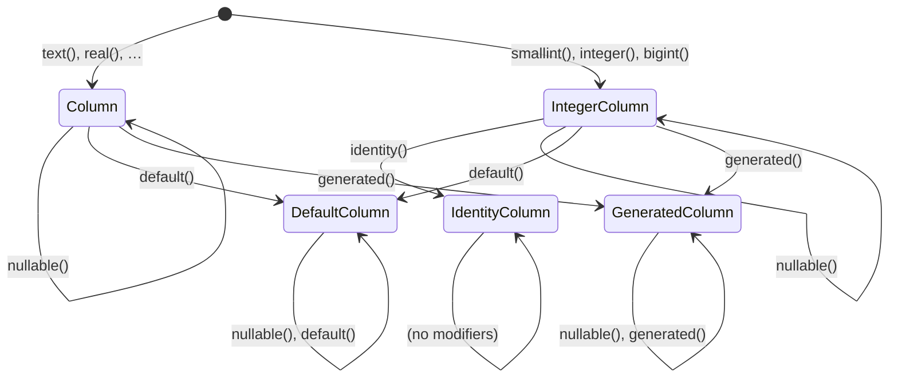

# Tables, columns and data types

This guide explains how you declare your database schema in quarry, and what those declarations turn into inside the library. It covers this directory ([column/](.)) and its neighbours: [data-type/](../data-type/), [column-factories.ts](../column-factories.ts), [define-table.ts](../define-table.ts), [table.ts](../table.ts), [define-enum.ts](../define-enum.ts), [define-type.ts](../define-type.ts), [kind-codecs.ts](../kind-codecs.ts), [types.ts](../types.ts) and [call-site.ts](../call-site.ts).

New to databases? Read [Part 1 of the builder overview](../ARCHITECTURE.md#part-1-first-principles) first. The type-level tricks used here (phantom types, generics with defaults, conditional types) are explained from scratch in [TYPES.md](../TYPES.md).

## Contents

- [What a declaration is, and what it is not](#what-a-declaration-is-and-what-it-is-not)
- [A table](#a-table)
- [A column: four types in one object](#a-column-four-types-in-one-object)
- [The modifier state machine](#the-modifier-state-machine)
- [Data types: the SQL side](#data-types-the-sql-side)
- [Every column factory](#every-column-factory)
- [Arrays](#arrays)
- [Enums](#enums)
- [Custom types: `defineType`](#custom-types-definetype)
- [Swapping a column's codec: `useCodec`](#swapping-a-columns-codec-usecodec)
- [Narrowing types: `typed` and factory type parameters](#narrowing-types-typed-and-factory-type-parameters)
- [Row types: `InferSelectType`, `InferInsertType`, `InferUpdateType`](#row-types)
- [Aliases: `table.as()`](#aliases-tableas)
- [Call sites: remembering where things were declared](#call-sites-remembering-where-things-were-declared)
- [Decisions](#decisions)
- [Glossary](#glossary)

## What a declaration is, and what it is not

```ts
import { defineTable, integer, text, timestamptz } from 'quarry';

export const users = defineTable('users', {
  columns: {
    id: integer().identity(),
    email: text(),
    name: text().nullable(),
    createdAt: timestamptz().name('created_at').default(),
  },
});
```

This **describes** a table that already exists in the database. It does not create it: quarry has no migrations. The description gives quarry three things:

1. **Names**, to write SQL: the table is `users`; the column you call `createdAt` is `created_at` in the database.
2. **Types**, to check your code: `id` is a `number` when read and is never written; `name` may be `null`; `createdAt` is a `Date` and may be left out of an insert because the database has a default.
3. **Codecs**, to move values: `createdAt` is read with the driver's `timestamptz` codec, which turns the server's representation into a `Date`.

Because the description can drift from the real table, `db.verify` compares the two ([verify/README.md](../verify/README.md)).

## A table

`defineTable(name, schema)` ([define-table.ts](../define-table.ts)) returns a `Table<N, S>` ([table.ts](../table.ts)):

```ts
export class Table<N extends string, S extends Schema> {
  readonly name: N; // 'users': the name references use
  readonly schema: S; // { columns: { id: …, email: …, … } }
  declare readonly $refs: { … }; // phantom: every 'users.<key>' → its column
  readonly _quarry: { source: string; site: CallSite | undefined };
}
```

- `N` is the table name as a **literal type** (`'users'`, not just `string`), so the type checker can build reference strings like `'users.email'` from it.
- `S` is the exact type of the schema object, so every column's precise type is kept.
- `_quarry.source` is the table's name **in the database**. It equals `name` except for an alias ([below](#aliases-tableas)).
- `_quarry.site` is where `defineTable` was called, for error messages ([call sites](#call-sites-remembering-where-things-were-declared)).

### `$refs`: the table's references

`$refs` is never set at run time. Its type maps every reference string to the column it names:

```ts
// for users, $refs has the type:
{
  'users.id': IdentityColumn<DataType<'integer'>, number, never, never>;
  'users.email': Column<DataType<'text'>, string, string, string>;
  'users.name': Column<DataType<'text'>, string | null, string | null, string | null>;
  'users.createdAt': DefaultColumn<DataType<'timestamptz'>, Date, Date | undefined, Date>;
}
```

It is computed with a **template literal type** over the column keys:

```ts
declare readonly $refs: {
  [K in `${N}.${keyof S['columns'] & string}`]: S['columns'][K extends `${N}.${infer C}` ? C : never];
};
```

Read it as: "for every key `K` of the form `users.<column key>`, the value is the column whose key is what follows `users.`". The comment in the source explains why it is written as a union of keys rather than with an `as` clause: it is faster for the type checker, which computes this once per table instead of once per lookup. A query's **scope** is the merge of the `$refs` of the tables in it ([TYPES.md](../TYPES.md#scope-which-columns-you-can-reference)).

### `tableNode`

`tableNode(table)` turns a table into the `TableNode` the compiler renders: `{ name: source, alias: name === source ? undefined : name }`, so `users` renders as `"users"` and an alias as `"users" as "managers"`.

## A column: four types in one object

A column ([base-column.ts](base-column.ts), `BaseColumn<D, S, I, U>`) carries one run-time value and four types:

| Type parameter | Meaning                                    | Example for `text().nullable()` |
| -------------- | ------------------------------------------ | ------------------------------- |
| `D`            | the SQL data type, a `DataType` subclass   | `DataType<'text'>`              |
| `S`            | the TypeScript type when **selected**      | `string \| null`                |
| `I`            | the TypeScript type accepted on **insert** | `string \| null`                |
| `U`            | the TypeScript type accepted on **update** | `string \| null`                |

`S`, `I` and `U` are phantom properties `$select`, `$insert`, `$update`: declared for the type checker, never assigned. The run-time data is in `_quarry`:

```ts
readonly _quarry: {
  readonly dataType: D;              // the SQL type, with its codec
  readonly columnName: string | undefined; // set by .name()
  readonly nullable: boolean;        // set by .nullable()
  readonly fill: 'default' | 'generated' | 'identity' | undefined;
  readonly site: CallSite | undefined; // where the factory was called
};
```

Why three TypeScript types instead of one? Because a column can be read and written differently:

- An **identity** or **generated** column is read but never written: `I` and `U` are `never`, which removes the key from insert and update rows ([row types](#row-types)).
- A column with a **default** may be omitted on insert: `I` includes `undefined`.
- With `typed()`, you can say "this nullable column is selected as `string | null`, but an update may not set it to null" (`U` is `string`).

`nullable`, `fill` and `site` are not used to run queries; they are kept for `db.verify`, which checks them against the database.

## The modifier state machine

Postgres restricts which column properties go together: an identity can't also have a default or be nullable; a column can't have both a default and a generation expression. quarry encodes these rules as **classes**: each modifier returns an instance of the class for the state it leads to, and each class only has the modifiers still valid there. An invalid chain isn't a type error on some argument: the method simply isn't there, and autocomplete never offers it.



`name()`, `typed()` and `useCodec()` are on every class (they are `abstract` in `BaseColumn`) and keep the state. Repeating a modifier is harmless, so it stays available.

How each modifier changes the types (from [column.ts](column.ts), [default-column.ts](default-column.ts), [generated-column.ts](generated-column.ts), [integer-column.ts](integer-column.ts), [identity-column.ts](identity-column.ts)):

| Modifier                          | Returns           | `S`          | `I`              | `U`         | `_quarry`                     |
| --------------------------------- | ----------------- | ------------ | ---------------- | ----------- | ----------------------------- |
| `nullable()`                      | same class        | `S \| null`  | `I \| null`      | `U \| null` | `nullable: true`              |
| `default()`                       | `DefaultColumn`   | `S`          | `I \| undefined` | `U`         | `fill: 'default'`             |
| `generated()`                     | `GeneratedColumn` | `S`          | `never`          | `never`     | `fill: 'generated'`           |
| `identity()` (integer types only) | `IdentityColumn`  | `S`          | `never`          | `never`     | `fill: 'identity'`            |
| `name(n)`                         | same class        |              |                  |             | `columnName: n`               |
| `typed<X, Y, Z>()`                | same class        | `X`          | `Y`              | `Z`         |                               |
| `useCodec(codec)`                 | same class        | codec output | codec input      | codec input | `dataType` with the new codec |

Notice that `nullable()` on a `DefaultColumn` adds `null` to `I` too: `I | undefined | null`, "may be omitted, or set to null".

Why does `IntegerColumn` extend `Column` and override `name`/`typed`/`useCodec`? So those methods return an `IntegerColumn` (keeping `identity()` available) rather than a plain `Column`. Each class re-declares them for the same reason.

### `AnyColumn`

[any-column.ts](any-column.ts) is the type "some column", used in `extends` positions (`Record<string, AnyColumn>` is a schema's `columns`). It lists only the properties the library reads, with `unknown` value types. The comment explains two subtleties worth knowing:

- If it named the classes, the generic `typed()` method signatures would have to be compared, which fails.
- Its value types are `unknown`, not `any`: when you write `columns: { a: text() }`, TypeScript infers `text()`'s type parameter from the expected type, and `unknown` fails `text`'s constraint, so the factory falls back to its default (`string`). With `any`, the column's type would silently become `any`.

## Data types: the SQL side

A `DataType` ([data-type/data-type.ts](../data-type/data-type.ts)) describes the SQL type of a column or expression, independent of nullability or TypeScript narrowing: `text`, `text null` and `text` narrowed to `'admin' | 'member'` all share `DataType<'text'>`.

```ts
export class DataType<K extends Kind = Kind> {
  readonly kind: K; // 'integer', 'text', 'timestamptz', 'enum', 'custom', 'array', …
  readonly modifiers: readonly number[] | undefined; // [320] for varchar(320), [10, 2] for numeric(10, 2)
  readonly codec: Codec; // the driver codec its values are sent and read with
  withCodec(codec: Codec): this; // a frozen copy with another codec
}
```

- **`kind`** drives the comparison methods: `MethodsByKind[kind]` ([operators.ts](../operators.ts)) is the set of methods an expression of this type has ([EXPRESSIONS.md](../EXPRESSIONS.md)). It also keeps types apart that admit the same comparisons, such as `integer` and `real`.
- **`codec`** defaults to `kindCodec(kind)` from [kind-codecs.ts](../kind-codecs.ts). Every expression of this type shares it: a value compared with a column is encoded exactly as one compared with any expression of the same type, and a selected column or expression is read with it.
- **`modifiers`** are read only by `db.verify`; values are not checked against them (a 400-character string goes to a `varchar(320)` column and the server rejects it).

The subclasses add what their kind needs:

| Class                                                 | Kind       | Adds                                                                             |
| ----------------------------------------------------- | ---------- | -------------------------------------------------------------------------------- |
| `ArrayType<E>` ([array.ts](../data-type/array.ts))    | `'array'`  | `element: E`; its codec is `arrayOf(element.codec)`                              |
| `EnumType<N>` ([enum.ts](../data-type/enum.ts))       | `'enum'`   | `enumName: N`, `values`, `site`; a text codec with `oid: 0` and `name: enumName` |
| `CustomType<N>` ([custom.ts](../data-type/custom.ts)) | `'custom'` | `sqlName: N`, `site`; the codec you gave `defineType`                            |

`EnumType<N>` and `CustomType<N>` carry their name as a type parameter, so two different enums are two different SQL types to the type checker, and can't be compared with each other ([EXPRESSIONS.md](../EXPRESSIONS.md#which-types-compare-with-which)).

### `kindCodecs`: the codec of each factory

[kind-codecs.ts](../kind-codecs.ts) maps each kind to the driver codec its columns use:

| Kind                                    | Codec                                  | JavaScript value                                             |
| --------------------------------------- | -------------------------------------- | ------------------------------------------------------------ |
| `smallint`, `integer`                   | `codecs.int2`, `codecs.int4`           | `number`                                                     |
| `bigint`                                | `codecs.int8AsString`                  | `string` (digits; a JS number can't hold every int8 exactly) |
| `decimal`                               | `codecs.numeric`                       | `string` (exact digits)                                      |
| `real`, `double precision`              | `codecs.float4`, `codecs.float8`       | `number`                                                     |
| `boolean`                               | `codecs.bool`                          | `boolean`                                                    |
| `text`, `varchar`                       | `codecs.text`, `codecs.varchar`        | `string`                                                     |
| `uuid`                                  | `codecs.uuid`                          | `string`                                                     |
| `bytea`                                 | `codecs.bytea`                         | `Uint8Array`                                                 |
| `date`, `time`, `timestamp`, `interval` | `codecs.date`, …                       | `string` (the server's text)                                 |
| `timestamptz`                           | `codecs.timestamptz`                   | `Date`                                                       |
| `jsonb`                                 | `codecs.jsonb`                         | parsed JSON (`JsonValue`)                                    |
| `inet`, `tsvector`                      | `codecs.inet`, `codecs.tsvector`       | `string`                                                     |
| `vector`                                | `codecs.vector`                        | `number[]` (pgvector)                                        |
| `daterange`, `tstzrange`                | `codecs.daterange`, `codecs.tstzrange` | `Range<string>`, `Range<Date>`                               |

Kinds without an entry (`enum`, `custom`, `array`) always get their codec from their `DataType` subclass; `kindCodec` falls back to `codecs.raw` (the server's text) for safety.

The **TypeScript type** of each factory is derived from this table: `Out<'integer'>` in [column-factories.ts](../column-factories.ts) is `CodecOutput<typeof kindCodecs['integer']>`, which is `number` because `codecs.int4.decodeText` returns a number. So a column's declared type is, by construction, what its codec returns at run time. Change a codec and the type follows.

`quarryRegistry`, at the bottom of the same file, is a different thing: the codecs used for result columns **no query typed** (raw SQL, an expression of unknown type). It is the driver's defaults with quarry's choices on top (`int8AsString`, `timestamptz` as `Date`, ranges, `vector`). See [EXECUTION.md](../EXECUTION.md#how-the-builder-picks-codecs).

## Every column factory

Each factory in [column-factories.ts](../column-factories.ts) has the same shape:

```ts
export function integer<T extends Out<'integer'> = Out<'integer'>>() {
  return new IntegerColumn<DataType<'integer'>, T>({
    dataType: new DataType('integer'),
    site: captureCallSite(integer),
  });
}
```

- The type parameter `T` defaults to the codec's output (`number`), and may narrow it (`integer<UserId>()`, `text<'free' | 'pro'>()`). `T extends Out<…>` means you can only narrow, never claim a type the codec doesn't produce.
- `IntegerColumn` for `smallint`, `integer`, `bigint` (the only ones that can be identities); `Column` for the rest.
- `captureCallSite(integer)` records where the factory was called.

`decimal(p, s)` and `varchar(n)` pass their arguments as `modifiers` (via the `modifiers()` helper, which stops at the first one left out). `bytea()` has no type parameter: what is read is always a plain `Uint8Array`, so there is nothing to narrow. `jsonb()` has two overloads so that an untyped `jsonb()` is a `JsonValue` and `jsonb<T>()` is `T` (the overload without a type parameter prevents TypeScript from inferring `T` from where the column is used).

The per-factory documentation comments in the source explain each type's comparisons and value format; [the public README's table](../../README.md#column-types) summarises them.

## Arrays

```ts
tags: array(text()),                    // text[], string[]
scores: array(integer().nullable()),    // integer[], (number | null)[]
```

`array(element)` takes a fresh or nullable **element column** and returns `Column<ArrayType<D>, T[]>`. The element's nullability types the elements; modifiers applied to the result (`.nullable()`, `.default()`, `.name()`) belong to the array column.

Only one dimension is modelled, so the element can't itself be an array (the parameter type is `DataType<Exclude<Kind, 'array'>>`). Postgres treats `integer[][]` as the same type as `integer[]`, with a rule that every sub-array has the same length, which TypeScript can't express; and `any`/`all` compare against the base elements, never against a sub-array.

`ArrayType`'s codec is `arrayOf(element.codec)` ([driver/CODECS.md](../driver/CODECS.md#arrays-arrayof)), so an array of ranges or jsonb is sent as the element literals Postgres expects and read back element by element.

## Enums

```ts
const status = defineEnum('order_status', ['pending', 'paid', 'shipped']);
const orders = defineTable('orders', {
  columns: { status: status().default() },
});
const refunds = defineTable('refunds', {
  columns: { status: status<'paid'>() },
});
```

`defineEnum(name, labels)` ([define-enum.ts](../define-enum.ts)) creates **one** `EnumType` and returns a factory that makes columns of it. The `const` type parameters capture the name and labels as literal types, so the column's value type is `'pending' | 'paid' | 'shipped'`, and a column may narrow it (`status<'paid'>()`).

The enum's codec ([enum.ts](../data-type/enum.ts) `enumCodec`) sends and reads labels as text, with `oid: 0` and `name: 'order_status'`: enums have no fixed type number (**OID**) in Postgres, so the driver looks it up by name in the catalog once per pool ([driver/CODECS.md](../driver/CODECS.md#types-looked-up-by-name-the-catalog)). Once known, parameters compared with an enum column declare its type exactly.

Labels are ordered as declared, as in Postgres, so `lt`/`gt` compare by position. `db.verify` checks the labels and their order.

## Custom types: `defineType`

```ts
const citext = defineType({ sql: 'citext', codec: codecs.text });
const positive = defineType({ sql: 'positive_int', codec: codecs.int4 }); // a domain
```

`defineType({ sql, codec })` ([define-type.ts](../define-type.ts)) declares a SQL type quarry has no factory for (an extension's type, a **domain** (a named restriction of another type), your own) and returns a column factory. Its columns have `DataType` kind `'custom'`, a `CustomType` holding the SQL name and your codec.

- **Comparisons**: `MethodsByKind['custom']` is `CustomMethods`: every operator (text-like ones, `@>`, `<@`, `&&`, range-like ones, `@@`), each taking a value of the codec's type or an expression of the **same** custom type. quarry can't know which operators the type has, so it offers all and lets Postgres decide.
- **Insert type**: the factory returns `Column<CustomType<N>, T, [Out] extends [T] ? In : T>`: if you didn't narrow `T`, writes take the codec's input type; if you did, writes take `T`.
- **Verify**: `db.verify` checks the column's type name, or the domain it is declared with.

## Swapping a column's codec: `useCodec`

```ts
id: bigint().identity().useCodec(codecs.int8),   // read as a bigint, not a string
at: timestamptz().useCodec(codecs.raw),          // the server's text, typed string
```

`useCodec(codec)` keeps the column's SQL type (its kind, its methods, what `verify` checks) but sends and reads its values with another codec, and changes the TypeScript types to match:

```ts
override useCodec<In, Out>(codec: Codec<In, Out>) {
  return new Column<D, SwapType<S, Out>, SwapType<I, In>, SwapType<U, In>>({
    ...this._quarry,
    dataType: this._quarry.dataType.withCodec(codec),
  });
}
```

`SwapType<Old, New>` ([base-column.ts](base-column.ts)) replaces the type but keeps `null` and `undefined` (nullability and "may be omitted"), and keeps `never` as `never` (a column never written stays so). `DataType.withCodec` makes a frozen copy of the same class with the new codec, so an `EnumType` stays an `EnumType`.

## Narrowing types: `typed` and factory type parameters

Two ways to make a column's TypeScript type more precise than its codec's:

```ts
type UserId = number & { readonly __brand: 'UserId' };
id: integer<UserId>().identity(),                   // one type for all three views
note: text().nullable().typed<string | null, string | null, string>(), // three views
legacy: text().typed<string, never, never>(),       // read-only
```

`typed<X extends S, Y extends I, Z extends U>()` narrows each view independently, but only **narrows**: each must extend the current type, so you can't claim the driver returns something it doesn't, or that Postgres accepts something it doesn't. `Column`, `IntegerColumn` and `DefaultColumn` require all three type arguments, which makes the intent explicit; `GeneratedColumn` and `IdentityColumn` take one (`typed<X extends S>()`), since they are never written. It changes no run-time data.

A **branded** type like `UserId` is a TypeScript trick: a `number` intersected with a fake property, so a plain `number` (or a `PostId`) isn't assignable to it. Comparisons are checked by SQL type, not TypeScript type ([EXPRESSIONS.md](../EXPRESSIONS.md#values-vs-expressions)), so branded ids still compare with each other in SQL.

## Row types

[types.ts](../types.ts) derives the rows of a table from its columns' phantom types:

```ts
type User = InferSelectType<typeof users>;
// { id: number; email: string; name: string | null; createdAt: Date }

type NewUser = InferInsertType<typeof users>;
// { email: string; name: string | null; createdAt?: Date }   (no id: identity)

type UserPatch = InferUpdateType<typeof users>;
// { email?: string; name?: string | null; createdAt?: Date }
```

How `InferInsertType` works, step by step:

```ts
export type InferInsertType<T extends AnyTable> = DrainOuterGeneric<
  Prettify<
    {
      [
        K in keyof Columns<T> as [Columns<T>[K]['$insert']] extends [never]
          ? never
          : undefined extends Columns<T>[K]['$insert']
            ? never
            : K
      ]: Columns<T>[K]['$insert'];
    } & {
      [
        K in keyof Columns<T> as undefined extends Columns<T>[K]['$insert']
          ? K
          : never
      ]?: Exclude<Columns<T>[K]['$insert'], undefined>;
    }
  >
>;
```

1. The first mapped type keeps the **required** keys: those whose insert type isn't `never` (identity, generated) and doesn't include `undefined` (default).
2. The second keeps the **optional** keys (`?:`): those whose insert type includes `undefined`, with `undefined` removed from the value.
3. `as …` in a mapped type renames or **drops** keys: mapping a key to `never` removes it.
4. `[X] extends [never]` (with brackets) is the reliable way to test for `never`: a bare `X extends never` distributes over a union and gives `never` for `never` itself. See [TYPES.md](../TYPES.md#conditional-types-and-the-never-test).
5. `Prettify` flattens the intersection into one object type so editor hovers are readable; `DrainOuterGeneric` forces the compiler to resolve it once ([TYPES.md](../TYPES.md#type-checking-speed)).

A nullable column without a default is **required** on insert: you pass `null` explicitly. That is deliberate: leaving a key out is never an implicit NULL.

## Aliases: `table.as()`

```ts
const managers = users.as('managers');
db.selectFrom(users).innerJoin(managers).on('managers.id', 'users.managerId');
```

`as(alias)` returns a new `Table` with `name: alias` (so references are `'managers.…'`) and the same schema, source and site. `tableNode` then renders `"users" as "managers"`, and every reference renders against the alias (`"managers"."id"`). The `const A` type parameter keeps the alias as a literal type.

## Call sites: remembering where things were declared

`db.verify` points at the exact line of a wrong column. For that, each factory, `defineTable`, `defineEnum` and `defineType` records its **call site** ([call-site.ts](../call-site.ts)):

```ts
export function captureCallSite(fn) {
  if (typeof Error.captureStackTrace !== 'function') return undefined;
  const site = {};
  const limit = Error.stackTraceLimit;
  Error.stackTraceLimit = 1;
  try {
    Error.captureStackTrace(site, fn); // records the frame that called `fn`
  } finally {
    Error.stackTraceLimit = limit;
  }
  return site;
}
```

- `Error.captureStackTrace(obj, fn)` is a V8 feature that attaches a `stack` to `obj`, skipping frames above `fn`, so the first frame is "where `fn` was called". Limiting the stack to one frame keeps it around a microsecond, cheap enough to do for every column.
- V8 only **formats** the stack the first time `.stack` is read. Nothing is formatted unless `verify` reports a problem.
- `resolveCallSite(site)` parses the frame (`at … (/app/schema.ts:3:9)`), maps it through a source map when Node has one loaded (`node:module`'s `findSourceMap`), and turns a `file:` URL into a path. It reaches Node's modules through `process.getBuiltinModule`, so they load only when a call site is resolved.

## Decisions

Why columns work this way. Each links to its full entry (what it is, why, the alternatives, the cost, measured impact) in [DECISIONS.md](../DECISIONS.md):

- [A class per column modifier state](../DECISIONS.md#a-class-per-column-modifier-state): invalid combinations can't be written, and autocomplete teaches the rules.
- [Phantom types: what a column reads and writes](../DECISIONS.md#phantom-types-what-a-column-reads-and-writes): three TypeScript types per column, because Postgres reads and writes columns differently.
- [TypeScript types derived from codecs](../DECISIONS.md#typescript-types-derived-from-codecs): a column's type can't drift from what the driver returns.
- [`DataType` separate from the column](../DECISIONS.md#datatype-separate-from-the-column): expressions and columns share the SQL type's rules.
- [Enums and custom types keyed by name in their type](../DECISIONS.md#enums-and-custom-types-keyed-by-name-in-their-type): two enums never compare, as in Postgres.
- [Declarations, not migrations](../DECISIONS.md#declarations-not-migrations): the database is the source of truth; `verify` keeps the code honest.
- [Call sites captured eagerly, formatted lazily](../DECISIONS.md#call-sites-captured-eagerly-formatted-lazily): precise diagnostics at almost no cost.

## Glossary

**Branded type**: a primitive type intersected with a fake property (`number & { __brand: 'UserId' }`) so values of different meanings don't mix.

**Codec**: the driver object that encodes and decodes one Postgres type ([driver/CODECS.md](../driver/CODECS.md)).

**Default** (`default()`): the database fills the column in when an insert omits it.

**Domain**: a Postgres type defined as another type plus constraints (`create domain positive_int as int check (value > 0)`).

**Enum**: a Postgres type whose values are a fixed, ordered list of labels.

**Generated column** (`generated()`): computed by Postgres from other columns; never written.

**Identity column** (`identity()`): numbered by Postgres from a sequence; never written.

**Kind**: the SQL type's name as `DataType.kind` records it.

**Modifier**: a method on a column that changes its properties (`nullable`, `default`, …). Also, a **type modifier** is the number(s) in `varchar(320)` or `numeric(10, 2)`.

**OID**: Postgres's numeric identifier for a type (23 is `int4`). Built-in types have fixed OIDs; enums, domains and extension types don't.

**Phantom property**: a property declared for the type checker only (`$select`, `$refs`).

**Schema**: here, the `{ columns: { … } }` object passed to `defineTable`. (In Postgres, a schema is also a namespace of tables, like `public`.)
