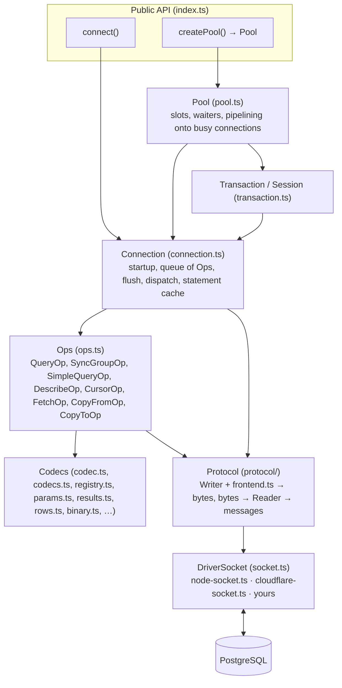
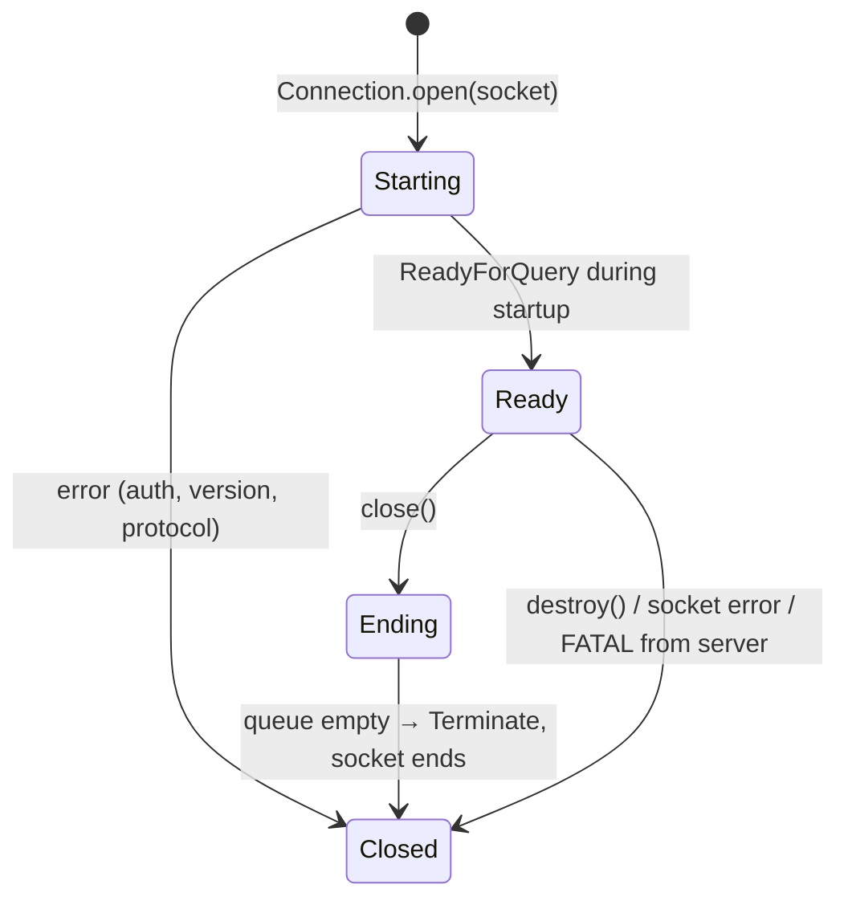
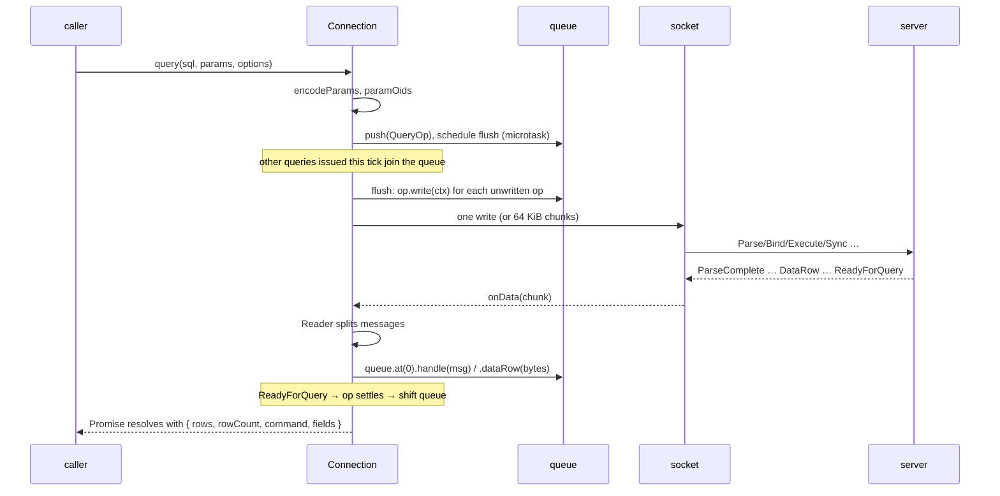
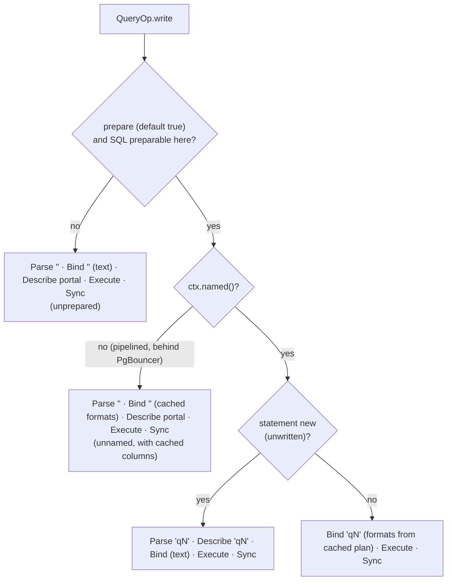
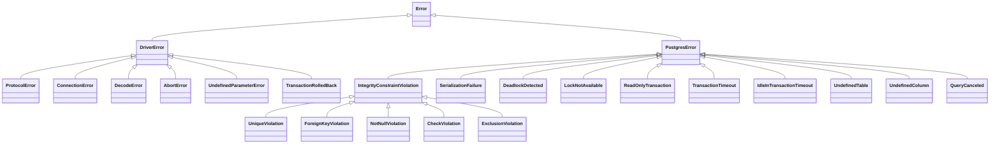

# The PostgreSQL driver, from the inside

This is the internal guide to quarry's PostgreSQL driver: the code in `src/driver/` that opens network connections to a PostgreSQL server, speaks its wire protocol, and turns bytes into JavaScript values. [README.md](README.md) next to this file documents the driver's **API** (options, methods); this guide explains **how it works and why**.

It assumes basic TypeScript and nothing about databases or networking. [Part 1](#part-1-foundations) builds up the ideas; every term is collected in the [glossary](#glossary).

The driver documentation:

| Document                                 | Covers                                                                                                                                                       |
| ---------------------------------------- | ------------------------------------------------------------------------------------------------------------------------------------------------------------ |
| this file                                | foundations, layers, files, the connection and its operations, the statement cache, pipelining and backpressure, PgBouncer, memory, timing, runtimes, errors |
| [protocol/README.md](protocol/README.md) | the wire protocol: message formats, the extended query protocol, the reader and the writer                                                                   |
| [auth/README.md](auth/README.md)         | connecting: configuration, hosts and failover, TLS and certificates, startup, protocol negotiation, SCRAM, channel binding, md5, IAM passwords               |
| [CODECS.md](CODECS.md)                   | codecs, built-ins, `arrayOf`, the registry, parameter OIDs, binary after describe, the type catalog                                                          |
| [POOL.md](POOL.md)                       | the pool: slots, waiters, pipelining onto busy connections, adaptive depth, draining for exclusive callers, lifetimes, ending                                |
| [TRANSACTIONS.md](TRANSACTIONS.md)       | transactions, savepoints, retries, and how BEGIN, COMMIT and batches are framed on the wire                                                                  |
| [STREAMING.md](STREAMING.md)             | cursors and streams, COPY in and out, LISTEN/NOTIFY                                                                                                          |
| [CANCELLATION.md](CANCELLATION.md)       | `AbortSignal`, client timeouts, cancel requests, statement and transaction timeouts                                                                          |
| [DECISIONS.md](DECISIONS.md)             | every design decision and optimisation in the driver: what it is, why, the alternatives, the cost, the measured impact                                       |

## Contents

- [Part 1: Foundations](#part-1-foundations)
- [Part 2: Layers](#part-2-layers)
- [Part 3: Every file in `src/driver/`](#part-3-every-file-in-srcdriver)
- [Part 4: The connection](#part-4-the-connection)
- [Part 5: Operations](#part-5-operations)
- [Part 6: The prepared-statement cache](#the-prepared-statement-cache)
- [Part 7: Pipelining](#pipelining)
- [Part 8: Behind PgBouncer](#part-8-behind-pgbouncer)
- [Part 9: Memory and allocation](#part-9-memory-and-allocation)
- [Part 10: Timing and telemetry](#timing)
- [Part 11: Runtimes and sockets](#part-11-runtimes-and-sockets)
- [Part 12: Errors](#errors)
- [Part 13: The driver knows nothing about quarry](#the-driver-knows-nothing-about-quarry)
- [Part 14: Testing](#part-14-testing)
- [Decisions](#decisions)
- [Glossary](#glossary)

## Part 1: Foundations

### Client, server, connection

PostgreSQL runs as a **server** process listening on a network port (5432 by default) or a Unix-domain socket (a file-like address for programs on the same machine). Your program is a **client**. To talk, the client opens a **connection**: a TCP socket, which is a two-way stream of bytes between the two machines. For each connection, the server starts a dedicated **backend** process that serves only that connection, for its whole life.

A connection carries a **session**: state that lasts until it closes, such as settings (`SET search_path = …`), temporary tables, prepared statements, and whether a transaction is open.

### Why connections are expensive, and why pools exist

Opening a connection costs several **round trips** (a message sent and its answer received): TCP's handshake, TLS's handshake (for encryption), Postgres's startup and authentication; and on the server, a new process. That is milliseconds, often more than the query itself. So programs keep connections open and reuse them. A **pool** holds a set of open connections and lends one to each piece of work ([POOL.md](POOL.md)).

### Round trips, latency and throughput

**Latency** is how long one request takes. Over a network, every request pays at least one round trip: 0.1 ms on the same machine, 1–5 ms in a data centre, 50+ ms across continents. **Throughput** is how many requests complete per second. If each request waits for the previous answer, throughput is at most 1 / latency per connection. The main way to do better without more connections is to not wait: **pipelining** ([Part 7](#pipelining)).

### The event loop

Node (and Bun, Deno, browsers, Workers) runs JavaScript on **one thread**. I/O doesn't block it: a socket read registers a callback and the thread moves on; when bytes arrive, the **event loop** runs the callback. Promises' `.then` callbacks run as **microtasks**: right after the current piece of code finishes, before the next I/O callback. The driver uses this to batch: anything queued during the current tick is written together in one microtask ([Part 4](#writing-the-flush)).

### What a wire protocol is

The bytes on a connection follow a format both sides agree on: the **wire protocol**. PostgreSQL's (version 3, from 2003; minor version 3.2 since PostgreSQL 18) is a sequence of **messages**, each a type byte, a length, and a body. The client sends messages like "parse this SQL" and "run it with these values"; the server answers with "here are the columns", "here is a row", "done". [protocol/README.md](protocol/README.md) covers it in detail.

### Text and binary formats

A value can travel as **text** (the integer 1 as the character `1`) or in its type's **binary** format (as four bytes `00 00 00 01`). Binary is often cheaper to decode, and is chosen per column ([CODECS.md](CODECS.md#binary-after-describe)).

### Prepared statements

Before running SQL, the server **parses** it (checks the syntax), **analyses** it (resolves names and types) and **plans** it (decides how to execute). A **prepared statement** does that once and keeps the result under a name, so later runs only send the name and the values. The driver prepares and caches statements automatically ([Part 6](#the-prepared-statement-cache)).

### Backpressure

If the client produces bytes faster than the network takes them, they pile up in memory. **Backpressure** is the signal to stop producing until the buffer drains. The driver respects it when writing ([Part 4](#backpressure)) and when reading COPY output ([STREAMING.md](STREAMING.md)).

## Part 2: Layers



- **Socket**: moves bytes. The rest of the driver only uses the small `DriverSocket` interface, so it runs anywhere a socket can be provided.
- **Protocol**: turns messages into bytes (`Writer`, `frontend.ts`) and bytes into messages (`Reader`).
- **Codecs**: turn JavaScript values into parameter bytes and result bytes into JavaScript values.
- **Ops**: one queued request each (a query, a cursor, a COPY): what it writes, and how it reacts to each reply message.
- **Connection**: owns the socket and a queue of ops, writes them, routes replies to them in order.
- **Transaction**, **Pool**: built on connections.

## Part 3: Every file in `src/driver/`

| File                                         | What it does                                                                                                                                                                                                |
| -------------------------------------------- | ----------------------------------------------------------------------------------------------------------------------------------------------------------------------------------------------------------- |
| [index.ts](index.ts)                         | The public API of `quarry/driver`.                                                                                                                                                                          |
| [connect.ts](connect.ts)                     | `connect()`, `openConnection()`: hosts in turn, TLS plans, protocol-version retry, connect timeout, cancel requests. [auth/README.md](auth/README.md)                                                       |
| [config.ts](config.ts)                       | `ConnectionOptions`, connection-string parsing, `PG*` environment variables, `resolveConfig`, `.pgpass`. [auth/README.md](auth/README.md#configuration)                                                     |
| [connection.ts](connection.ts)               | `Connection`: startup and authentication, the op queue, flushing, dispatching replies, the statement cache, `query`/`queryGroup`/`simpleQuery`/`describe`/`cursor`/`copy*`/`listen`, cancellation, closing. |
| [ops.ts](ops.ts)                             | The operations: `Op`, `QueryOp`, `SyncGroupOp`, `SimpleQueryOp`, `DescribeOp`, `CursorOp`, `FetchOp`, `ClosePortalOp`, `CopyFromOp`, `CopyToOp`; `QueryResult`, `OpTiming`, `Statement`.                    |
| [cursor.ts](cursor.ts)                       | `CursorIterator`: one run of a cursor (opening, serialised `next()`, `return()`, `statementTimeout`, aborts). [STREAMING.md](STREAMING.md#cursors)                                                          |
| [row-stream.ts](row-stream.ts)               | `RowStream`: rows one at a time over a cursor's batches; async iterable and disposable.                                                                                                                     |
| [queue.ts](queue.ts)                         | `Queue<T>`: a FIFO that keeps its array's capacity.                                                                                                                                                         |
| [pool.ts](pool.ts)                           | `Pool`, `PoolClient`, `createPool`, the adaptive `Depth`, the pool's LISTEN connection. [POOL.md](POOL.md)                                                                                                  |
| [transaction.ts](transaction.ts)             | `Transaction`, `Session`, `TransactionRolledBack`, `Transaction.run`/`batch`. [TRANSACTIONS.md](TRANSACTIONS.md)                                                                                            |
| [protocol/](protocol/README.md)              | `frontend.ts` (client messages), `writer.ts`, `reader.ts`, `messages.ts` (server message types), `text.ts` (UTF-8 helpers).                                                                                 |
| [auth/](auth/README.md)                      | `scram.ts` (SCRAM-SHA-256, channel binding, SASLprep), `md5.ts`, `encoding.ts` (base64, UTF-8, hex).                                                                                                        |
| [codec.ts](codec.ts)                         | The `Codec` interface, `defineCodec`, `arrayOf`, `declareParamType`, `typed`/`TypedValue`. [CODECS.md](CODECS.md)                                                                                           |
| [codecs.ts](codecs.ts)                       | The built-in codecs (`codecs`) and `defaultCodecs`.                                                                                                                                                         |
| [registry.ts](registry.ts)                   | `CodecRegistry` (codec by type OID), `TypeCatalog` (types looked up by name), `catalogQuery`.                                                                                                               |
| [params.ts](params.ts)                       | `encodeParams`, `paramOids`: encoding a query's parameters and choosing the OIDs to declare.                                                                                                                |
| [results.ts](results.ts)                     | Result plans: which codec and format each column is read with, cached per statement.                                                                                                                        |
| [rows.ts](rows.ts)                           | Row decoders: generated JavaScript per result shape, and a fallback.                                                                                                                                        |
| [binary.ts](binary.ts)                       | Binary-format decoders (`int4`, `float8`, `timestamptz`, `numeric`, `uuid`, `jsonb`, `vector`, arrays).                                                                                                     |
| [array-params.ts](array-params.ts)           | `binaryArray`: encoding arrays of common types in binary.                                                                                                                                                   |
| [types.ts](types.ts)                         | Text helpers: OID tables, `parseArray`, `parseBytea`, `formatTimestamp`, `encodeParam`, COPY text format.                                                                                                   |
| [parsers.ts](parsers.ts)                     | Text parsers: `parseTimestamptz`, `parseRange`, `vectorValues`.                                                                                                                                             |
| [capabilities.ts](capabilities.ts)           | `Capabilities`, PgBouncer detection, `statementNames`, the PostgreSQL 18 check.                                                                                                                             |
| [errors.ts](errors.ts)                       | Every error class and `postgresError()`.                                                                                                                                                                    |
| [notice.ts](notice.ts)                       | `Notice` and `Notification` shapes.                                                                                                                                                                         |
| [telemetry.ts](telemetry.ts)                 | OpenTelemetry-compatible spans, without depending on OpenTelemetry.                                                                                                                                         |
| [socket.ts](socket.ts)                       | The `DriverSocket` and `SocketFactory` interfaces.                                                                                                                                                          |
| [node-socket.ts](node-socket.ts)             | Sockets on `node:net`/`node:tls` (Node, Bun, Deno).                                                                                                                                                         |
| [cloudflare-socket.ts](cloudflare-socket.ts) | Sockets on `cloudflare:sockets` (Workers).                                                                                                                                                                  |

## Part 4: The connection

[connection.ts](connection.ts). A `Connection` is one session with the server. Its main state:

```ts
readonly #socket: DriverSocket;
readonly #reader: Reader;           // bytes → messages
readonly #writer = new Writer();    // messages → bytes
readonly #queue = new Queue<Op>();  // operations, in the order they were issued
#written = 0;                       // how many at the front of the queue have been written
#flushScheduled = false;
#backpressure = false;              // the socket's buffer is full
#blocking: Op | undefined;          // an exclusive op written: nothing more is written until it completes
#canceling: Op | undefined;         // an op we asked the server to cancel: hold later writes
readonly #statements = new Map<string, Statement>(); // the prepared-statement cache
#naming: 'always' | 'alone' | 'never';
#status: 'I' | 'T' | 'E';          // idle / in transaction / failed transaction
#pid; #secretKey;                   // for cancel requests
readonly #parameters = new Map<string, string>(); // server_version, TimeZone, …
```

### Lifecycle



`Connection.open` (called by [connect.ts](connect.ts) once a socket is connected, and TLS started if needed) runs `#startup()`: send the StartupMessage, answer authentication requests, record BackendKeyData and ParameterStatus, until ReadyForQuery. During startup, messages go to an **inbox** that `#startup` reads one at a time (`#nextStartupMessage`); afterwards, they go to the ops. [auth/README.md](auth/README.md#startup-step-by-step).

`#fail(error)` is the single exit for every failure: it marks the connection closed, destroys the socket, fails every queued op with the error, wakes anyone waiting, and notifies `onClose` listeners. A connection is never reopened: the pool replaces it ([POOL.md](POOL.md)).

### The life of a query on a connection

<a id="the-life-of-a-query-on-a-connection"></a>



`query()` → `#query()`:

1. A server-side `statementTimeout` takes a separate path ([CANCELLATION.md](CANCELLATION.md#statement-timeouts)).
2. `invalidSql(sql)`: the SQL must be a string without NUL bytes (Postgres text can't contain them).
3. `encodeParams` and `paramOids` ([CODECS.md](CODECS.md#encoding-a-querys-parameters)).
4. A `QueryOp` is built and `#enqueue`d. `#enqueue` fails it at once if the connection is closed or the signal is already aborted; otherwise it pushes it, schedules a flush, and wires the signal and the client timeout ([CANCELLATION.md](CANCELLATION.md)).
5. If the type catalog isn't loaded yet and this query needs it, `#loadTypesAfter` starts loading it, queued **behind** this query ([CODECS.md](CODECS.md#types-looked-up-by-name-the-catalog)).

A performance detail: `#query` creates its promise with a **shared executor function** (`capture`) that stores `resolve`/`reject` in module variables, rather than an arrow function closing over the op. A closure per query would allocate a function and its context every time; this allocates neither. The same care (no closures, no spreads, index loops) shows in other per-query code; comments mark it.

### Writing: the flush

<a id="writing-the-flush"></a>

```ts
#schedule(): void {
	if (this.#flushScheduled) return;
	this.#flushScheduled = true;
	queueMicrotask(this.#flushTask);
}

#flush(): void {
	this.#flushScheduled = false;
	if (this.#closed || this.#backpressure) return;
	while (this.#written < this.#queue.length && this.#blocking === undefined && this.#canceling === undefined) {
		const op = this.#queue.at(this.#written);
		this.#written++;
		const before = this.#writer.length;
		try {
			op.write(this.#ctx);
		} catch (error) {
			// a request that can't be encoded fails alone; nothing of it is sent
			this.#writer.truncate(before);
			…
			continue;
		}
		op.written = true;
		if (op.exclusive) this.#blocking = op;
		if (this.#writer.length >= FLUSH_BYTES && !this.#send(this.#writer.take())) return;
	}
	if (this.#writer.length > 0) this.#send(this.#writer.take());
}
```

- **One write per tick.** Every op issued in the same synchronous run of code lands in the queue before the microtask runs, and they are all encoded into one buffer and handed to the socket in one `write`. Fewer writes mean fewer system calls and fewer network packets.
- **64 KiB chunks.** For a long queue, the buffer is handed over every `FLUSH_BYTES` (65,536) bytes. If the socket reports its buffer full, encoding stops right there.
- **An op that can't be encoded** (a codec threw, a string contains NUL) is cut out of the buffer (`truncate`) and failed alone; the others still go.
- **Exclusive ops** (cursors, COPY) keep talking after they're written (a cursor sends Execute again for each batch), and anything written after them would interleave with that conversation. So once one is written, `#blocking` stops further writes until it completes.
- **A pending cancel** (`#canceling`) also holds back writes: [CANCELLATION.md](CANCELLATION.md#why-later-writes-are-held-back).

### Backpressure

<a id="backpressure"></a>
`#send(bytes)` calls `socket.write`, which returns `false` when the runtime's send buffer is over its high-water mark. The connection then sets `#backpressure`, and `#flush` encodes nothing more: queued ops stay as objects, **not yet encoded**, so a burst of ten thousand queries (or a few with huge parameters) doesn't become ten thousand encoded buffers in memory. When the socket emits `drain`, `onDrain` clears the flag, wakes ops waiting on `ctx.drain()` (COPY), and reschedules the flush.

### Reading replies

<a id="reading-replies"></a>

```ts
#onData(chunk: Uint8Array): void {
	const reader = this.#reader;
	try {
		reader.push(chunk);
		for (let type = reader.nextType(); type >= 0; type = reader.nextType()) {
			if (type === 0x44 && !this.#starting) {                   // 'D': DataRow
				const op = this.#queue.at(0);
				if (op?.written && op.dataRow(reader.bytes, reader.start, reader.end)) continue;
			} else if (type === 0x41) {                                // 'A': NotificationResponse
				this.#notify(decodeNotification(reader.bytes, reader.start, reader.end, this.#channelNames));
				if (this.#closed) return;
				continue;
			}
			this.#dispatch(reader.parse());
			if (this.#closed) return;
		}
	} catch (error) {
		this.#fail(error instanceof Error ? error : new ProtocolError(String(error)));
	}
}
```

- **DataRow fast path**: rows are by far the most frequent message. Instead of building a message object, the connection passes the read buffer and the row's offsets straight to the op, whose generated decoder reads the values in place ([CODECS.md](CODECS.md#row-decoders)).
- **NotificationResponse fast path**: decoded straight from the buffer, with recently seen channel names reused ([STREAMING.md](STREAMING.md#listen-and-notify)).
- **`#dispatch(msg)`**: NoticeResponse goes to `onNotice` listeners and ParameterStatus updates `parameters` whatever is running; during startup, everything else goes to the inbox; a FATAL or PANIC error is remembered (`#fatal`), so later failures report it; then the message goes to the op at the **head** of the queue.

Replies come back in the order requests were sent, so the op at the head is always the one the message belongs to. When `op.handle(msg)` returns `true` (it saw its final ReadyForQuery), the connection shifts it off the queue, unblocks writing if it was exclusive or canceled, may send a pending cancel for the new head, reschedules the flush, and runs the op's `onDone`.

A message with no op in flight is either an error the server sends on its own (an idle session timeout, an administrator terminating the backend: the connection fails with it) or a protocol violation (`ProtocolError`).

`onDone` is how the pool learns a query finished without a promise of its own per query: the connection calls it **before** callbacks on the query's promise run, so a pool can lend the connection to the next query before the caller's continuation issues its own.

### Closing

`close()` sets `#ending` (no new work), waits until the queue is empty (`idle()`), writes **Terminate**, and ends the socket. Like libpq, it doesn't wait for the server to close its side (that would wait for the backend process to exit, about a millisecond). `close({ timeout })` fails what's still running after the timeout. `destroy()` fails everything immediately.

## Part 5: Operations

[ops.ts](ops.ts). Each request is an `Op`, an object the connection queues, writes, and feeds messages to:

```ts
abstract class Op {
	written = false;
	done = false;
	readonly exclusive: boolean = false;
	canceledBy: 'abort' | 'timeout' | undefined;
	onTiming;
	onDone;
	queuedAt;
	writtenAt;
	dataRow(bytes, start, end): boolean; // the DataRow fast path; false if not accepted
	get prepares(): number; // statements it may write named
	abstract write(ctx: OpContext): void; // append its messages to ctx.writer
	abstract handle(msg, ctx): boolean; // true when complete (its ReadyForQuery)
	abstract fail(error: Error): void; // the connection failed first
}
```

`OpContext` is what an op may use on its connection: the writer, the registry and catalog, the statement cache (`statement`, `forget`, `unprepare`, `preparable`), the naming decision (`named`), `send` and `drain` for ops that talk after being written, `pause`/`resume` for COPY backpressure, and `retry` to requeue a replacement op.

| Op                         | Messages written                                                                                                                                                             | Used by                                                             |
| -------------------------- | ---------------------------------------------------------------------------------------------------------------------------------------------------------------------------- | ------------------------------------------------------------------- |
| `QueryOp`                  | [Parse, Describe] Bind Execute [Sync]                                                                                                                                        | `query`, and each statement of a group                              |
| `SyncGroupOp`              | several `QueryOp`s, one Sync                                                                                                                                                 | `queryGroup`: BEGIN with the first statement, transactional batches |
| `SimpleQueryOp`            | Query                                                                                                                                                                        | `simpleQuery`: several statements, no parameters                    |
| `DescribeOp`               | Parse Describe(S) Sync                                                                                                                                                       | `describe`                                                          |
| `CursorOp`                 | outside a transaction (exclusive): [Parse] [Describe Flush] Bind Execute(n) Flush, then Execute(n) Flush per pull, Sync; inside one: Bind on a named portal, Execute(n) Sync | `cursor`, `stream` ([STREAMING.md](STREAMING.md))                   |
| `FetchOp`, `ClosePortalOp` | Execute(n) Sync / Close Sync on a transaction's named portal                                                                                                                 | the later batches and the end of a cursor inside a transaction      |
| `CopyFromOp` (exclusive)   | Query, then CopyData … CopyDone                                                                                                                                              | `copyFrom`, `copyRows`                                              |
| `CopyToOp` (exclusive)     | Query                                                                                                                                                                        | `copyTo`                                                            |

### `QueryOp.write`: four ways to send one statement



- **New named statement**: Parse it under a name (`q1`, `q2`, … per connection) and Describe it, so its parameter types and columns are learned; Bind asks for **text** results, because no column's type is known yet.
- **Cached named statement**: only Bind and Execute; the formats come from the cached plan, so columns whose codec reads binary are asked for in binary ([CODECS.md](CODECS.md#binary-after-describe)).
- **Unnamed with cached columns**: behind PgBouncer when pipelined ([Part 8](#part-8-behind-pgbouncer)).
- **Unprepared** (`prepare: false`, or SQL marked unpreparable): the unnamed statement, text results, Describe of the portal for the columns.

### `QueryOp.handle`

| Message              | What happens                                                                                                                         |
| -------------------- | ------------------------------------------------------------------------------------------------------------------------------------ |
| ParseComplete        | the statement is marked `parsed`                                                                                                     |
| ParameterDescription | ignored (the server's inferred parameter types)                                                                                      |
| RowDescription       | columns known: stored on a new statement, and a plan is chosen (`#described`)                                                        |
| NoData               | the statement returns no rows                                                                                                        |
| BindComplete         | for a cached statement, use its cached plan (no RowDescription will come)                                                            |
| DataRow              | decoded and kept (up to `keepRows`)                                                                                                  |
| CommandComplete      | the tag (`SELECT 1`, `UPDATE 3`)                                                                                                     |
| ErrorResponse        | becomes a `PostgresError` (`#onError`); the server then skips to Sync                                                                |
| CopyInResponse       | COPY FROM STDIN through `query()`: answered with CopyFail and Sync (the server ignores Sync during COPY), so the query fails cleanly |
| ReadyForQuery        | `#finish`: resolve, reject, or retry a stale statement                                                                               |

### keepRows

<a id="keeprows"></a>
`dataRow` returns early once `rows.length >= keepRows`, so the rows after it are **not decoded**: the bytes are skipped. The query still runs to completion and the command tag still counts every row. quarry's `takeFirst()` (`keepRows: 1`) and `expectOne()` (`keepRows: 2`) use it. A row not kept is never decoded, so a decode error in it goes unnoticed (documented on the option).

### Decode errors

If a codec throws while decoding a value, the generated decoder wraps it in a `DecodeError` naming the column and type OID (never the value, which could be sensitive). The op records it, drops its rows, ignores the rest of the rows, and rejects with it at ReadyForQuery. The connection stays usable: the protocol is intact, only that query's values were unreadable.

## Part 6: The prepared-statement cache

<a id="the-prepared-statement-cache"></a>

### Entries

```ts
interface Statement {
	readonly name: string; // 'q7', or '' for SQL only ever sent unnamed (its columns are still cached)
	readonly key: string; // its key in the cache: the SQL, or types and SQL (below)
	readonly sql: string;
	readonly types: readonly number[]; // the declared parameter types
	used: number; // last lookup, on the connection's counter
	unwritten: boolean; // created, its Parse not yet written
	parsed: boolean; // ParseComplete arrived
	fields: readonly Field[] | undefined; // its columns, once described
	error: PostgresError | undefined; // its Parse failed
	readonly plans: CachedPlan[]; // how its results are read, per registry/codecs
}
```

The same SQL with different declared parameter types is a different server-side statement. The **key** is the SQL itself for the first statement of a SQL text, whose `types` are compared on each lookup; the same SQL with other types is keyed `types.join(',') + '\0' + sql`, which no SQL text can equal (SQL has no NUL). A SQL string used again keeps its hash, so a hit costs a `Map` lookup and a short array comparison; a key built per query would be hashed in full every time (about 450 ns for a builder point lookup's 200 characters).

### Lookup and eviction

`Connection.#statement(sql, types, named)`:

- Look up the SQL; if it isn't there, or its statement declares other types, look up the types-and-SQL key.
- Found: stamp `used` with `++#statementUses` and return it. (A use stamp rather than moving the entry to the end of the `Map`: deleting and re-adding a key on every hit makes the `Map` rehash, garbage that adds up to GC pauses on small queries.)
- Not found: create it with the next name. If the cache is full (`statementCacheSize`, default 100), evict the entry with the lowest `used` and write a **Close** for its server-side statement **before** the new Parse, in the same buffer (the op ignores the CloseComplete).

`prepare: false` (per query or per connection) or `statementCacheSize: 0` disables named statements.

### Errors and stale statements

- **Parse failed** (a syntax error): the statement records its error and is dropped from the cache. If other queries with the same SQL were pipelined behind it, their Binds reference a statement that doesn't exist and get "prepared statement does not exist" (`26000`); `#onError` reports the original Parse error to them instead, which is the error you'd want to see.
- **Stale statement** (`staleStatement` in [ops.ts](ops.ts)): a schema change made the cached plan invalid, reported as `0A000` from `RevalidateCachedQuery` ("cached plan must not change result type"), a `42804` from `transformAssignedExpr` (a parameter type inferred from a column that changed type), or `26000` from `FetchPreparedStatement` (the server no longer has it: `DEALLOCATE`, `DISCARD ALL`). Outside a transaction (`status === 'I'`, since inside one the error has already failed the transaction), the op drops the statement and **retries once unprepared**, transferring its `onDone` to the retry so the caller sees one query. Inside a transaction the error is reported.
- **Unprepare**: if even a **fresh** Parse of the SQL got a stale plan, a pooler is mapping it back to a server-side statement prepared before the schema change (PgBouncer does this). The SQL is added to `#unprepared` and is never named again on this connection.

## Part 7: Pipelining

<a id="pipelining"></a>
**Pipelining** means sending a request before the answer to the previous one has arrived. Postgres processes requests on a connection in order and answers in order, so the client can match answers to requests by position. Ten queries pipelined cost about one round trip instead of ten.

The connection pipelines automatically: everything issued in the same tick goes out in one write ([the flush](#writing-the-flush)), and anything issued while earlier queries are in flight is written in the next flush without waiting for them. Captured from the driver, three concurrent `pool.query()` calls on a one-connection pool:

```
C> Parse("q2", "select $1::int") Describe(S) Bind(q2) Execute Sync  Bind(q2) Execute Sync  Bind(q2) Execute Sync   (one write)
S< ParseComplete ParameterDescription RowDescription BindComplete DataRow CommandComplete ReadyForQuery
S< BindComplete DataRow CommandComplete ReadyForQuery
S< BindComplete DataRow CommandComplete ReadyForQuery
```

The second and third queries reuse `q2` although its Parse hasn't been answered yet: the server processes messages in order, so by the time it reads their Binds, `q2` exists.

### Error isolation: one Sync per query

When a statement fails, the server **skips every message until the next Sync**, then answers ReadyForQuery. So each `QueryOp` ends with its own Sync: a failing query doesn't fail the ones pipelined behind it. Statements that **should** fail together (a BEGIN and the first statement of its transaction, a transactional batch) share one Sync on purpose, through `SyncGroupOp` ([TRANSACTIONS.md](TRANSACTIONS.md)).

Inside a transaction, a failed statement fails the whole transaction (Postgres's rule, not the driver's): later statements get "current transaction is aborted" until the rollback.

### Depth

A connection itself puts no limit on how many queries are in flight; the pool does ([POOL.md](POOL.md#adaptive-pipeline-depth)). Backpressure bounds the memory ([Part 4](#backpressure)).

## Part 8: Behind PgBouncer

**PgBouncer** is a popular **connection pooler**: a proxy between many clients and a few server connections. In **transaction mode** it lends a server connection to a client only for the duration of a transaction (or a single statement outside one), so consecutive queries of one client may run on different server connections. Session state (prepared statements, `SET`, `LISTEN`) doesn't survive that.

PgBouncer 1.21+ can keep track of **named prepared statements** (`max_prepared_statements`): it prepares them on whichever server connection runs them, **rewriting** the statement name in every Parse and Bind. That rewriting has a cost: PgBouncer flushes what it holds and writes the rewritten message apart from the rest, so each named query reaches the server in two writes. Under load, the single-threaded pooler becomes the bottleneck, and that costs more than having the server parse again.

What the driver does ([capabilities.ts](capabilities.ts), `naming()` in [connection.ts](connection.ts)):

| What the other end reports at login                                          | `statementNames` | Naming                                                        |
| ---------------------------------------------------------------------------- | ---------------- | ------------------------------------------------------------- |
| no PgBouncer, or PgBouncer in session mode                                   | `kept`           | `always`: every cached statement is named                     |
| PgBouncer 1.26+ in transaction/statement mode, `max_prepared_statements` > 0 | `rewritten`      | `alone`: named only when the query is alone on the connection |
| the same with `max_prepared_statements = 0`                                  | `unsupported`    | `never`                                                       |

PgBouncer 1.26+ reports itself through ParameterStatus (`pgbouncer.version`, `pgbouncer.pool_mode`, `pgbouncer.max_prepared_statements`). For 1.21–1.25, which don't, set `preparePipelined: false` to get `alone`; `true` forces `always`.

`ctx.named()` with `alone` returns true only when the op is the only thing on the connection (`queue.length === 1`) and doesn't itself contain more than one statement that may be named.

A query sent **unnamed** this way still benefits from the cache: if the statement's columns are known, it asks for their binary formats and reuses the cached plan and decoder; Describe of the portal reports the columns, and `#describedUnnamed` checks they still match (same names, types and formats). If a schema change altered them, the cache entry is dropped and the rows are decoded by what the server sent; if a column requested in binary changed to a type no codec can read in binary, the query fails with a `DecodeError` after running ([ops.ts](ops.ts)).

Other poolers and proxies (RDS Proxy, Supavisor, Neon) follow the same rules; [README.md](README.md#poolers-and-proxies) has the user-facing advice. The driver's own settings never use session state: statement timeouts, transaction settings and transaction timeouts all use `set_config(…, true)` inside a transaction.

## Part 9: Memory and allocation

A driver runs the same code millions of times; small allocations per query or per row become **garbage collection** (GC) pauses, which show up as tail latency (p99). The driver is written to allocate little:

| Where                                           | What                                                                                                                                                                      | Why                                                                                                                                                        |
| ----------------------------------------------- | ------------------------------------------------------------------------------------------------------------------------------------------------------------------------- | ---------------------------------------------------------------------------------------------------------------------------------------------------------- |
| [protocol/reader.ts](protocol/reader.ts)        | Messages are read **in place** from the received chunk; only a message split across two chunks is copied, into a buffer of exactly its size; consumed chunks are released | no re-copying when joining chunks, so large rows and COPY data stay linear, and an idle connection holds no old buffer                                     |
| [protocol/writer.ts](protocol/writer.ts)        | One growable buffer per connection; a buffer that grew past 1 MiB for one message is handed to the socket and replaced, not copied or kept                                | big parameters don't pin a large buffer for the connection's lifetime                                                                                      |
| [protocol/writer.ts](protocol/writer.ts) `take` | Small writes are copied into a Node `Buffer` from its shared pool                                                                                                         | Node's socket takes a `Buffer` without wrapping it                                                                                                         |
| [protocol/reader.ts](protocol/reader.ts)        | Messages without fields (ParseComplete, BindComplete, …) and ReadyForQuery are shared constant objects; the last command tag string is reused                             | several messages per query, none allocated                                                                                                                 |
| [rows.ts](rows.ts)                              | Rows decoded straight into an object literal by generated code; no intermediate values array                                                                              | one allocation per row, and every row has the same hidden class                                                                                            |
| [rows.ts](rows.ts)                              | Generated functions of at most 8 columns each; the cache of generated sources dropped past 4 M characters                                                                 | V8's optimizing compiler needs memory superlinear in function size: one function for 100 columns cost ~70 MB of native memory, 8-column pieces under 10 MB |
| [queue.ts](queue.ts)                            | A FIFO that keeps its array (head/tail indexes)                                                                                                                           | `push` then `shift` on a short array reallocates its storage every time                                                                                    |
| [connection.ts](connection.ts)                  | Shared promise executor; default query options computed once; no closures per query                                                                                       | no function contexts per query                                                                                                                             |
| [pool.ts](pool.ts)                              | Slot state in fields, not sets of busy connections; per-connection callbacks made once                                                                                    | adding/removing from a set on every query rehashes it                                                                                                      |
| [connection.ts](connection.ts)                  | Statement cache uses use stamps, not reordering                                                                                                                           | no `Map` rehash per hit                                                                                                                                    |
| [binary.ts](binary.ts), [rows.ts](rows.ts)      | `bytea` values and undecoded binary columns are **copied** out of the read buffer                                                                                         | a row must never keep the whole read buffer alive or alias it                                                                                              |
| [connection.ts](connection.ts) flush            | Queued ops stay unencoded while the socket is full                                                                                                                        | memory bounded by the socket, not by the queue length                                                                                                      |
| [ops.ts](ops.ts) `CopyToOp`                     | Pauses the socket past a high-water mark                                                                                                                                  | COPY output can't outrun the consumer                                                                                                                      |
| [ops.ts](ops.ts) `CursorOp`                     | Fetches `batchSize` rows at a time, only when the consumer asks                                                                                                           | a large result never sits in memory at once                                                                                                                |
| [protocol/reader.ts](protocol/reader.ts)        | `maxMessageSize` (default 1 GiB, Postgres's own field limit)                                                                                                              | a corrupt length can't make the driver allocate without bound                                                                                              |

The benchmarks behind these choices live in `bench/driver` (`pnpm bench:driver`).

## Part 10: Timing and telemetry

<a id="timing"></a>

- **`onTiming`** (a query option): when set, the op records `queuedAt` when queued and `writtenAt` when written, and on settling reports `{ queuedMs, execMs }`: time waiting behind other ops on the connection, and time from being written to finishing (server work, transfer and decoding). quarry's `onQuery` uses it ([../EXECUTION.md](../EXECUTION.md#onquery-events)). Unset, nothing is timed.
- **`telemetry: { tracer }`** ([telemetry.ts](telemetry.ts)): each query becomes an OpenTelemetry-style client span (kind client, `db.system.name: postgresql`, the operation name from the SQL's first keyword, `db.query.summary` from the tag, the SQL text unless `queryText: false`, the row count, the SQLSTATE on error). The driver defines the few interfaces it calls (`TracerLike`, `SpanLike`) instead of depending on `@opentelemetry/api`. Parameters are never recorded.
- **`captureStack`**: appends the issuing code's stack to errors ("--- query issued at ---"). Off by default because quarry's executor does its own.

## Part 11: Runtimes and sockets

The connection only talks to a `DriverSocket` ([socket.ts](socket.ts)):

```ts
interface DriverSocket {
	readonly encrypted: boolean;
	write(data: Uint8Array): boolean; // false when the buffer is full
	startTls(options: TlsConnectOptions): Promise<void>; // upgrade in place
	peerCertificate(): Uint8Array | undefined; // DER, for channel binding
	pause(): void;
	resume(): void; // read backpressure
	end(): void | Promise<void>;
	destroy(): void;
	onData(h);
	onClose(h);
	onError(h);
	onDrain(h);
}
interface SocketFactory {
	connect(options: SocketConnectOptions): Promise<DriverSocket>;
}
```

### Node, Bun and Deno: [node-socket.ts](node-socket.ts)

- `node:net` and `node:tls` are loaded **on first use**, through `process.getBuiltinModule` where available (much cheaper than `import()` at cold start). `node:tls` loads the whole crypto stack (~3 ms), so a plain connection never loads it, and a pool preloads what it will need in the background (`preloadSockets`), as `connect.ts` does while the TCP handshake is in flight.
- `TCP_NODELAY` (`setNoDelay(true)`) on TCP sockets: without it, the operating system may hold small writes back up to ~40 ms hoping to merge them (Nagle's algorithm), which the driver's own batching makes unnecessary.
- TCP keepalive when configured.
- **TLS contexts are cached** (`secureContext`, up to 16, keyed by CA, certificate, key and passphrase): building one parses the certificates, which would otherwise happen per connection.
- `startTls` upgrades the existing socket (after an SSLRequest is accepted) by wrapping it with `tls.connect({ socket })`, moving the event handlers to the TLS socket.
- `peerCertificate()` uses `getPeerX509Certificate().raw` where available (parsed lazily) rather than `getPeerCertificate()`, which decodes every field.
- Bun and Deno run the same code through their Node compatibility layers; `pnpm test:runtimes` runs a smoke test on all three.

### Cloudflare Workers: [cloudflare-socket.ts](cloudflare-socket.ts)

Workers provide sockets through `cloudflare:sockets`, chosen automatically when `navigator.userAgent === 'Cloudflare-Workers'`:

- The module name is in a variable so bundlers and the type checker leave it alone outside Workers.
- Reading is a loop over the socket's `ReadableStream`; `pause()`/`resume()` gate that loop with a promise.
- Workers' writable stream always reports a `desiredSize` of 1, so the adapter counts the bytes whose writes haven't completed itself and reports a full buffer at 64 KiB (Node's default high-water mark).
- `startTls` uses the socket's own `startTls()` (`secureTransport: 'starttls'`).
- Workers' TLS always verifies against public CAs and doesn't expose the server certificate, so custom CAs, client certificates, direct TLS (no ALPN) and `sslmode` below `verify-ca` are refused with clear errors, and SCRAM runs without channel binding. Unix sockets don't exist there. SCRAM uses WebCrypto when `node:crypto` is unavailable ([auth/README.md](auth/README.md#crypto)). Generated row decoders need `new Function`, which Workers forbid: [rows.ts](rows.ts) falls back to a generic decoder.

### Anything else

Pass `socket: { connect(options) { … } }` to use your own transport (a test double, an SSH tunnel, a different runtime). The walkthrough's captures were made exactly this way ([../WALKTHROUGH.md](../WALKTHROUGH.md)).

## Part 12: Errors

<a id="errors"></a>



[errors.ts](errors.ts):

- **`PostgresError`**: an error the **server** reported (ErrorResponse). It carries every field the server sent (`severity`, `code` (the five-character **SQLSTATE**, e.g. `23505`), `detail`, `hint`, `position`, `schema`, `table`, `column`, `constraint`, `routine`, …), all of them in `fields` keyed by protocol code, and the failing `query` (`{ sql, params }`), **non-enumerable** so logs don't print parameter values. `isRetryable` is true for `40001` and `40P01`; `isFatal` for FATAL/PANIC (the server ends the session).
- `postgresError(fields)` picks the subclass by SQLSTATE (the `classes` table), falling back to `IntegrityConstraintViolation` for any class-23 code, then to `PostgresError`. `IntegrityConstraintViolation.columns` reads the column from the `column` field, or parses it from a `Key (a, b)=(…)` detail.
- **`QueryCanceled`** (`57014`) has a `reason`: `'abort'` or `'timeout'` when this client asked for the cancel (the op recorded `canceledBy`), otherwise `'statement_timeout'` (the message says so) or `'user'` ([CANCELLATION.md](CANCELLATION.md)).
- **`ConnectionError`**: the connection couldn't be opened, TLS or authentication failed on the client's side, or the socket closed. `code` carries the system error (`ECONNREFUSED`, `ETIMEDOUT`) or the driver's own (`EAUTHMETHOD`, `EPROTOCOL`, `EVERSION`).
- **`ProtocolError`**: the server sent bytes that aren't valid protocol. The connection is closed: once framing is lost, nothing after it can be trusted.
- **`DecodeError`**: a value couldn't be decoded (column and type OID, never the value). Only that query fails.
- **`AbortError`**: aborted by a signal or a client-side timeout before reaching the server (or while acquiring a connection).
- **`UndefinedParameterError`**: `undefined` as a parameter or inside an array parameter, with its position (`$2[3]`) and the SQL (truncated to 500 characters).
- **`TransactionRolledBack`**: COMMIT answered ROLLBACK ([TRANSACTIONS.md](TRANSACTIONS.md#commit-that-rolled-back)).

## Part 13: The driver knows nothing about quarry

<a id="the-driver-knows-nothing-about-quarry"></a>
Nothing in `src/driver/` imports from the rest of `src/`. It is exported as its own entry point (`quarry/driver`), with its own options and types, and could be published alone. quarry's integration (decoding to its column types, `onQuery`, call-site stacks, mapping options) is entirely in [../driver-executor.ts](../driver-executor.ts). The only concepts the builder borrowed from the driver are codecs and the registry, which the driver owns.

This keeps the driver testable against other drivers' test suites (`pnpm test:compat` runs node-postgres's and postgres.js's suites through shims) and benchmarkable on its own, and keeps the builder free of protocol details.

## Part 14: Testing

- `pnpm test` starts a throwaway PostgreSQL cluster when PostgreSQL is installed ([test/driver/setup/](../../test/driver/setup/)): TLS, a role per authentication method, and PgBouncer. Integration tests are in [test/driver/integration/](../../test/driver/integration/); without PostgreSQL they skip.
- [test/driver/fake-server.test.ts](../../test/driver/fake-server.test.ts) scripts a fake server over a real TCP socket, for behaviour a real server won't produce on demand (protocol negotiation, odd replies). [test/driver/helpers/backend.ts](../../test/driver/helpers/backend.ts) encodes server messages.
- Unit tests: protocol framing, the reader, codecs, rows, config, the queue.
- `pnpm test:compat` runs node-postgres's and postgres.js's own suites against this driver ([test/driver/compat/](../../test/driver/compat/)); `expectations.ts` lists every test allowed to fail and why.
- `pnpm test:runtimes` and `pnpm test:workers`: smoke tests on Bun, Deno and workerd.

## Decisions

Why the driver is built this way. Each links to its full entry (what it is, why, the alternatives, the cost, measured impact) in [DECISIONS.md](DECISIONS.md):

- [Our own wire-protocol implementation, with no dependencies](DECISIONS.md#our-own-wire-protocol-implementation-with-no-dependencies): full control over allocation, pipelining and binary formats.
- [Requests as operations in one FIFO queue](DECISIONS.md#requests-as-operations-in-one-fifo-queue): the protocol answers in order, so a FIFO of ops is the whole concurrency model.
- [The driver knows nothing about the query builder](DECISIONS.md#the-driver-knows-nothing-about-the-query-builder): testable, benchmarkable and publishable alone.
- [Pipelining, with one Sync per query](DECISIONS.md#pipelining-with-one-sync-per-query): the throughput of pipelining without its usual failure coupling.
- [Coalesced writes: one write per microtask](DECISIONS.md#coalesced-writes-one-write-per-microtask): everything issued in one tick goes out in one `write`.
- [Backpressure: 64 KiB chunks, and queued ops stay unencoded](DECISIONS.md#backpressure-64-kib-chunks-and-queued-ops-stay-unencoded): memory is bounded by the socket, not by queued work.
- [Prepared statements by default, named per connection](DECISIONS.md#prepared-statements-by-default-named-per-connection): each distinct statement is parsed and planned once per connection.
- [Binary only after describe](DECISIONS.md#binary-only-after-describe): no column is requested in a format before its type is known.
- [Zero-copy reads: messages decoded in place](DECISIONS.md#zero-copy-reads-messages-decoded-in-place): and [generated row decoders](DECISIONS.md#generated-monomorphic-row-decoders): the most frequent work is the cheapest.
- [Allocation cuts for the small-query tail](DECISIONS.md#allocation-cuts-for-the-small-query-tail): less garbage, fewer GC pauses in the tail.
- [One small socket interface](DECISIONS.md#one-small-socket-interface): a new runtime needs one small adapter.
- [PostgreSQL 18 or later only](DECISIONS.md#postgresql-18-or-later-only): no compatibility code for old servers.
- [Errors carry everything and leak nothing](DECISIONS.md#errors-carry-everything-and-leak-nothing): every server field kept; parameters stay out of logs.

## Glossary

**Backend**: the server process serving one connection.

**Backpressure**: the signal to stop producing data until the consumer catches up.

**Command tag**: the server's summary of a finished statement (`SELECT 3`, `UPDATE 1`).

**Connection**: one socket and session with the server.

**Event loop / microtask**: how JavaScript schedules callbacks; a microtask runs right after the current code, before I/O callbacks.

**Exclusive op**: an operation that keeps talking after it is written (cursor, COPY), so nothing else may be written until it completes.

**GC (garbage collection)**: the runtime reclaiming unused memory; frequent small allocations cause pauses.

**Latency / throughput**: time per request / requests per second.

**Message**: one unit of the wire protocol: a type byte, a length, a body.

**Op**: the driver's object for one queued request ([ops.ts](ops.ts)).

**PgBouncer**: a connection pooler (proxy) commonly placed in front of Postgres.

**Pipelining**: sending requests without waiting for earlier answers.

**Portal**: a statement bound to its parameter values, ready to execute.

**Prepared statement**: SQL parsed and planned once, kept under a name for repeated execution.

**Round trip**: a request and its answer; the unit of network latency.

**Session**: the state a connection carries (settings, prepared statements, an open transaction).

**SQLSTATE**: Postgres's five-character error code (`23505` unique violation, `40001` serialization failure).

**Sync**: the message that ends a pipeline segment; the server answers it with ReadyForQuery, and after an error skips to it.

**TLS**: the encryption layer under HTTPS, also used by Postgres connections.

**Unix-domain socket**: a socket addressed by a file path, for processes on the same machine.
