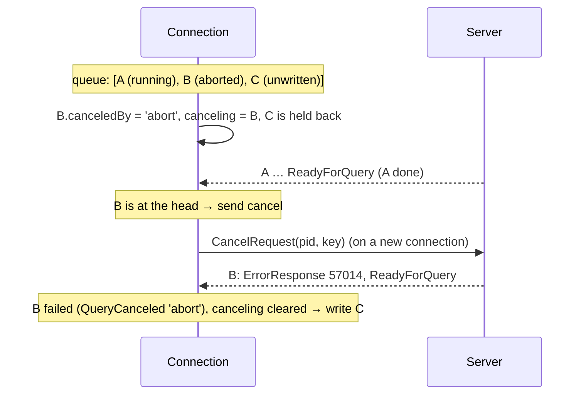

# Cancellation and timeouts

A query can run for a long time: a slow plan, a lock it waits for, an accidental full-table scan. This guide explains how the driver stops one: with an `AbortSignal`, with a client-side `timeout`, with a server-side `statementTimeout`, and with `connection.cancel()`; how a **cancel request** reaches the server; and why the driver holds back later queries while one is being canceled.

Code: `#enqueue`, `#abortOn`, `#timeOut`, `#abort`, `#cancelAtHead`, `cancel`, `#queryWithTimeout` in [connection.ts](connection.ts); `sendCancel` in [connect.ts](connect.ts); `Op.classify` in [ops.ts](ops.ts); `QueryCanceled` in [errors.ts](errors.ts).

## Contents

- [Why canceling is not simple](#why-canceling-is-not-simple)
- [Every timeout in the driver](#every-timeout-in-the-driver)
- [`signal` and `timeout`: canceling from the client](#signal-and-timeout-canceling-from-the-client)
- [The cancel request](#the-cancel-request)
- [Why later writes are held back](#why-later-writes-are-held-back)
- [Statement timeouts](#statement-timeouts)
- [`QueryCanceled` and its reason](#querycanceled-and-its-reason)
- [Why it is built this way](#why-it-is-built-this-way)
- [Glossary](#glossary)

## Why canceling is not simple

Once a query has been sent, the server is working on it; the client can't take the bytes back. Stopping it needs the server's cooperation, and Postgres's mechanism is unusual: the client opens a **new connection** and sends a **CancelRequest** naming the backend process (its pid) and proving the right to cancel it (the secret key from BackendKeyData). The server then interrupts whatever that backend is running at that moment, which fails with `57014 canceling statement due to user request`.

"Whatever it is running at that moment" is the catch. With pipelining, a connection may have several queries in flight; a cancel aimed at the third could hit the first, if that's what the server is still running. And a cancel that arrives while the server is still reading the query's messages is dropped. The driver handles both.

Not sending a query is much simpler: if it is still in the queue, it is just removed.

## Every timeout in the driver

| Option                                   | Where                           | Measured on                        | What happens                                                                                                                                  |
| ---------------------------------------- | ------------------------------- | ---------------------------------- | --------------------------------------------------------------------------------------------------------------------------------------------- |
| `connectTimeout` (30 s)                  | connection options              | the client                         | connecting (TCP, TLS, startup, auth) is abandoned: `ConnectionError` `ETIMEDOUT` ([auth/README.md](auth/README.md#connect-timeout-and-abort)) |
| `acquireTimeout` (30 s)                  | pool                            | the client                         | waiting for a pool connection fails: `ConnectionError` `ETIMEDOUT` ([POOL.md](POOL.md#exclusive-use-acquire-transactions-cursors-copy))       |
| `timeout` (ms)                           | per query                       | the client                         | unsent: dropped (`AbortError`); sent: canceled (`QueryCanceled`, reason `'timeout'`)                                                          |
| `signal`                                 | per query, `acquire`, `connect` | the client                         | the same, reason `'abort'`                                                                                                                    |
| `statementTimeout` (ms or interval)      | per query                       | the **server**                     | the server cancels it (`QueryCanceled`, reason `'statement_timeout'`)                                                                         |
| `timeout`                                | transaction options             | the server (`transaction_timeout`) | the server ends the session: `TransactionTimeout` ([TRANSACTIONS.md](TRANSACTIONS.md#settings-setlocal-and-the-transaction-timeout))          |
| `close({ timeout })`, `end({ timeout })` | connection, pool                | the client                         | what's still running after it is failed and closed                                                                                            |

quarry's `execute({ timeout })` maps to `statementTimeout`, and `signal` to `signal` ([../EXECUTION.md](../EXECUTION.md#timeouts-and-cancellation)).

## `signal` and `timeout`: canceling from the client

`#enqueue(op, signal, timeout)`:

- A signal **already aborted**: the op fails immediately with `AbortError("The query was aborted before it was sent")`; nothing is queued.
- Otherwise `#abortOn` adds an `abort` listener and `#timeOut` starts a timer; both are removed when the op settles (`op.onSettle`), so a finished query leaves no listener or timer behind. (They are separate methods so that queries without them don't pay for the closures.)

Both call `#abort(op, reason)`:

```ts
#abort(op, reason, cause?) {
	if (op.done) return;
	if (!op.written) {                 // still in the queue: just drop it
		this.#queue.removeAt(this.#queue.indexOf(op));
		op.fail(new AbortError(reason === 'timeout' ? 'The query timed out before it was sent' : 'The query was aborted before it was sent', { cause }));
		return;
	}
	op.canceledBy = reason;            // sent: ask the server
	this.#canceling ??= op;            // hold back later writes
	this.#cancelAtHead();
}
```

A query that was never sent can't have done anything, so it fails with `AbortError` and the connection is unaffected. A sent one is canceled on the server.

## The cancel request

`connection.cancel()` calls the `cancel` function `connect.ts` gave the connection at open time: `sendCancel(config, host, plan, pid, key)`.

1. Open a **new socket** to the same host, with the **same TLS plan** as the original connection (a cancel request in plain text would expose the key).
2. Send `CancelRequest`: `Int32 length`, `Int32 80877102`, `Int32 pid`, the key (4 bytes in protocol 3.0, up to 256 in 3.2).
3. Wait for the server to close the socket (it sends nothing back), or 5 seconds; then destroy it.

`cancel()` resolves once the request was delivered; the canceled query then fails on the original connection. Calling `connection.cancel()` yourself cancels whatever is running (reason `'user'`, since the op didn't ask for it).

## Why later writes are held back

<a id="why-later-writes-are-held-back"></a>
Two rules make a cancel hit the query it was meant for:

1. **Send it only when the op is at the head of the queue** (`#cancelAtHead`): the server answers in order, so the op whose replies are being read is the one it is running. If the op to cancel is third in the pipeline, the cancel waits until the first two finish. A query pipelined behind others is canceled once the server gets to it, never one ahead of it.
2. **Write nothing after it until it completes** (`#canceling` stops `#flush`): otherwise, by the time the cancel arrives, the server may have finished the target and started a later query, which would be canceled instead.



**Repeated, with backoff.** The server drops a cancel that arrives while it is still reading the query's messages (before it starts executing). So `#cancelAtHead` sends the cancel, and while the op is still running and at the head, sends it again after 50, 100, 200, 400 and 800 ms (at most 6 attempts). The timers are `unref`'d and cleared when the op settles.

If another aborted op is waiting further back, `#canceling` moves to it when the first settles, keeping later writes held back until it too is done.

In a `SyncGroupOp` (several statements under one Sync), a cancel applies to the group: `canceledBy` is passed to the statement currently running, which is the one the server interrupts; the rest are skipped by the server as after any error.

## Statement timeouts

<a id="statement-timeouts"></a>
A client-side timeout can only ask the server to stop. A **server-side** timeout makes the server stop by itself: Postgres's `statement_timeout` setting cancels any statement that runs longer. The `statementTimeout` query option sets it for one query, with `set_config('statement_timeout', $1, true)`: a bound parameter, and **transaction-local** (the `true`), so the setting can't outlive the query or, behind a pooler, leak into another client's session.

`#queryWithTimeout(sql, params, options, timeout)`:

- **Outside a transaction**: wrap the query in its own, all four statements pipelined in one write (captured):

```
C> begin Sync  select set_config('statement_timeout', $1, true) as previous Sync  <query> Sync  commit Sync
```

The query's result is returned; if it failed, its error is thrown (before any other).

- **Inside a transaction**: read the current value and set the new one in one statement (`select current_setting('statement_timeout') as previous, set_config('statement_timeout', $1, true)`), pipelined with the query; afterwards, if still in the transaction, restore the previous value, without waiting.

Numbers are milliseconds (`'2000ms'`); strings are any Postgres interval (`'2s'`, `'500ms'`).

## `QueryCanceled` and its reason

`QueryCanceled` (`57014`) has a `reason`:

| `reason`              | Meaning                                                                          | How the driver knows                                              |
| --------------------- | -------------------------------------------------------------------------------- | ----------------------------------------------------------------- |
| `'abort'`             | this client canceled it because a `signal` aborted                               | the op's `canceledBy` (set by `#abort`, applied by `Op.classify`) |
| `'timeout'`           | this client canceled it because its `timeout` expired                            | the op's `canceledBy`                                             |
| `'statement_timeout'` | the server's `statement_timeout`                                                 | the message says "statement timeout"                              |
| `'user'`              | anything else: `connection.cancel()`, `pg_cancel_backend()` from another session | default                                                           |

## Why it is built this way

- **Drop if unsent, cancel if sent**: the cheapest correct action in each case; dropping touches neither the server nor the connection.
- **Cancel only at the head, hold later writes**: the cancel can only hit its target, even with deep pipelines.
- **Repeat the cancel**: Postgres ignores cancels that arrive too early; retrying with backoff is the only way to make them reliable.
- **Server-side statement timeouts, transaction-local**: the server enforces them even if the client is stuck, and they can't leak through poolers.
- **Every wait has a timeout**: connecting, acquiring, running, closing: nothing in the driver waits forever by default except an explicit `acquireTimeout: 0`.

## Glossary

**`AbortSignal`**: the standard JavaScript object (from an `AbortController`) that tells an operation to stop.

**BackendKeyData**: the server's startup message with the backend's pid and secret key.

**CancelRequest**: the message, on its own connection, that asks the server to interrupt a backend.

**`statement_timeout`**: the Postgres setting that cancels statements running longer than it.

**`unref`**: marks a Node timer as not keeping the process alive.
