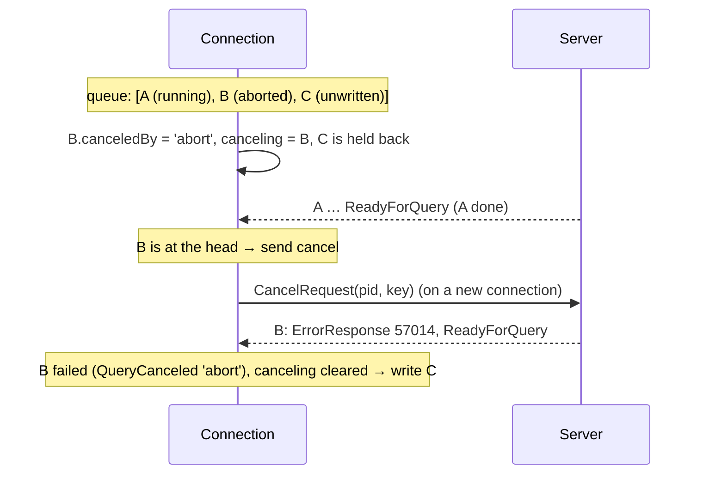

# Cancellation and timeouts

A query can run for a long time: a slow plan, a lock it waits for, an accidental full-table scan. This guide explains how the driver stops one: with an `AbortSignal`, with a client-side `timeout`, with a server-side `statementTimeout`, and with `connection.cancel()`; how a **cancel request** reaches the server; and why the driver holds back later queries while one is being canceled.

Code: `#enqueue`, `#abortOn`, `#timeOut`, `#abort`, `#cancelAtHead`, `cancel`, `#queryWithTimeout` in [connection.ts](connection.ts); `sendCancel` in [connect.ts](connect.ts); `Op.classify` in [ops.ts](ops.ts); `QueryCanceled` in [errors.ts](errors.ts).

## Contents

- [Why canceling is not simple](#why-canceling-is-not-simple)
- [Every timeout in the driver](#every-timeout-in-the-driver)
- [`signal` and `timeout`: canceling from the client](#signal-and-timeout-canceling-from-the-client)
- [The cancel request](#the-cancel-request)
- [Why later writes are held back](#why-later-writes-are-held-back)
- [Statement timeouts](#statement-timeouts)
- [`QueryCanceled` and its reason](#querycanceled-and-its-reason)
- [Decisions](#decisions)
- [Glossary](#glossary)

## Why canceling is not simple

Once a query has been sent, the server is working on it; the client can't take the bytes back. Stopping it needs the server's cooperation, and Postgres's mechanism is unusual: the client opens a **new connection** and sends a **CancelRequest** naming the backend process (its pid) and proving the right to cancel it (the secret key from BackendKeyData). The server then interrupts whatever that backend is running at that moment, which fails with `57014 canceling statement due to user request`.

"Whatever it is running at that moment" is the catch. With pipelining, a connection may have several queries in flight; a cancel aimed at the third could hit the first, if that's what the server is still running. And a cancel that arrives while the server is still reading the query's messages is dropped. The driver handles both.

Not sending a query is much simpler: if it is still in the queue, it is just removed.

## Every timeout in the driver

| Option                                   | Where                           | Measured on                        | What happens                                                                                                                                  |
| ---------------------------------------- | ------------------------------- | ---------------------------------- | --------------------------------------------------------------------------------------------------------------------------------------------- |
| `connectTimeout` (30 s)                  | connection options              | the client                         | connecting (TCP, TLS, startup, auth) is abandoned: `ConnectionError` `ETIMEDOUT` ([auth/README.md](auth/README.md#connect-timeout-and-abort)) |
| `acquireTimeout` (30 s)                  | pool                            | the client                         | waiting for a pool connection fails: `ConnectionError` `ETIMEDOUT` ([POOL.md](POOL.md#exclusive-use-acquire-transactions-cursors-copy))       |
| `timeout` (ms)                           | per query                       | the client                         | unsent: dropped (`AbortError`); sent: canceled (`QueryCanceled`, reason `'timeout'`)                                                          |
| `signal`                                 | per query, `acquire`, `connect` | the client                         | the same, reason `'abort'`                                                                                                                    |
| `statementTimeout` (ms or interval)      | per query                       | the **server**                     | the server cancels it (`QueryCanceled`, reason `'statement_timeout'`)                                                                         |
| `timeout`                                | transaction options             | the server (`transaction_timeout`) | the server ends the session: `TransactionTimeout` ([TRANSACTIONS.md](TRANSACTIONS.md#settings-setlocal-and-the-transaction-timeout))          |
| `close({ timeout })`, `end({ timeout })` | connection, pool                | the client                         | what's still running after it is failed and closed                                                                                            |

quarry's `execute({ timeout })` maps to `statementTimeout`, and `signal` to `signal` ([../EXECUTION.md](../EXECUTION.md#timeouts-and-cancellation)).

## `signal` and `timeout`: canceling from the client

`#enqueue(op, signal, timeout)`:

- A signal **already aborted**: the op fails immediately with `AbortError("The query was aborted before it was sent")`; nothing is queued.
- Otherwise `#abortOn` adds an `abort` listener and `#timeOut` starts a timer; both are removed when the op settles (`op.onSettle`), so a finished query leaves no listener or timer behind. (They are separate methods so that queries without them don't pay for the closures.)

Both call `#abort(op, reason)`:

```ts
#abort(op, reason, cause?) {
	if (op.done) return;
	if (!op.written) {                 // still in the queue: just drop it
		this.#queue.removeAt(this.#queue.indexOf(op));
		op.fail(new AbortError(reason === 'timeout' ? 'The query timed out before it was sent' : 'The query was aborted before it was sent', { cause }));
		return;
	}
	op.canceledBy = reason;            // sent: ask the server
	this.#canceling ??= op;            // hold back later writes
	this.#cancelAtHead();
}
```

A query that was never sent can't have done anything, so it fails with `AbortError` and the connection is unaffected. A sent one is canceled on the server.

## The cancel request

`connection.cancel()` calls the `cancel` function `connect.ts` gave the connection at open time: `sendCancel(config, host, plan, pid, key)`.

1. Open a **new socket** to the same host, with the **same TLS plan** as the original connection (a cancel request in plain text would expose the key).
2. Send `CancelRequest`: `Int32 length`, `Int32 80877102`, `Int32 pid`, the key (4 bytes in protocol 3.0, up to 256 in 3.2).
3. Wait for the server to close the socket (it sends nothing back), or 5 seconds; then destroy it.

`cancel()` resolves once the request was delivered; the canceled query then fails on the original connection. Calling `connection.cancel()` yourself cancels whatever is running (reason `'user'`, since the op didn't ask for it).

## Why later writes are held back

<a id="why-later-writes-are-held-back"></a>
Two rules make a cancel hit the query it was meant for:

1. **Send it only when the op is at the head of the queue** (`#cancelAtHead`): the server answers in order, so the op whose replies are being read is the one it is running. If the op to cancel is third in the pipeline, the cancel waits until the first two finish. A query pipelined behind others is canceled once the server gets to it, never one ahead of it.
2. **Write nothing after it until it completes** (`#canceling` stops `#flush`): otherwise, by the time the cancel arrives, the server may have finished the target and started a later query, which would be canceled instead.



**Repeated, with backoff.** The server drops a cancel that arrives while it is still reading the query's messages (before it starts executing). So `#cancelAtHead` sends the cancel, and while the op is still running and at the head, sends it again after 50, 100, 200, 400 and 800 ms (at most 6 attempts). The timers are `unref`'d and cleared when the op settles.

If another aborted op is waiting further back, `#canceling` moves to it when the first settles, keeping later writes held back until it too is done.

In a `SyncGroupOp` (several statements under one Sync), a cancel applies to the group: `canceledBy` is passed to the statement currently running, which is the one the server interrupts; the rest are skipped by the server as after any error.

## Cursors

<a id="cursors"></a>
A cursor ([STREAMING.md](STREAMING.md#cursors)) spends most of its life **suspended**: the server has sent a batch and waits for the next Execute, while your loop works. A cancel request then does nothing, since the backend isn't running anything (before #34, that is all an abort did, so aborting a stream between batches had no effect). `CursorOp.interrupt(reason)` (and the `CursorIterator`'s own signal and timer for a cursor inside a transaction) therefore distinguishes:

- **Between batches**: close the portal (Close + Sync outside a transaction), with no cancel request; the next pull rejects with `AbortError` ("The cursor was aborted" / "timed out").
- **While a batch runs**: ask the server to cancel it, as for a query; the batch fails with `QueryCanceled` (`reason: 'abort'` or `'timeout'`). Inside a transaction that fails the transaction, like any canceled statement.

`statementTimeout` on a cursor bounds it from its first batch to its last, the consumer's time included, because a suspended portal keeps `statement_timeout` running across Executes ([framed like a query's](#a-cursors-statement-timeout)).

## Statement timeouts

<a id="statement-timeouts"></a>
A client-side timeout can only ask the server to stop. A **server-side** timeout makes the server stop by itself: Postgres's `statement_timeout` setting cancels any statement that runs longer. The `statementTimeout` query option sets it for one query, with `set_config('statement_timeout', $1, true)`: a bound parameter, and **transaction-local** (the `true`), so the setting can't outlive the query or, behind a pooler, leak into another client's session.

`#queryWithTimeout(sql, params, options, timeout)` sends three statements under **one Sync**, as one `SyncGroupOp`, in one write:

```
C> S($1 = '2000ms')  <query>  S($1 = null)  Sync
```

`S` is one prepared statement:

```sql
select case when $1::text is null
  then set_config('statement_timeout', current_setting('quarry.statement_timeout'), true)
  else set_config('quarry.statement_timeout', current_setting('statement_timeout'), true)
    || set_config('statement_timeout', $1, true)
end
```

With a value, it keeps the current `statement_timeout` in a custom setting, `quarry.statement_timeout`, and sets the new one. With null, it puts the kept value back. Both settings are transaction-local, so the same three statements are right in both cases:

- **Outside a transaction block**: statements under one Sync run in one implicit transaction, which ends at the Sync and takes both settings with it; the restore changes nothing.
- **Inside one** (a `Transaction`, or `begin` sent by the caller): the restore ends the setting right after the query, so the transaction's later statements keep their own `statement_timeout` (a `set local` included). If the query fails, the server skips the restore and the transaction is failed anyway; rolling back (or to a savepoint) discards the setting.

PostgreSQL re-arms `statement_timeout` for each Execute, from the value current when the statement starts, so the query, and only the query, runs under the new value.

The query's result is returned, or its error is thrown. If `S` fails (an invalid interval, such as `'soon'`), the server skips the query, which rejects with that error. A query that can't be sent (an `undefined` parameter) fails before any of the group is written, so `S` is never sent alone, which inside a transaction would have left the setting on its later statements. Both uses of `S` declare their parameter as `text` (OID 25), so the statement cache finds one statement for them, keyed by its SQL, and the connection prepares it once. Over a pool the group is one operation: it frees its pipeline slot at its ReadyForQuery, before the caller's callbacks, as any query does, so the adaptive depth and [width](POOL.md#adaptive-width) count it as one completion. `signal` and `timeout` cancel the group, which hits the statement running ([above](#why-later-writes-are-held-back)); `onTiming` times the whole group.

Numbers are milliseconds (`'2000ms'`); strings are any Postgres interval (`'2s'`, `'500ms'`).

**Why one Sync group, independent of the transaction status.** The connection's transaction status is the one in the **last ReadyForQuery received**: it says how the last answered query left the connection, not how the queries still queued or in flight ahead of this one will leave it. Until #38 the framing was chosen from it (`begin`/`set_config`/query/`commit` with four Syncs when idle; set, query, then an asynchronous restore when in a transaction). On a pipelined connection, a pool's shared connection included, that was wrong three ways:

- **Not applied.** In a transaction whose `commit` is already queued (another caller's transaction, or another timed query's framing), the in-transaction variant ran its `set_config(…, true)` after that commit, in an implicit transaction of its own, and the query ran unbounded. The pool doesn't pipeline onto a connection reporting a transaction, but a caller waiting for a pipeline slot is handed one mid-read and runs a microtask later, after the rest of that read (which can hold another timed query's `begin`) changed the status.
- **Another caller's transaction committed.** Behind a `begin` not yet answered, the status still said idle: the timed query's own `begin` was ignored (a warning) and its `commit` committed the other caller's transaction, half done.
- **Applied to the wrong statement.** In a transaction, the restore was sent only once the query's answer came back, so statements pipelined behind it ran under its timeout.

In one Sync group nothing can come between the setting, the query and the restore, and the same statements are right in or out of a transaction block, so the status isn't read. Behind PgBouncer in transaction mode, the group ends with one Sync and ReadyForQuery, so the server connection stays linked for all three and is released after, as for any query.

`S` is one statement for both ends because its Parse then comes first in the group, where nothing can make the server skip it. With two statements, a query that failed made the server skip the restore's Parse, while groups pipelined behind it had already bound that name (`26000 prepared statement does not exist`).

Because the timeout leaves nothing on the connection, quarry's executor runs a builder query or a default `db.batch` with a `timeout` on the pool's shared, pipelined connections, like any other ([../EXECUTION.md](../EXECUTION.md#connections-shared-or-exclusive)).

<a id="a-cursors-statement-timeout"></a>
**A cursor's statement timeout.** A cursor with a `statementTimeout` is always opened as an unnamed portal in the implicit transaction of one Sync (the kind used outside a transaction: [STREAMING.md](STREAMING.md#cursors)), whatever the transaction status says, and `CursorOp` frames it like a query:

```
C> S('2000ms')  Parse/Bind/Execute(portal) Flush   … Execute Flush per batch …   [Close]  S(null)  Sync
```

`S` (unnamed: a cursor runs rarely enough) shares the portal's implicit transaction, so the setting covers every batch; outside a transaction block the Sync ends it, inside one the restore does. The restore is written only once nothing the portal asked for is unanswered (its statement's Describe, a running batch), so its answers come last and can't be mistaken for the portal's: a cursor closed while the server runs a batch writes Close, the restore and Sync when that batch ends, which costs nothing, since the server finishes the batch anyway. After an error the server skips to the Sync, restore included, which a failed implicit transaction doesn't need (an explicit one is failed and rolls the setting back). A cursor that goes stale on its first batch is reopened with `S` again, since its implicit transaction ended with the error.

Until #38 the cursor read the status instead: when idle it queued `begin` and the setting before the cursor and `commit` after it, each with its own Sync, so behind a `begin` not yet answered, its `commit` committed the other caller's transaction. The refusal inside a transaction (whose other queries run between a held portal's batches) now comes from the `Transaction`, which knows it is one; on a plain connection after `begin`, a timed cursor holds the connection between batches, like a cursor outside a transaction.

## `QueryCanceled` and its reason

`QueryCanceled` (`57014`) has a `reason`:

| `reason`              | Meaning                                                                          | How the driver knows                                              |
| --------------------- | -------------------------------------------------------------------------------- | ----------------------------------------------------------------- |
| `'abort'`             | this client canceled it because a `signal` aborted                               | the op's `canceledBy` (set by `#abort`, applied by `Op.classify`) |
| `'timeout'`           | this client canceled it because its `timeout` expired                            | the op's `canceledBy`                                             |
| `'statement_timeout'` | the server's `statement_timeout`                                                 | the message says "statement timeout"                              |
| `'user'`              | anything else: `connection.cancel()`, `pg_cancel_backend()` from another session | default                                                           |

## Decisions

Why cancellation works this way. Each links to its full entry (what it is, why, the alternatives, the cost, measured impact) in [DECISIONS.md](DECISIONS.md):

- [Drop unsent queries without contacting the server](DECISIONS.md#drop-unsent-queries-without-contacting-the-server): the cheapest correct action; nothing touches the server.
- [Cancel only the query at the head, and hold back later writes](DECISIONS.md#cancel-only-the-query-at-the-head-and-hold-back-later-writes): the cancel can only hit its target, even with deep pipelines; repeated because Postgres ignores early cancels.
- [Aborting a suspended cursor closes it instead of cancelling](DECISIONS.md#aborting-a-suspended-cursor-closes-it-instead-of-cancelling): between batches there is nothing to cancel.
- [Server-side statement timeouts, transaction-local and pipelined](DECISIONS.md#server-side-statement-timeouts-transaction-local-and-pipelined): the server enforces them even if the client is stuck.
- [A statement timeout is framed under the query's Sync, whatever the transaction status](DECISIONS.md#a-statement-timeout-is-framed-under-the-querys-sync-whatever-the-transaction-status): it bounds its own query alone, whatever else is pipelined.
- [A statement timeout bounds the whole stream](DECISIONS.md#a-statement-timeout-bounds-the-whole-stream): for cursors.
- [Every wait has a timeout](DECISIONS.md#every-wait-has-a-timeout): nothing waits forever by default.

## Glossary

**`AbortSignal`**: the standard JavaScript object (from an `AbortController`) that tells an operation to stop.

**BackendKeyData**: the server's startup message with the backend's pid and secret key.

**CancelRequest**: the message, on its own connection, that asks the server to interrupt a backend.

**`statement_timeout`**: the Postgres setting that cancels statements running longer than it.

**`unref`**: marks a Node timer as not keeping the process alive.
