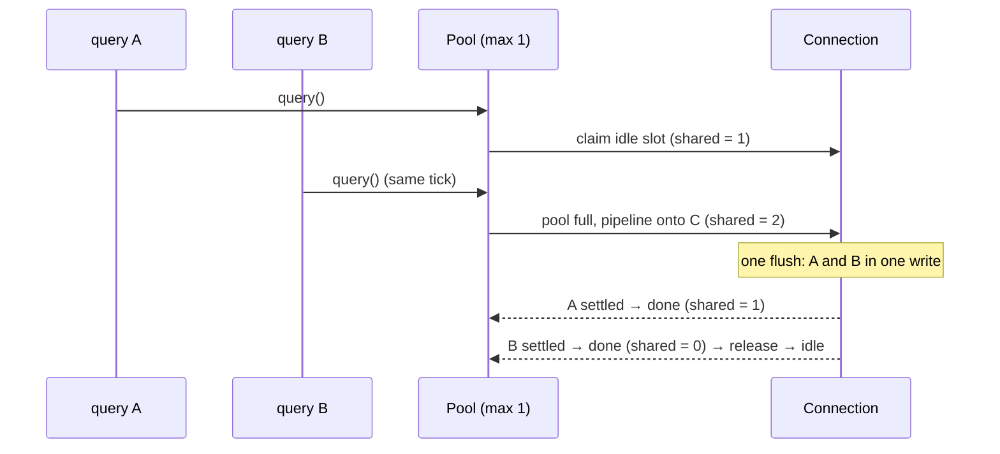

# The connection pool

[pool.ts](pool.ts). A **pool** keeps a set of open connections and lends them out, so programs don't pay for a new connection per request ([ARCHITECTURE.md](ARCHITECTURE.md#why-connections-are-expensive-and-why-pools-exist)). quarry's pool does more than lend: when every connection is busy, it **pipelines** further queries onto the connections already in use, adapting how many it puts on each to the network; and it guarantees that callers who need a connection to themselves (transactions, cursors) aren't starved by that pipelining.

## Contents

- [Options](#options)
- [The bookkeeping](#the-bookkeeping)
- [Two ways to use a connection](#two-ways-to-use-a-connection)
- [Exclusive use: `acquire`, transactions, cursors, COPY](#exclusive-use-acquire-transactions-cursors-copy)
- [Opening connections](#opening-connections)
- [Releasing and giving back](#releasing-and-giving-back)
- [Pipelining onto busy connections](#pipelining-onto-busy-connections)
- [Adaptive pipeline depth](#adaptive-pipeline-depth)
- [Draining for exclusive callers](#draining-for-exclusive-callers)
- [Idle timeout, lifetime and `min`](#idle-timeout-lifetime-and-min)
- [Ending the pool](#ending-the-pool)
- [How quarry uses the pool](#how-quarry-uses-the-pool)
- [Decisions](#decisions)
- [Glossary](#glossary)

## Options

`PoolOptions` extends the connection options ([auth/README.md](auth/README.md#configuration)) with:

| Option           | Default   | Meaning                                                                                                          |
| ---------------- | --------- | ---------------------------------------------------------------------------------------------------------------- |
| `max`            | 10        | most connections open at once (opening ones count)                                                               |
| `min`            | 0         | connections kept open even when idle                                                                             |
| `idleTimeout`    | 30 s      | close a connection idle this long (0: never)                                                                     |
| `maxLifetime`    | 1 h       | replace connections older than this, minus up to 10% random jitter (0: never)                                    |
| `acquireTimeout` | 30 s      | how long a caller waits for a connection (0: forever)                                                            |
| `maxWaiting`     | unlimited | fail fast once this many callers are waiting                                                                     |
| `pipeline`       | adaptive  | pipeline depth per shared connection: adaptive from 100 to 1000; a number fixes it; `false`/`0` disables sharing |
| `onConnect`      |           | runs on each new connection before first use (e.g. to `SET` session state)                                       |

`createPool(options | connectionString)` resolves the configuration once (`resolveConfig`), fills `min`, and in the background preloads the socket modules the connections will need (`preloadSockets`) so the first query doesn't pay for loading `node:tls`.

## The bookkeeping

```ts
interface Slot {             // one per open connection
	readonly connection: Connection;
	busy: boolean;           // lent out (for queries, or to one caller)
	shared: number;          // queries in flight while lent for queries; -1 when not shared
	readonly expiresAt: number; // end of its lifetime
	idleSince: number;
	depth: Depth | undefined;   // its adaptive pipeline depth, once a query was timed
	readonly settled; readonly fulfilled; readonly rejected; // callbacks made once per connection
}
#slots = new Map<Connection, Slot>(); // every open connection
#idle: Slot[] = [];                   // a stack: most recently used last
#busy = 0;                            // slots lent out
#waiters: Waiter[] = [];              // callers waiting for a connection of their own
#sharedWaiters: Waiter[] = [];        // queries waiting for a pipeline slot
#draining = new Set<Slot>();          // shared connections taking no new queries, reserved for #waiters
#opening = 0;                         // connections being opened
```

State lives in fields of the slot (`busy`, `shared`) rather than in sets of busy or shared connections: adding and removing a connection from a set on every query makes the set rehash, garbage that shows up as GC pauses. The three callbacks are made once per connection for the same reason: a closure per query would allocate a context per query.

`stats` reports `{ total, idle, busy, waiting }`.

## Two ways to use a connection

|                      | Exclusive                                                                                            | Shared                                                                  |
| -------------------- | ---------------------------------------------------------------------------------------------------- | ----------------------------------------------------------------------- |
| Who                  | `acquire()` (→ `PoolClient`), `transaction()`, `cursor()`/`stream()`, `copyFrom`/`copyRows`/`copyTo` | `query()`, `simpleQuery()`, `describe()`, `loadTypes()`, `withShared()` |
| Holds the connection | until released / the callback or iteration ends                                                      | for one query (`withShared`: one group of queries)                      |
| Can share it         | no: session state, open transactions or a portal belong to one caller                                | yes: one query at a time per caller, pipelined with others              |
| Path                 | `#take` → `#waiters`                                                                                 | `#claimShared` → `#sharedWaiters`                                       |

## Exclusive use: `acquire`, transactions, cursors, COPY

```ts
#take(signal): Promise<Connection> {
	if (this.#ended) return Promise.reject(new DriverError('The pool has ended'));
	if (signal?.aborted) return Promise.reject(new AbortError(…));
	const idle = this.#takeIdle();
	if (idle !== undefined) return Promise.resolve(idle.connection);
	const waiting = this.#wait(this.#waiters, signal);
	this.#serveWaiters(); // open a connection if there's room
	this.#rebalance();    // or drain a shared one, if the pool is full
	return waiting;
}
```

- `#takeIdle()` pops the **most recently used** idle connection (a stack, LIFO), discarding closed or expired ones. Reusing the warmest connection lets the others reach their idle timeout when traffic drops, so the pool shrinks naturally.
- `#wait(queue, signal)` queues a `Waiter` with an `acquireTimeout` timer (`ConnectionError` `ETIMEDOUT`) and the abort signal (`AbortError`); either removes it from the queue. Past `maxWaiting`, it rejects immediately: under overload, failing fast is better than an ever-growing queue.
- `#with(signal, fn)` is `#take`, run `fn`, release in `finally`: what `transaction`, `copyFrom` and `copyRows` use. `cursor` and `copyTo` are async generators that hold the connection across `yield`s and release in `finally` (also when the consumer `break`s).
- `acquire()` wraps the connection in a **`PoolClient`**: `query`, `cursor`, `stream`, `describe`, `transaction`, `connection` (the raw one), and `release(discard?)`; `await using client = await pool.acquire()` releases it at the end of the scope. Release twice is a no-op; using it after release throws.

## Opening connections

```ts
#serveWaiters(): void {
	while (this.#waiters.length + this.#sharedWaiters.length > this.#opening && this.#total() < this.#max) {
		this.#open().then(
			(slot) => this.#giveBack(slot),
			(error) => { /* reject one waiter with the error; then try again for the others */ },
		);
	}
}
```

- It opens one connection per waiter not already covered by one being opened, up to `max`.
- `#open()` calls `openConnection(config)` ([auth/README.md](auth/README.md)), runs `onConnect` (destroying the connection if it throws), creates the slot with a **jittered** expiry (`maxLifetime × (1 − random × 0.1)`, so connections opened together don't all expire together), and registers `connection.onClose(() => this.#forget(slot))`.
- **A failure rejects one waiter** (the first) with the connection error, then calls `#serveWaiters` again: each waiter gets its own attempt, so a transient failure doesn't fail every waiter at once, and a persistent one fails them one by one with the real error.
- `#forget(slot)`: a connection closed on its own (server restart, network loss, the server's idle timeout) is removed everywhere, and the pool re-serves waiters, rebalances and refills `min`.

## Releasing and giving back

```ts
#releaseSlot(slot, discard) {
	const reusable = !discard && !connection.closed && !this.#expired(slot);
	if (!reusable) { close it; serve waiters; refill min; return; }
	if (connection.pending > 0 || connection.transactionStatus !== 'idle') { this.#releaseWhenIdle(slot); return; }
	this.#unlend(slot);
	this.#giveBack(slot);
}
```

- `release(true)` (or an error) discards the connection: for one left in an unknown session state.
- A connection released with queries still running, or **inside a transaction**, is never handed to someone else straight away: `#releaseWhenIdle` waits for its queries to finish; if it's still in a transaction then (the caller forgot to commit or roll back), the connection is **destroyed** ("Released with a transaction open"), because the next borrower would otherwise run inside someone else's transaction.

`#giveBack(slot)` decides where an available connection goes, in priority order:

1. the first **exclusive waiter**;
2. else, if queries wait for a pipeline slot, it becomes **shared**: `shared = 0` and `#fillShared` gives it queued queries, at most `ceil(sharedWaiters / (opening + 1))` of them, so a burst is spread across the connections still being opened instead of piling onto the first;
3. else, if the pool is ending, it is closed;
4. else it is parked idle, and the idle sweep is armed.

## Pipelining onto busy connections

<a id="pipelining-onto-busy-connections"></a>
When every connection is busy, a pool without pipelining makes the next query wait for one to be free: throughput is capped at `max` queries per round trip. quarry's pool instead sends it on a connection that is already running queries: the connection pipelines it ([ARCHITECTURE.md](ARCHITECTURE.md#pipelining)), and its answer comes back right after the others.

`pool.query()` is written with **no closures** (it runs for every query):

```ts
query(sql, params, options) {
	const slot = this.#claimShared(options?.signal);
	if (slot === undefined) return this.#queryShared(sql, params, options); // wait in line
	const started = this.#timing();
	return slot.connection.queryThen(sql, params, options,
		started < 0 ? slot.settled : this.#settledTimed(slot, started));
}

#claimShared(signal) {
	if (this.#pipeline <= 1 || signal?.aborted || this.#ended) return undefined;
	const slot = this.#takeIdle() ?? this.#pickShared(); // claimed before any await
	if (slot !== undefined) slot.shared = Math.max(0, slot.shared) + 1;
	return slot;
}
```

- **An idle connection first.** Only when there is none does it pipeline.
- **`#pickShared()`** picks a connection to pipeline onto only when the pool is **full** (`total >= max`), no connection is idle, and no query is already queued (`sharedWaiters` empty: queued queries go first, in order). Among shared connections, it takes the **least loaded** that is below its pipeline depth, not draining, and `#shareable` (open, not in a transaction, not expired). Before the pool is full, a new connection is better than pipelining.
- **Claimed synchronously**, before any `await`: queries issued in the same tick see each other's claims and spread out.
- `connection.queryThen(…, onDone)`: the connection calls `onDone` when the query settles, **before** the caller's `.then` callbacks run ([ARCHITECTURE.md](ARCHITECTURE.md#reading-replies)), so the slot is freed before the caller's next query is issued.
- **`#done(slot, started)`** ends a query's turn: decrement `shared`; feed its latency to the adaptive depth if it was timed; hand the free slot straight to the next queued query (`#fillShared`); when the last query finishes, the connection stops being shared and goes back through `#releaseSlot` (to an exclusive waiter, a queued query, or idle).
- If no slot can be claimed, `#queryShared` → `#withShared` → `#waitShared` queues the query in `#sharedWaiters` (and opens a connection if there's room). It runs when `#fillShared` hands it a slot on any connection, or `#giveBack` makes one shared.



The pool's `pipeline <= 1` disables all of this (every query takes the exclusive path).

## Adaptive pipeline depth

<a id="adaptive-pipeline-depth"></a>
How many queries should one connection carry? Too few, and on a slow network each connection idles while its answers travel back; too many, and queries just queue on the server behind each other, adding latency for nothing. The right depth depends on the round-trip time, which the pool can't know in advance. So, by default, each connection measures it (`Depth`):

```ts
class Depth {
	limit = PIPELINE_FLOOR; // 100
	#fastest = Infinity;
	#sum = 0;
	#count = 0;
	sample(latency, waiting) {
		if (latency < this.#fastest) this.#fastest = latency;
		this.#sum += latency;
		if (++this.#count * SAMPLE_EVERY < this.limit) return; // a round: about `limit` queries
		const ratio = this.#sum / this.#count / this.#fastest;
		this.#sum = 0;
		this.#count = 0;
		if (ratio < 1.5 && waiting)
			this.limit = Math.min(1000, Math.ceil(this.limit * 1.5));
		else if (ratio > 3)
			this.limit = Math.max(100, Math.floor(this.limit * 0.75));
	}
}
```

- A query's latency is at least one round trip; the **fastest** latency seen estimates that floor. It only ever decreases, so if the network gets slower the estimate errs towards a shallower pipeline.
- One shared query in 8 is timed (`#timing`: a counter and a bit mask, then `performance.now()`), to keep the cost negligible.
- Each **round** (about `limit` queries, one round trip's worth of a full pipeline) compares the average timed latency with the floor:
  - **near it** (under 1.5×): queries aren't queueing on the server; the round trip is what limits throughput. If callers are **waiting** for a slot, a deeper pipeline helps: grow by half, up to 1000.
  - **far above it** (over 3×): the server (or the client) is the bottleneck, and more depth only lines queries up: shrink by a quarter, down to 100.
- At 0 ms network latency it stays at 100; at 5 ms with 1000 callers on one connection it grows until it reaches the server's throughput rather than 100 queries per round trip.

`pipeline: n` fixes the depth at n (no sampling).

## Draining for exclusive callers

<a id="draining-for-exclusive-callers"></a>
The danger of sharing: under a steady stream of queries, a shared connection might **never** become free, because each finishing query is immediately replaced by a queued one. A caller waiting for a connection of its own (a transaction) would wait forever while queries keep flowing: **starvation**.

`#rebalance()` prevents it:

```ts
#rebalance() {
	const target = this.#ended || this.#total() < this.#max ? 0 : Math.max(0, this.#waiters.length - this.#opening);
	// release draining connections beyond the target …
	while (this.#draining.size < target) {
		// mark the least-loaded shared connection as draining
	}
}
```

- **Target**: one draining connection per exclusive waiter that no connection being opened will serve, but only when the pool is full (otherwise a new connection is coming).
- A **draining** connection takes **no new queries** (`#pickShared` and `#fillShared` skip it). Queries already in flight on it finish, at most its pipeline depth of them, however many keep arriving; then `#done` releases it and `#giveBack` hands it to the waiting caller first.
- The least-loaded shared connection is chosen, so the wait is as short as possible. The other connections keep pipelining.
- When waiters leave (served, timed out, aborted), extra draining connections are released back to sharing.

`#rebalance` runs whenever the balance can change: a waiter arrives or leaves, a connection opens, fails or closes.

## Idle timeout, lifetime and `min`

- **Idle timeout**: a connection idle for `idleTimeout` is closed, unless that would leave fewer than `min`.
- **Lifetime**: a connection past `maxLifetime` is closed when released or found idle, and replaced if needed for `min` (even if that briefly leaves fewer than `min`). Recycling connections picks up server configuration changes and DNS changes, and limits per-backend memory growth. `#shareable` stops putting new queries on an expired connection.
- **One timer for all idle connections**: parking a connection doesn't start a timer of its own. `#armSweep(deadline)` only re-arms the single sweep timer if this deadline is earlier than the armed one; `#sweepIdle` closes (or keeps, below `min`) the connections that are due and re-arms for the next deadline. Timers are `unref`'d, so an idle pool doesn't keep the process alive.
- **`min`**: `#fillMin` opens connections until `min` exist; failures are retried on the next acquire or release.

## Ending the pool

<a id="ending-the-pool"></a>
`pool.end({ timeout? })` stops new work and closes the pool **once the work already issued is done**:

1. `#ended` is set: `#take` and `query` reject new calls; `#rebalance` drains nothing.
2. Idle connections are closed now.
3. Queries and callers **already waiting** still get a connection; reserved clients and transactions keep theirs until released. Released connections are closed instead of parked.
4. `#checkDrained` resolves the end once nothing is waiting, lent out or opening.
5. With `timeout`, whatever is still waiting or running after it is failed ("The pool has ended") and its connection closed immediately.
6. The LISTEN connection is closed too.

`end()` is idempotent (it returns the same promise), and `Pool` implements `AsyncDisposable`.

The pool's **LISTEN** connection (`pool.listen`) is a dedicated connection outside `max`, described in [STREAMING.md](STREAMING.md#listen-and-notify).

## How quarry uses the pool

quarry's `DriverExecutor` ([../EXECUTION.md](../EXECUTION.md#connections-shared-or-exclusive)) takes both paths:

- **Shared**, for what leaves nothing on the connection: a builder query or `db.sql` statement through `pool.query`, `describe` through `pool.describe`, and a default `db.batch` through `withShared`. So concurrent builder queries get everything above: idle connections first, pipelining onto busy ones once the pool is full, the FIFO of slots, the adaptive depth, and draining for exclusive callers.
- **Exclusive**, for what holds state: `db.transaction` through `pool.transaction`; `stream()`, an atomic `db.batch`, a query or batch with a `timeout`, and `db.sql` statements that change session or transaction state (`begin`, `set`, `listen`, `create temp table`, …) through `acquire()`. On that connection, what quarry sends together is still pipelined by the connection (BEGIN with its first statement, a timeout's BEGIN/`set_config`/query/COMMIT).

`withShared(fn, { signal })` (internal) is `#withShared`: it claims one pipeline slot (an idle connection, a busy one when the pool is full, or the next free slot in line), runs `fn` on that connection, and ends the slot when `fn`'s promise settles. A batch's statements thus go out together on one connection, counted as one query of its pipeline; `fn` must issue all its queries before settling and leave no session or transaction state behind. Until #36, quarry took the exclusive path for every operation, so its queries beyond `max` waited in `#waiters` for a whole connection.

## Decisions

Why the pool works this way. Each links to its full entry (what it is, why, the alternatives, the cost, measured impact) in [DECISIONS.md](DECISIONS.md):

- [Pipelining onto busy connections, only once the pool is full](DECISIONS.md#pipelining-onto-busy-connections-only-once-the-pool-is-full): throughput beyond `max` queries per round trip without more server connections; a fresh connection beats sharing.
- [A FIFO of pipeline slots, with slot hand-off](DECISIONS.md#a-fifo-of-pipeline-slots-with-slot-hand-off): no throughput cliff under sustained load.
- [Draining a shared connection for exclusive callers](DECISIONS.md#draining-a-shared-connection-for-exclusive-callers): transactions can't starve, however heavy the query traffic.
- [Adaptive pipeline depth, from 100 to 1000](DECISIONS.md#adaptive-pipeline-depth-from-100-to-1000): deep on slow networks, shallow when the server is the bottleneck; why not a fixed 1000.
- [Pool policies: LIFO idle, jittered lifetime, safe release, fail fast](DECISIONS.md#pool-policies-lifo-idle-jittered-lifetime-safe-release-fail-fast): LIFO idle stack, no mid-transaction hand-over, per-waiter attempts, fail-fast limits.
- [One sweep timer for every idle connection](DECISIONS.md#one-sweep-timer-for-every-idle-connection): no timer allocated per release.
- [Allocation cuts for the small-query tail](DECISIONS.md#allocation-cuts-for-the-small-query-tail): fields instead of sets, callbacks made once: no per-query garbage in the hottest path.

## Glossary

**Draining**: a shared connection taking no new queries so it can be handed to a caller who needs it alone.

**Exclusive use**: holding a connection for several operations (a transaction, a cursor, a reserved client).

**Jitter**: a small random variation added to a timeout so many timers don't fire together.

**Pipeline depth**: how many queries one connection may have in flight.

**Shared use**: a connection lent for single queries, several in flight at once.

**Slot**: the pool's bookkeeping for one open connection.

**Starvation**: a waiter that never gets served because others keep going first.

**Waiter**: a caller queued for a connection (`#waiters`) or a pipeline slot (`#sharedWaiters`).
