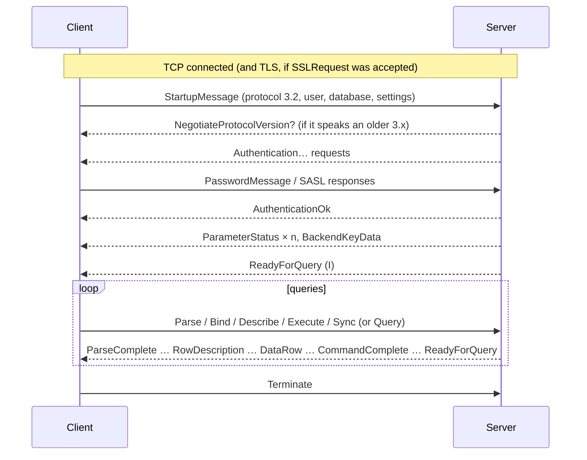
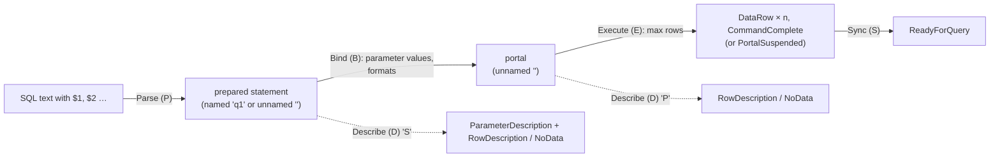

# The PostgreSQL wire protocol, and how the driver reads and writes it

Everything a client and a PostgreSQL server say to each other is a sequence of **messages** over one byte stream. This guide explains that protocol from scratch, then the four files here that implement it:

| File                       | Role                                                                                                           |
| -------------------------- | -------------------------------------------------------------------------------------------------------------- |
| [frontend.ts](frontend.ts) | One function per **client** message (Parse, Bind, Execute, Sync, …), writing it into a `Writer`.               |
| [writer.ts](writer.ts)     | `Writer`: builds many messages into one growable buffer, back-filling each length.                             |
| [reader.ts](reader.ts)     | `Reader`: splits incoming bytes into complete **server** messages, and decodes them; the notification decoder. |
| [messages.ts](messages.ts) | Types only: `BackendMessage` (every server message), `Field` (a result column), `NoticeFields`.                |
| [text.ts](text.ts)         | UTF-8 helpers: `utf8` (decode), `allocate` (a Node `Buffer` where possible), `asBuffer`.                       |

The official reference is the PostgreSQL documentation's [Frontend/Backend Protocol](https://www.postgresql.org/docs/current/protocol.html) chapter. [../../WALKTHROUGH.md](../../WALKTHROUGH.md) shows real captured bytes for a whole query.

## Contents

- [Bytes, integers and strings](#bytes-integers-and-strings)
- [Message framing](#message-framing)
- [The conversation](#the-conversation)
- [Startup-phase messages](#startup-phase-messages)
- [The simple query protocol](#the-simple-query-protocol)
- [The extended query protocol](#the-extended-query-protocol)
- [Errors, Sync and pipelining](#errors-sync-and-pipelining)
- [Formats, NULL and parameter types](#formats-null-and-parameter-types)
- [Every message the driver uses](#every-message-the-driver-uses)
- [Protocol versions: 3.0 and 3.2](#protocol-versions-30-and-32)
- [The writer](#the-writer)
- [The reader](#the-reader)
- [Decisions](#decisions)
- [Glossary](#glossary)

## Bytes, integers and strings

A **byte** is 8 bits, a number from 0 to 255, usually written in hexadecimal (`0x41`, or just `41` in a dump; that's 65, the character `A`). In JavaScript, a sequence of bytes is a `Uint8Array`.

The protocol uses three building blocks:

- **Integers** of 1, 2 or 4 bytes (`Int8`, `Int16`, `Int32`), **big-endian**: the most significant byte first. The number 71 as an `Int32` is `00 00 00 47`; 196,610 is `00 03 00 02`. Signed: `ff ff ff ff` is −1.
- **Strings** (`String` in the docs, a "C string"): UTF-8 bytes ending with a zero byte (`00`). `app` is `61 70 70 00`. So a string can't contain a zero byte, which is why the driver refuses NUL in SQL and in parameters sent as text.
- **Byte sequences** (`Byte n`): raw bytes, usually after a length that says how many.

## Message framing

After the very first message, every message has the same shape:

```
┌──────────┬────────────────────┬───────────────────────────┐
│ type     │ length             │ body                      │
│ 1 byte   │ Int32, big-endian  │ length − 4 bytes          │
└──────────┴────────────────────┴───────────────────────────┘
```

- **type**: one ASCII letter saying what the message is: `P` Parse, `B` Bind, `T` RowDescription, `D` DataRow, `Z` ReadyForQuery, … The same letter can mean different things in each direction (`D` is Describe from the client and DataRow from the server).
- **length**: the size of the message **including the length itself** but **not** the type byte. A message with an empty body has length 4.

So to read a stream: read 5 bytes, get the type and length, then read `length − 4` more bytes; repeat. That is all the [reader](#the-reader) does at its core.

The first message of a connection (StartupMessage, or SSLRequest, or CancelRequest) has **no type byte**, just the length and body, because it predates the format; the body starts with a number that tells them apart.

## The conversation



[../auth/README.md](../auth/README.md) covers the startup phase in detail. Throughout, the server can also send three messages at any time: **NoticeResponse** (a warning), **ParameterStatus** (a setting changed, e.g. `TimeZone`), and **NotificationResponse** (a `NOTIFY` on a channel this session listens to).

## Startup-phase messages

| Message                        | Direction                 | Body                                                                                                                                              |
| ------------------------------ | ------------------------- | ------------------------------------------------------------------------------------------------------------------------------------------------- |
| SSLRequest                     | client →                  | `Int32 80877103` (8 bytes in all). The server answers one byte, `S` (go ahead with TLS) or `N`                                                    |
| StartupMessage                 | client →                  | `Int32` protocol version (3.2 = `0x00030002`), then `name\0value\0` pairs, then `\0`                                                              |
| CancelRequest                  | client → (new connection) | `Int32 80877102`, `Int32` process id, the secret key (4 bytes before 3.2, up to 256 from 3.2)                                                     |
| Authentication… (`R`)          | ← server                  | `Int32` code: 0 Ok, 3 cleartext password, 5 MD5 (+ 4-byte salt), 10 SASL (+ mechanism names), 11 SASL continue, 12 SASL final, others unsupported |
| PasswordMessage (`p`)          | client →                  | the password or MD5 hash; also carries SASL initial response and responses                                                                        |
| BackendKeyData (`K`)           | ← server                  | `Int32` process id, then the secret key                                                                                                           |
| ParameterStatus (`S`)          | ← server                  | `name\0value\0`                                                                                                                                   |
| NegotiateProtocolVersion (`v`) | ← server                  | `Int32` newest minor version it supports, `Int32` count, unrecognised option names                                                                |
| ReadyForQuery (`Z`)            | ← server                  | one byte: `I` idle, `T` in a transaction, `E` in a failed transaction                                                                             |

`frontend.ts` writes them with `startup`, `sslRequest`, `cancelRequest`, `password`, `saslInitialResponse`, `saslResponse`; untyped messages are opened with `Writer.beginUntyped()`.

## The simple query protocol

The oldest way to run SQL: one **Query** message (`Q`) with SQL text, possibly several statements separated by `;`, no parameters:

```
C> Query("select 1; select 2")
S< RowDescription DataRow CommandComplete(SELECT 1)
S< RowDescription DataRow CommandComplete(SELECT 1)
S< ReadyForQuery(I)
```

Results are always text. The driver uses it for `simpleQuery()` (scripts, statements that can't be prepared) and for COPY. Every other query uses the extended protocol.

## The extended query protocol

The extended protocol splits running a statement into steps, which is what makes parameters, prepared statements, binary results and pipelining possible:



| Step     | Message | Body                                                                                                                                                                     | Server answers                                                                                       |
| -------- | ------- | ------------------------------------------------------------------------------------------------------------------------------------------------------------------------ | ---------------------------------------------------------------------------------------------------- |
| Parse    | `P`     | statement name `\0`, SQL `\0`, `Int16` n, n × `Int32` parameter type OIDs (0 = infer)                                                                                    | ParseComplete (`1`)                                                                                  |
| Describe | `D`     | `S` + statement name, or `P` + portal name                                                                                                                               | ParameterDescription (`t`, statements only) then RowDescription (`T`) or NoData (`n`)                |
| Bind     | `B`     | portal `\0`, statement `\0`, `Int16` n + n × `Int16` parameter formats, `Int16` n + n × (`Int32` length + bytes, or −1 for NULL), `Int16` n + n × `Int16` result formats | BindComplete (`2`)                                                                                   |
| Execute  | `E`     | portal `\0`, `Int32` max rows (0 = all)                                                                                                                                  | DataRow (`D`) × rows, then CommandComplete (`C`), or PortalSuspended (`s`) if it stopped at max rows |
| Close    | `C`     | `S` + statement name, or `P` + portal name                                                                                                                               | CloseComplete (`3`)                                                                                  |
| Sync     | `S`     | (empty)                                                                                                                                                                  | ReadyForQuery (`Z`)                                                                                  |
| Flush    | `H`     | (empty)                                                                                                                                                                  | (sends whatever is pending, no ReadyForQuery)                                                        |

- A **prepared statement** is the parsed and planned SQL. The **unnamed** statement (`''`) is replaced by the next Parse of the unnamed statement; a **named** one lasts until closed or the session ends.
- A **portal** is a statement bound to values, ready to run. The driver always uses the unnamed portal.
- **Execute with max rows** returns at most that many rows and suspends the portal; another Execute continues it. That is how cursors fetch in batches ([../STREAMING.md](../STREAMING.md#cursors)).
- **Flush** asks the server to send what it has without ending the segment: cursors use Execute + Flush so the portal stays open between batches.

What the driver writes for one query, depending on the cache ([../ARCHITECTURE.md](../ARCHITECTURE.md#queryopwrite-four-ways-to-send-one-statement)):

```
new statement:     Parse("q1", sql) Describe(S "q1") Bind("", "q1", values, text) Execute("", 0) Sync
cached statement:  Bind("", "q1", values, formats) Execute("", 0) Sync
unprepared:        Parse("", sql) Bind("", "", values, text) Describe(P "") Execute("", 0) Sync
```

## Errors, Sync and pipelining

When anything fails (a syntax error at Parse, a constraint violation at Execute), the server sends **ErrorResponse** (`E`) and then **ignores every message until the next Sync**, which it answers with ReadyForQuery. That rule is what makes pipelining safe and controllable:

```
C> Bind(q1) Execute Sync   Bind(q2) Execute Sync   Bind(q1) Execute Sync
S< BindComplete DataRow CommandComplete ReadyForQuery
S< ErrorResponse ReadyForQuery                  ← q2 failed; skipped to its Sync
S< BindComplete DataRow CommandComplete ReadyForQuery   ← the third still runs
```

With one Sync per query, a failure affects only that query. With several statements under one Sync (`SyncGroupOp`), the first failure skips the rest, which the driver uses deliberately for BEGIN + first statement and for transactional batches ([../TRANSACTIONS.md](../TRANSACTIONS.md)).

ErrorResponse and NoticeResponse share a body format: repeated `Byte1 field code` + `String value`, ended by a zero byte. Codes: `S`/`V` severity (`V` is never translated), `C` SQLSTATE, `M` message, `D` detail, `H` hint, `P` position, `W` where, `s` schema, `t` table, `c` column, `d` data type, `n` constraint, `F` file, `L` line, `R` routine, and a few more. `noticeFields()` reads them into an object; [../errors.ts](../errors.ts) maps them to properties.

## Formats, NULL and parameter types

- **Format codes**: 0 = text, 1 = binary. Bind gives them for parameters (0 entries = all text; 1 entry = all the same; n = per parameter) and for result columns (same convention). `frontend.bind` writes no parameter formats when every value is a string, and per-parameter formats when any value is a `Uint8Array` (binary). For results it writes `0` (all text), `[1]` (all binary) or the per-column list a result plan chose ([../CODECS.md](../CODECS.md#binary-after-describe)).
- **NULL**: a value of length −1 (`ff ff ff ff`), with no bytes, in Bind and in DataRow.
- **Parameter types**: Parse may declare an OID per parameter, or 0 for "infer from context". The driver declares a codec's OID except for text-like codecs, whose type is better inferred ([../CODECS.md](../CODECS.md#declaring-parameter-types)).
- The protocol counts parameters in an `Int16` read as unsigned: at most **65,535** parameters per statement. `encodeParams` refuses more before anything is sent.
- **RowDescription** gives, per column: name, source table OID and column number (0 for computed columns), **type OID**, type size, type modifier, and format code. The type OID is what the driver checks codecs against.

## Every message the driver uses

Client messages ([frontend.ts](frontend.ts)):

| Function                                                         | Type            | Used for                                    |
| ---------------------------------------------------------------- | --------------- | ------------------------------------------- |
| `startup`                                                        | (none)          | opening the session                         |
| `sslRequest`                                                     | (none)          | asking for TLS                              |
| `cancelRequest`                                                  | (none)          | canceling a query, on a separate connection |
| `password`, `saslInitialResponse`, `saslResponse`                | `p`             | authentication                              |
| `query`                                                          | `Q`             | simple queries, COPY                        |
| `parse`, `bind`, `describe`, `execute`, `close`, `sync`, `flush` | `P B D E C S H` | the extended protocol                       |
| `copyData`, `copyDone`, `copyFail`                               | `d c f`         | COPY FROM STDIN                             |
| `terminate`                                                      | `X`             | closing                                     |

Server messages ([messages.ts](messages.ts), `parseMessage` in [reader.ts](reader.ts)):

| Type | Message                  | Type      | Message                          |
| ---- | ------------------------ | --------- | -------------------------------- |
| `R`  | Authentication…          | `T`       | RowDescription                   |
| `K`  | BackendKeyData           | `D`       | DataRow                          |
| `S`  | ParameterStatus          | `C`       | CommandComplete                  |
| `Z`  | ReadyForQuery            | `I`       | EmptyQueryResponse               |
| `v`  | NegotiateProtocolVersion | `s`       | PortalSuspended                  |
| `1`  | ParseComplete            | `E`       | ErrorResponse                    |
| `2`  | BindComplete             | `N`       | NoticeResponse                   |
| `3`  | CloseComplete            | `A`       | NotificationResponse             |
| `t`  | ParameterDescription     | `G` / `H` | CopyInResponse / CopyOutResponse |
| `n`  | NoData                   | `d` / `c` | CopyData / CopyDone              |

An unknown type is a `ProtocolError`, which closes the connection: once framing is wrong, nothing after it can be trusted.

## Protocol versions: 3.0 and 3.2

Protocol 3.0 dates from PostgreSQL 7.4. PostgreSQL 18 introduced **3.2** (3.1 was never used), whose one change the driver cares about is **variable-length cancel keys** (up to 256 bytes instead of 4), which makes guessing a key to cancel someone else's query infeasible. The driver asks for 3.2 (`LATEST_PROTOCOL_MINOR`) and accepts what the server **negotiates** down to: a server or pooler that only speaks 3.0 replies with NegotiateProtocolVersion, and the session continues at 3.0. Some poolers reject 3.2 outright with an error instead; the driver then reconnects once asking for 3.0 ([../auth/README.md](../auth/README.md#protocol-version-negotiation)).

## The writer

[writer.ts](writer.ts). All client messages are built into **one buffer per connection**, so a whole pipeline of messages leaves in a single socket write.

```ts
const w = new Writer();
w.begin(0x50).cstring('q1').cstring(sql).int16(0).end(); // Parse
w.begin(0x53).end(); // Sync
socket.write(w.take());
```

- **`begin(type)`** writes the type byte, remembers where the length goes, and skips 4 bytes. **`end()`** writes the length (`pos − start`) back into that slot. Messages are written front to back without knowing their size in advance.
- **`#ensure(n)`** grows the buffer by doubling (amortised constant time per byte).
- **`int8/16/32`** write big-endian through a `DataView`.
- **`string(value)`** encodes UTF-8 in place. Short ASCII strings (most parameters) are copied character by character, cheaper than creating a view for `TextEncoder.encodeInto`. Long strings reserve one byte per character first and only grow for what didn't fit: most text is ASCII, and reserving 3 bytes per character (the UTF-8 worst case for JavaScript strings) would triple the buffer for large values.
- **`cstring(value)`** refuses a NUL character (it would end the string early, changing what the server reads), then writes the zero terminator.
- **`value(v)`** writes a length-prefixed value for Bind: −1 for `null`, the bytes of a `Uint8Array`, or a string's UTF-8 with its length back-filled.
- **`truncate(length)`** drops what was written after `length`: if an op throws halfway through writing itself, the connection cuts its partial messages out, so the buffer stays valid.
- **`take()`** returns the bytes and resets the writer. Small outputs are copied into a Node `Buffer` (from Node's shared pool, so cheap, and accepted by Node's socket without wrapping); a buffer that grew past 1 MiB (`MAX_RETAINED`) for one big message is handed over as is and replaced with a fresh small one, so it isn't copied, nor kept for the connection's lifetime.

## The reader

[reader.ts](reader.ts). The socket delivers bytes in **chunks** of arbitrary size: one chunk may hold many messages, or a fraction of one. The `Reader` turns chunks into whole messages.

```ts
reader.push(chunk);
for (let type = reader.nextType(); type >= 0; type = reader.nextType()) {
	// reader.bytes[reader.start .. reader.end) is the message body
	const msg = reader.parse(); // or read the body directly (DataRow)
}
```

### Reading in place

`nextType()` looks at the current chunk from `#pos`: if 5 bytes are there, it reads the length; if the whole message is there, it sets `bytes`, `start`, `end` to point **into the chunk** and advances. No copy. The caller decodes the body straight from the chunk: the connection's DataRow fast path hands those offsets to the row decoder ([../ARCHITECTURE.md](../ARCHITECTURE.md#reading-replies)).

### Messages split across chunks

If a message is incomplete at the end of a chunk, `#stash(needed)` copies **just its beginning** into a buffer of the message's full size (or 5 bytes, if even the length isn't complete), and releases the chunk. Later `push` calls fill that buffer (`#fill`) until it is complete (`#partReady`), and `nextType` returns it before reading on in the new chunk. So:

- only split messages are ever copied, and each byte at most once: a 100 MB row arriving in 64 KiB chunks is collected linearly, not by re-joining a growing buffer (quadratic);
- a chunk is released as soon as it is consumed, so an idle connection holds no buffers.

When `push` arrives while unread messages remain in the current chunk (the caller stopped reading mid-chunk), the rest and the new chunk are joined into one buffer.

### Bounds and limits

Every length is checked: a message length below 4 or above `maxMessageSize` (default 1 GiB) is a `ProtocolError`, so a corrupt or hostile length can't make the driver allocate without bound. Inside a body, the `Cursor` helper checks every read stays within the message (`#need`), and `cstring` requires its terminator inside it. A DataRow's value lengths are checked by the row decoder.

### Decoding

`parse()` calls `parseMessage(type, bytes, start, end)`, a `switch` on the type byte. Cheap paths matter here:

- Messages without fields (ParseComplete, BindComplete, CloseComplete, NoData, EmptyQueryResponse, PortalSuspended, CopyDone) and the three ReadyForQuery variants are **shared constant objects**: a query gets several of them, and they are never modified.
- A DataRow message object (when not taken by the fast path) holds a `subarray` view of its body, not a copy.
- **CommandComplete** tags repeat (`SELECT 1` again and again), so the last tag's bytes and string are kept: if the next tag has the same bytes, the same string is returned without decoding. The bytes are **copied** for the comparison, because a view would keep the whole chunk alive.
- `Cursor` creates its `DataView` lazily: the frequent messages read integers by hand.
- Counts (columns, parameters) are read as **unsigned** 16-bit, so up to 65,535 parameters fit.
- BackendKeyData's key must be 4 to 256 bytes.

### Notifications

`decodeNotification(bytes, start, end, names?)` decodes a NotificationResponse (`Int32` pid, channel `\0`, payload `\0`) straight from the buffer. `ChannelNames` remembers the last 8 channel names (as copied bytes and their strings), so a notification on a known channel reuses its string: comparing a few bytes is cheaper than decoding them, and `Map` lookups by an identical string reuse its cached hash. Short ASCII payloads are built in JavaScript (`shortText`), cheaper than a native decode for a few bytes.

### UTF-8: [text.ts](text.ts)

`utf8(bytes, start, end)` decodes with Node `Buffer.toString('utf8', …)` when the bytes are a `Buffer` (native and fast for short strings), otherwise builds short ASCII strings by hand and uses `TextDecoder` for the rest. `asBuffer` wraps a chunk as a `Buffer` sharing its memory (no copy) so that fast path applies.

## Decisions

Why the protocol layer works this way. Each links to its full entry (what it is, why, the alternatives, the cost, measured impact) in [DECISIONS.md](../DECISIONS.md):

- [Coalesced writes: one write per microtask](../DECISIONS.md#coalesced-writes-one-write-per-microtask): one write buffer, many messages: pipelining for free, one system call per flush.
- [Back-filled message lengths](../DECISIONS.md#back-filled-message-lengths): messages written once, front to back.
- [The writer: reserve one byte per character, hand off big buffers](../DECISIONS.md#the-writer-reserve-one-byte-per-character-hand-off-big-buffers): no tripled or pinned buffers for large values.
- [Zero-copy reads: messages decoded in place](../DECISIONS.md#zero-copy-reads-messages-decoded-in-place): read in place, copy only split messages.
- [DataRow fast path: no message objects for rows](../DECISIONS.md#datarow-fast-path-no-message-objects-for-rows): rows go straight to the decoder.
- [Strict bounds checks on every read](../DECISIONS.md#strict-bounds-checks-on-every-read): a protocol error closes the connection instead of corrupting later results.
- [Shared constant messages and repeated-string caches](../DECISIONS.md#shared-constant-messages-and-repeated-string-caches): the messages every query receives cost nothing.
- [A NOTIFY fast path and a channel-name cache](../DECISIONS.md#a-notify-fast-path-and-a-channel-name-cache): notifications without message objects.

## Glossary

**Big-endian**: most significant byte first: 1 as `Int32` is `00 00 00 01`.

**C string**: text followed by a zero byte.

**Chunk**: one piece of bytes as the socket delivers it; unrelated to message boundaries.

**Extended query protocol**: Parse / Bind / Describe / Execute / Sync.

**Format code**: 0 for text, 1 for binary.

**Frontend / backend**: the protocol's names for client and server.

**OID**: object identifier; here, a type's number (23 = `int4`).

**Portal**: a bound statement ready to execute.

**Simple query protocol**: one Query message with SQL text, text results.

**SQLSTATE**: the five-character error code in an ErrorResponse's `C` field.

**Sync**: ends a pipeline segment; after an error the server skips to it.
