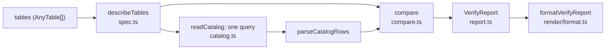

# `db.verify`: does the code match the database?

Your table definitions describe tables that already exist ([column/README.md](../column/README.md)); nothing stops the two from drifting apart. A column renamed in a migration but not in the code, or a `varchar(320)` declared `varchar(255)`, only shows up as a runtime error, possibly in production. `db.verify(tables)` compares every declared table and column with the live database, in **one read-only query**, and reports each difference with the line of code that declares it and SQL that would fix it.

```ts
const report = await db.verify([users, posts], { strict: true });
if (!report.ok) throw new Error(formatVerifyReport(report));
```

The command-line front end is [../cli/README.md](../cli/README.md).

## Contents

- [The pipeline](#the-pipeline)
- [Step 1: describing the code (`spec.ts`)](#step-1-describing-the-code-spects)
- [Step 2: reading the catalog (`catalog.ts`)](#step-2-reading-the-catalog-catalogts)
- [Step 3: one type language for both sides (`sql-type.ts`)](#step-3-one-type-language-for-both-sides-sql-typets)
- [Step 4: comparing (`compare.ts`)](#step-4-comparing-comparets)
- [Every rule](#every-rule)
- [Step 5: the report (`report.ts`)](#step-5-the-report-reportts)
- [Step 6: rendering (`render/`)](#step-6-rendering-render)
  - [Options and terminal detection](#options-and-terminal-detection)
- [Decisions](#decisions)
- [Glossary](#glossary)

## The pipeline



`verifyWith(executor, tables, options)` ([verify.ts](verify.ts)) runs it:

```ts
const specs = describeTables(tables);
const relations =
  specs.length === 0
    ? []
    : await readCatalog(
        executor,
        specs.map((s) => s.name),
        options.schema,
      );
const {
  diagnostics,
  tables: results,
  columns,
} = compare(specs, relations, options);
return {
  ok: errors === 0,
  diagnostics,
  tables: results,
  summary: { errors, warnings, infos, tables, columns, durationMs },
};
```

It runs on the database's own executor, so it works through any executor (and in tests, on a fake one). With no tables it sends no query at all.

`VerifyOptions` ([report.ts](report.ts)) has two fields:

- **`strict`**: columns only the database has are errors, for a CI check that the code declares the whole schema. Default `false`.
- **`schema`**: look the tables up in this schema instead of through the session's `search_path`. Fixes then qualify table names with it (unless it is `public`).

## Step 1: describing the code (`spec.ts`)

[spec.ts](spec.ts) turns each `Table` into plain data:

```ts
interface TableSpec {
  name: string;
  columns: ColumnSpec[];
  site: CallSite | undefined;
}
interface ColumnSpec {
  key: string; // 'createdAt'
  name: string; // 'created_at'
  type: SqlType; // { name: 'timestamptz', isEnum: false, modifiers: undefined, array: false }
  enum: EnumSpec | undefined; // name, labels, site, when the (element) type is an enum
  nullable: boolean; // from .nullable()
  fill: 'default' | 'generated' | 'identity' | undefined;
  site: CallSite | undefined;
}
```

Everything comes from the columns' `_quarry` data ([column/README.md](../column/README.md#a-column-four-types-in-one-object)): this is why columns record `nullable`, `fill` and `site` although queries never use them. Tables are described once per database name (an alias and its table are the same table).

## Step 2: reading the catalog (`catalog.ts`)

Postgres describes itself in **system catalogs**, tables in the `pg_catalog` schema: `pg_class` (tables and other relations), `pg_attribute` (their columns), `pg_type` (types), `pg_attrdef` (defaults), `pg_enum` (enum labels), `pg_namespace` (schemas). [catalog.ts](catalog.ts) reads all it needs in one query, `catalogSql`:

```sql
with wanted as (
  select w.ord::int4 as ord, pg_catalog.to_regclass(w.name) as oid
  from pg_catalog.unnest($1::text[]) with ordinality as w(name, ord)
)
select wanted.ord as tableindex, n.nspname::text as schemaname, c.relname::text as relname, …
from wanted
left join pg_catalog.pg_class c on c.oid = wanted.oid
left join pg_catalog.pg_attribute a on a.attrelid = c.oid and a.attnum > 0 and not a.attisdropped
… (types, domains, array elements, defaults, enum labels) …
order by wanted.ord, a.attnum
```

- **One parameter**, a `text[]` of table names (`textArrayLiteral`), each quoted as an identifier and optionally schema-qualified. `to_regclass(name)` resolves each name exactly as a query would: through the session's `search_path`, or in `options.schema`.
- `with ordinality` numbers the names, so each output row says which requested table it belongs to (`tableindex`); a table that doesn't exist produces one row with nulls (`left join`), which becomes `undefined`.
- One row per column, in table and column order. `a.attnum > 0 and not a.attisdropped` skips system columns and dropped ones.
- Domains are resolved to their base type (`typbasetype`) and array types to their element (`typelem`), so the comparison sees `integer[]` as "array of integer"; the domain's name is kept to compare with a `defineType` of it.
- The query is written so **every driver returns the same rows**: only text, booleans and `int4` values, no arrays or JSON (enum labels come as a JSON array **as text**), lowercase one-word aliases. `parseCatalogRows` then reads each field defensively (`text()`, `bool()` accept `'t'`/`'true'`/`true`), so verify would work over a driver that returns everything as strings.
- It is tagged `quarry:verify` for `onQuery`.

`parseCatalogRows(rows, count)` groups rows into a `CatalogRelation` per requested table: `{ schema, name, kind ('table' | 'partitioned table' | 'view' | 'materialized view' | 'foreign table' | undefined), relkind, columns }`, each column with its `SqlType`, `notNull`, `identity` (`'always'`/`'by default'`), `generated` (`'stored'`/`'virtual'`), default or generation `expression`, `domain`, and `enumLabels`.

## Step 3: one type language for both sides (`sql-type.ts`)

The code says `DataType<'decimal'>` with modifiers `[10, 2]`; the catalog says `typname = 'numeric'`, `atttypmod = 655366`. [sql-type.ts](sql-type.ts) maps both into one shape:

```ts
interface SqlType {
  name: string; // 'numeric', 'varchar', 'integer', an enum's name, or format_type(...) for others
  isEnum: boolean;
  modifiers: readonly number[] | undefined; // [10, 2]; undefined = none (in the code: "any")
  array: boolean;
}
```

- `codeType(dataType)`: kinds whose DDL name differs are renamed (`decimal` → `numeric`); arrays become their element with `array: true`; enums use their enum name, custom types their `sqlName`. `numeric(p)` becomes `numeric(p, 0)`, as Postgres records it.
- `catalogType(row)`: built-in types (`pg_catalog`) map from internal names (`int4` → `integer`, `float8` → `double precision`, `bpchar` → `char`, …); enums and pgvector's `vector` keep `typname` whatever schema they're in; other types use the server's `format_type`, which qualifies them when they are not on the search path.
- `decodeTypmod(name, typmod)` unpacks the **type modifier**, an integer Postgres stores per column: `varchar(n)` stores n + 4; `numeric(p, s)` stores `((p << 16) | s) + 4`, with the scale an 11-bit signed number since PostgreSQL 15 (so negative scales work); time types store their precision directly, and pgvector's `vector` its dimension count.
- `sameType(expected, actual)`: same name, enum-ness and array-ness, and modifiers equal **if the code gives any**: `varchar()` in the code accepts a `varchar(320)` column; `varchar(255)` doesn't.
- `renderType(type)` writes it back as DDL (`varchar(32)[]`, `numeric(10,2)`, an enum's name quoted when it needs it), for messages and fixes.

The same `codeType` and `renderType` give the casts of multi-row inserts (without modifiers); how each `DataType` class maps to a name is in [data-type/README.md](../data-type/README.md#sql-names-and-modifiers-codetype-and-rendertype).

## Step 4: comparing (`compare.ts`)

[compare.ts](compare.ts) `compare(specs, relations, options)` walks each table and produces **diagnostics** (one per difference) and a per-table view.

For each table:

1. **Missing**, or not a table or view (e.g. a sequence): one `table-missing` diagnostic, with a `create table` fix generated from the spec. Its columns get no diagnostics of their own; in the per-table view each is listed with status `error` and code `table-missing`.
2. For each declared column, find the database column by name (a `Map`, removing each one found):
   - not found: `column-missing`, fix `alter table … add column …`;
   - found: `compareColumn` (type, enum labels, nullability, fill).
3. Database columns left over are **extra**: `column-extra`. Its severity depends on harm: an error with `strict`; otherwise a **warning** if inserts will fail (not null, no default, not identity), else **info**. The hint suggests the code to declare it (`legacyCode: text().name('legacy_code')`, via `suggestCode`); with `strict`, the fix is `alter table … drop column …`.

`compareColumn`:

- **Type**: `sameType`, or the code names the domain the column is declared with (`sameDomain`, for `defineType` of a domain). A mismatch suggests both directions: `alter table … alter column … type … using …::…`, or "declare it as `bigint()`" (`suggestType`).
- **Enum labels**, once per enum (`enumsChecked`): labels missing on either side are an error, with `alter type … add value … after …` fixes in the right order (Postgres can add labels but not drop them, so labels only the database has can only be fixed in the code); the same labels in another order are a warning, since `<` and `>` follow the order.
- **Nullability and fill are skipped for views and materialized views**, which report every column nullable and without defaults. For other relations:
- **Nullability**: nullable in the database but not in the code is an **error** (your types claim a value is never null, and it can be); the reverse is a **warning** (harmless but imprecise).
- **Fill** (`compareFill`): `default()` without a database default is an error (inserts that omit it would fail); a database identity or generated column that the code writes is an error (inserts that set it fail); a database default the code doesn't declare is info (you could omit it on insert).

Every diagnostic gets its `source` from the column's (or table's, or enum's) call site through `resolveCallSite` ([column/README.md](../column/README.md#call-sites-remembering-where-things-were-declared)), so the report can point at a file, line and column.

## Every rule

`RuleCode` values ([report.ts](report.ts)) are stable: never renamed or reused, so they can be filtered on.

| Code                          | Severity               | Means                                                                   |
| ----------------------------- | ---------------------- | ----------------------------------------------------------------------- |
| `table-missing`               | error                  | the table doesn't exist (or isn't a table or view)                      |
| `column-missing`              | error                  | a declared column doesn't exist                                         |
| `column-type-mismatch`        | error                  | type, modifiers or arrayness differ                                     |
| `column-nullable-mismatch`    | error                  | the database allows null; the code says never null                      |
| `column-not-null-mismatch`    | warning                | the code allows null; the database is `not null`                        |
| `column-default-missing`      | error                  | `default()` but no default in the database                              |
| `column-default-undeclared`   | info                   | a database default the code doesn't declare                             |
| `column-identity-missing`     | error / warning        | `identity()` but not an identity (warning if it has some other default) |
| `column-identity-undeclared`  | error                  | `generated always as identity`, but the code writes it                  |
| `column-generated-missing`    | error / warning        | `generated()` but not generated (error if not null without a default)   |
| `column-generated-undeclared` | error                  | generated in the database, but the code writes it                       |
| `enum-label-mismatch`         | error                  | labels differ                                                           |
| `enum-label-order`            | warning                | same labels, another order                                              |
| `column-extra`                | info / warning / error | a database column the code doesn't declare                              |

## Step 5: the report (`report.ts`)

```ts
interface VerifyReport {
  ok: boolean; // no errors
  diagnostics: Diagnostic[]; // in the order compare found them
  tables: TableResult[]; // the per-table view
  summary: { errors; warnings; infos; tables; columns; durationMs };
}
interface Diagnostic {
  severity;
  code;
  message; // 'users.age is bigint in the database, but integer in the code'
  table;
  column?;
  key?;
  expected?;
  actual?;
  label?; // short label for the code frame: 'found bigint'
  hint?;
  fix?; // what to do; SQL that would fix the database
  source?: { file; line; column }; // where the code declares it
}
```

- **`diagnostics`** are in the order `compare` produced them: table by table, each declared column's checks (type, enum labels, nullability, fill), then the extra columns. They are not sorted by severity, so a warning can come before a later table's errors.
- **`tables`** is the **per-table view**: for each table, `relation` (`schema.name`, or `undefined` when missing), `kind`, a `status`, and one `ColumnResult` per column (declared ones in order, then extra ones): `key` (`undefined` for an extra column), `name`, `expected` and `actual` as short text (`varchar(32)[] null`), `status` and the rule `codes` of its diagnostics. A status is the most severe of its diagnostics (`error` > `warning` > `info`), or `ok`; a table's is the worst of its columns'.
- **`summary`** counts diagnostics by severity, tables checked, and columns checked (counting those only the code or only the database has), and the time taken.

The report is plain data: it can be serialised (`--format json`), filtered, or rendered.

## Step 6: rendering (`render/`)

`formatVerifyReport(report, options)` ([render/format.ts](render/format.ts)) picks a renderer:

| Format             | File                                                                               | Output                                                                                                                |
| ------------------ | ---------------------------------------------------------------------------------- | --------------------------------------------------------------------------------------------------------------------- |
| `pretty` (default) | [render/pretty.ts](render/pretty.ts), [render/code-frame.ts](render/code-frame.ts) | each diagnostic with a code frame of the declaring line, a label under the exact span, and `help:` lines              |
| `table`            | [render/table.ts](render/table.ts)                                                 | one table per database table: column, expected, actual, status                                                        |
| `github`           | [render/github.ts](render/github.ts)                                               | GitHub Actions workflow commands (`::error file=…,line=…::…`), which appear as annotations on the pull request's diff |
| `json`             |                                                                                    | `JSON.stringify(report, null, 2)` and a newline                                                                       |

A `pretty` diagnostic looks like this (from the integration test's snapshot):

```
  × quarry(column-type-mismatch): users.email is varchar(320) in the database, but varchar(255) in
    the code
   ╭─[test/verify/fixtures/schema.ts:23:10]
22 │ id: integer().identity(),
23 │ email: varchar(255),
   · ─────────┬─────────
   ·          ╰── found varchar(320)
24 │ displayName: text().name('display_name').nullable(),
   ╰────
  help: alter table users alter column email type varchar(255) using email::varchar(255);
        or declare it as varchar(320)
```

`code-frame.ts` reads the schema file (`readSource`, cached), finds the span of the declaration on that line (`findSpan`), expands tabs to keep columns aligned, and draws the frame. When the file can't be read, the frame is replaced by an `at file:line:column (table.column)` line, and a diagnostic without a source gets `at table.column`. `pretty` and `table` both end with the same summary line (`formatSummary`):

```
  ✖ 8 errors, 2 warnings · 3 tables, 14 columns checked in 5ms
```

or `✔ schema matches the database` when there is nothing to report. Infos are counted as "notes".

The `table` format, from the render test's snapshot:

```
  × users  public.users (table)
      column                      code           database          issues
    ✔ id                          integer        integer
    × email                       varchar(255)   varchar(320)      column-type-mismatch
    ✔ display_name (displayName)  text null      text null
    …
    ⚠ legacy_code                 —              text              column-extra

  × invoices  missing
      column                      code           database          issues
    × id                          bigint         —                 table-missing
    × order_id (orderId)          bigint         —                 table-missing
```

The `github` format writes one workflow command per diagnostic: `error`, `warning` or `notice` by severity, with `file` (relative to `root`), `line`, `col` and `title=quarry(<code>)`, and the message, `help: <fix>` and the hint as the body. Newlines and `%` are escaped as the runner expects (`%0A`, `%25`), and `:` and `,` in property values too. It ends with a plain line: `quarry verify: 8 errors, 2 warnings, 0 notes in 3 tables, 14 columns`.

### Options and terminal detection

`FormatOptions` are `format` (default `pretty`), `root` (where `github` paths are relative to: default `GITHUB_WORKSPACE`, else the working directory), `read` (how schema files are read for code frames; the file system by default), and any field of `Terminal` to override detection. [render/terminal.ts](render/terminal.ts) `detectTerminal(process.stdout)` fills in the rest, so the same report renders well in a terminal, a CI log or a file:

| Field        | Detected from                                                                                                                                                      |
| ------------ | ------------------------------------------------------------------------------------------------------------------------------------------------------------------ |
| `color`      | `FORCE_COLOR` when set (`0` or `false` turn it off); otherwise on a TTY unless `NO_COLOR` is set. `TERM=dumb` counts as no TTY                                     |
| `unicode`    | `QUARRY_ASCII` when set (`0` keeps Unicode); otherwise Unicode except on `TERM=linux`, and on Windows only in Windows Terminal, VS Code, JetBrains terminals or CI |
| `hyperlinks` | `FORCE_HYPERLINK` when set (`0` or `false` turn it off); otherwise when colour is on, on a TTY, outside CI. File paths become OSC 8 links                          |
| `width`      | the stream's `columns`, else `COLUMNS`, else 80; messages and hints wrap at it                                                                                     |
| `cwd`        | `process.cwd()`: paths under it are shown relative to it                                                                                                           |

Without Unicode, the frame and icons use ASCII (`x`, `!`, `i`, `,-[`, `|`).

## Decisions

Why verify works this way. Each links to its full entry (what it is, why, the alternatives, the cost, measured impact) in [DECISIONS.md](../DECISIONS.md):

- [`verify` instead of trusting that code and database agree](../DECISIONS.md#verify-instead-of-trusting-that-code-and-database-agree): one read-only catalog query, names resolved as queries resolve them, driver-neutral SQL, severity by consequence, fixes in both directions, a plain-data report and stable rule codes.
- [Declarations, not migrations](../DECISIONS.md#declarations-not-migrations): why there is something to verify at all.
- [Call sites captured eagerly, formatted lazily](../DECISIONS.md#call-sites-captured-eagerly-formatted-lazily): how diagnostics point at the declaring line.

## Glossary

**Catalog** (system catalog): Postgres's own tables describing every table, column and type (`pg_class`, `pg_attribute`, `pg_type`, …).

**Diagnostic**: one reported difference.

**Domain**: a named type based on another, with constraints.

**Relation**: Postgres's word for anything table-like: tables, views, materialized views, foreign tables, sequences.

**`search_path`**: the list of schemas Postgres searches for an unqualified name.

**Type modifier** (`atttypmod`): the per-column number that records `varchar(n)`, `numeric(p, s)` and similar.
